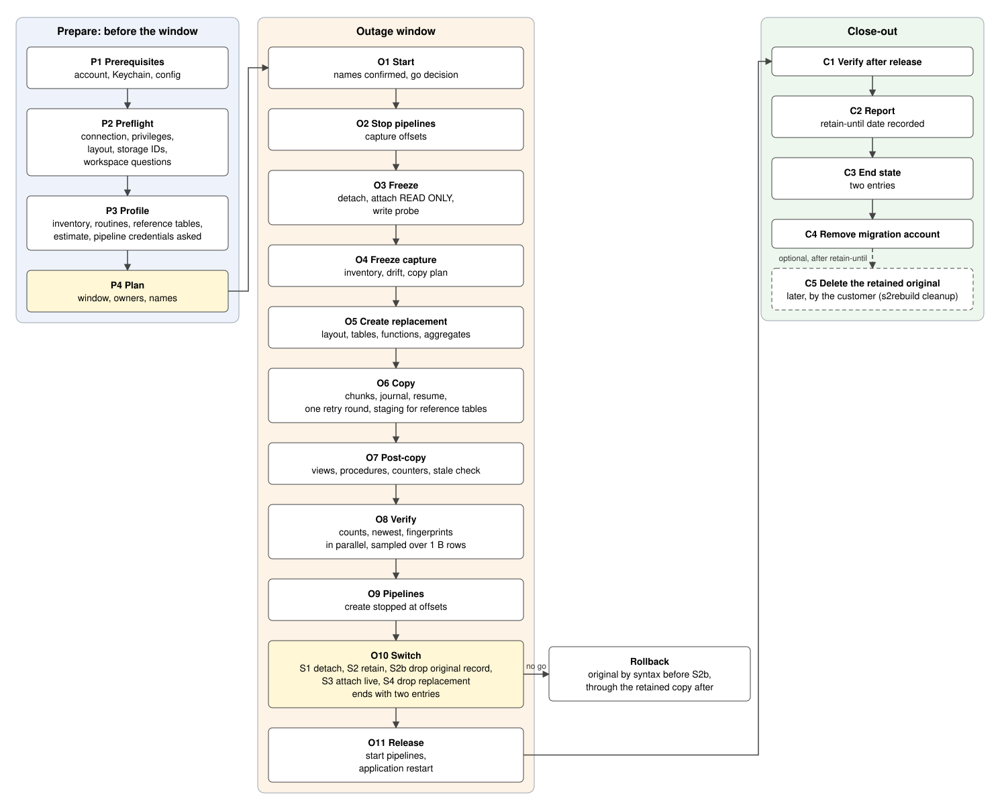

# SingleStore Database Rebuild Kit

Author: John Bergamini. Version 1.0.0. Proprietary; see [LICENSE](LICENSE).

The kit rebuilds a SingleStore Helios database into a new partition layout and cuts it over under its original name inside one outage window. The first outage step makes the source read only. Everything after that is a copy, a verification and a switch, each behind a gate, each restartable from a terminal. A run ends with two entries on the workspace: the live database in its new layout, and the original kept read only under a retained name until the customer deletes it.



## Who runs what

| Identity | Who | Steps |
|---|---|---|
| runner | A SQL account the kit creates at P1 and drops at C4 | P2, P3 tables, O4, O5 database and tables, O6, O7 counters and stale check, O8, C1, C2 |
| owner | The workspace admin SQL user, or the Portal identity in the owner notebook | P1 account, P2 and P3 pipelines, routines and write-capable accounts, O2, O3, O5 functions and aggregates, O7 views and procedures, O9, O10, O11, C3, C4, cleanup |
| operator | The person running the kit | every command; types the owner password, the pipeline credentials and the names when the kit asks; records the gates a person decides |
| customer | The application owner | stops the application (if asked), supplies the pipeline credentials, answers the workspace questions (autoscale, auto-suspend), restarts the application at O11, decides when the retained original is deleted (C5) |

The runner copies. The owner freezes, switches and releases. With an owner profile in the configuration the kit runs the admin steps itself; without one it prints each admin block and waits for `s2rebuild gate`.

## Prerequisites

Checked by `s2rebuild check` (P1 and P2) unless the table says otherwise.

| Need | Who provides | Checked by |
|---|---|---|
| A Helios workspace with the source database attached READWRITE, engine 8.9 or later (tested on 10.8.0) | customer | P2 |
| Workspace state ACTIVE, autoscale off, auto-suspend off or a keep-alive job for the window | customer | O1 records the operator's answer (`--workspace NOTE`) |
| Compute size: leaf cores times 8 at or above the target partition count; an S-8 at 4X copied 17.7 B rows in about 5 hours with 12 workers | customer | P2 |
| An admin SQL user for the workspace (the owner); its password in the Keychain item named in the configuration, or typed at P1 | customer | P1 |
| The runner account (`connections.runner.user`, `s2rebuild_runner` in the example), created by the kit at P1 with a password that meets the workspace policy; privileges SELECT, INSERT, DELETE, CREATE, DROP, ALTER, CREATE DATABASE, DROP DATABASE, PROCESS, CREATE VIEW, SHOW VIEW on `*.*` | kit | P1 creates, P2 verifies each privilege by name |
| Owner profile in the configuration, so admin steps execute with gates; without it the kit prints blocks and waits for recorded gates, and routines, pipelines and other accounts' grants are not visible | customer | P2 |
| Pipeline credentials per source type (S3 key pair, Kafka SASL user and password, or whatever the pipeline CONFIG names) | customer | P3 asks; a blank answer skips the type with a recorded decision |
| Free names for the replacement and the retained database | customer or the kit's date default | P2; O1 asks in production mode when the configuration leaves them out |
| A named owner for "application stopped" and "application restarted" | customer | P4, recorded at O1 |
| Operator machine: Python 3.10 or later, `pip install -e .` (PyMySQL, PyYAML, openpyxl), the macOS Keychain or environment variables, a network path to the workspace host on port 3306 with TLS, the SingleStore CA bundle in `certs/` | operator | P1 |
| A clone of the kit at a release tag; `customer/config.yaml` written from `examples/config.example.yaml` | operator | P1 |
| Disk: a few hundred MB per run for the journal, inventory and reports | operator | none |
| The operator's Mac on power and awake for the whole night: the kit starts `caffeinate -i -w <pid>` for every `run` and `step`; between commands run `caffeinate -i` in a terminal | operator | none |

Not required: an outage window (optional), a notebook, the Portal during the run, SUPER (cannot be granted on Helios).

## Install

Python 3.10 or later on macOS or Linux. The Keychain password source is macOS only; elsewhere use `password_env`.

```bash
python3 -m venv .venv
.venv/bin/pip install -e .
.venv/bin/s2rebuild --help
```

Run the offline tests with `.venv/bin/pip install pytest` and `.venv/bin/python -m pytest`. No test opens a network connection.

## Configure

1. Copy the example: `cp examples/config.example.yaml customer/config.yaml`.
2. Set the workspace host, the database names and the target layout. Every key is in [docs/CONFIG.md](docs/CONFIG.md).
3. Passwords: with `password_keychain` the kit fills the macOS Keychain items itself at P1 (`s2rebuild account-sql --execute` asks for the owner password when its item is missing, hidden, and generates the runner password to the workspace policy); or store them yourself (`security add-generic-password -a "$USER" -s s2rebuild-owner -w`), or name an environment variable with `password_env`. Pipeline credentials are asked for at P3 (or O9) and stored in the items named in `pipelines.credentials_keychain`; the variables in `pipelines.credentials_env` stay the fallback. The kit never prints, logs or writes a password or credential.
4. Names: `databases[].replacement` and `retained` may be left out. In `run.mode: production` (the default) O1 asks for them with the date default as the suggestion; `run.mode: test` (or `--mode test`) applies the defaults silently.
5. Everything a run writes stays under `customer/`. The rest of the folder is the static tree.

## Steps

Each step prints what it did and the gate it needs. Exit codes: 0 done, 1 refused, 2 incomplete (rerun to resume), 3 verification mismatch, 4 gate pending or failed. The full catalog with inputs, outputs, statements and recovery is [docs/STEPS.md](docs/STEPS.md).

Every command works on one run under `customer/runs/`. The P1 gate starts the run and prints its id. Export that id as `S2REBUILD_RUN`, so every later command names the same run. Without `S2REBUILD_RUN` or `--run ID`, a command uses the most recent run. `s2rebuild run` resumes that run and skips the steps that passed. It starts a run only when none exists, or with `--new` (`--new --run ID` names the new run). Once a run exists, `s2rebuild run --run ID` refuses an id that names no run, so a mistyped id never starts another run. Every gate hint and every log header prints the run id with its `--run` form.

The sequence from P1 to the go and on to O2, where RUN_ID is the id the P1 gate printed:

```bash
s2rebuild account-sql
s2rebuild gate P1 --pass --note TEXT
export S2REBUILD_RUN=RUN_ID
s2rebuild check
s2rebuild profile
s2rebuild plan
s2rebuild gate P4 --pass --note TEXT
s2rebuild run --from O1
s2rebuild gate O1 --pass --note TEXT
s2rebuild run
```

The first line prints the runner account block for the admin; `s2rebuild account-sql --execute` runs it instead with the owner profile (P1 below). After O11: `s2rebuild step C1`, `s2rebuild step C2`, `s2rebuild step C3`, `s2rebuild step C4`. Later, when the customer decides: `s2rebuild cleanup`.

### Prepare (before the window)

1. P1 Prerequisites. Print the runner account block with `s2rebuild account-sql` and have the admin run it, or run it with `s2rebuild account-sql --execute`: it asks for the owner password when its Keychain item is missing, prints the workspace password policy, generates a runner password that meets it, stores it in the runner's Keychain item and creates the account. Write the configuration. Gate: the account, the Keychain items and the configuration are in place; record it with `s2rebuild gate P1 --pass --note TEXT`. When no run exists yet, this gate starts the run and prints its id; export it as `S2REBUILD_RUN`.
2. P2 Preflight. `s2rebuild check` connects as the runner (and the owner), checks every runner privilege by name, records the source's branch record (name, STORAGE_ID, ATTACH_TYPE, COMPUTE_ID), confirms the replacement and retained names are free and the compute size fits the partition count, and prints `copy.workers` (1 to 32) beside the leaf cores. It prints three questions (ACTIVE, autoscale off, auto-suspend off or a keep-alive job) for O1 to record. With the owner profile it counts the routines by kind; without it the line says they are not visible to the runner. It refuses until P1 is recorded. Run it again any time: O1 needs P2 passed in the same run. Gate: every line ok.
3. P3 Profile. `s2rebuild profile` captures the inventory (tables, keys, sizes, accounts, sessions, views; with the owner profile the pipelines, the routines and the write-capable accounts, which the runner cannot see) and writes `profile.xlsx` with the estimate: one line, the rows divided by `estimate.rows_per_hour` (set the figure a run on your workspace measured). It refuses until P2 passed. Once P3 passed, a new capture needs `--redo`, which logs what it rewrites. `--dry-run` writes only `profile-dry-run.xlsx`, never the capture. Reference tables are counted exactly and planned through a staging table. Routines (functions, table-valued functions, aggregates, procedures) are captured with their definitions and recreated at O5 and O7; `objects.routines.ignore` leaves one behind on purpose. A pipeline that loads into an ignored procedure refuses the capture, since O9 would find no target. On route `kit` the kit then asks for the pipeline credentials of each source type (S3 key pair and token, Kafka SASL user and password, or key and value pairs for another type) and stores the CREDENTIALS JSON in the Keychain item named in `pipelines.credentials_keychain`; a blank answer skips the type, and the plan sheet and O9 list the pipelines that will not be recreated.
4. P4 Plan. `s2rebuild plan` prints the plan sheet: the window (when configured), step owners, the estimate line, pipeline credential route, the three workspace questions, the routines by kind, the retention days. Gate: the decisions are recorded with `s2rebuild gate P4 --pass --note TEXT`, the auto-suspend choice for the waits between commands among them.

### Outage window

5. O1 Start. `s2rebuild run --from O1` checks that P2 passed in this run, records the window when one is configured (no step stops on it), records the configuration hash, asks for a replacement or retained name the configuration leaves to the kit (`run.mode: production`; `--mode test` applies the defaults), prints both names, and waits for the go decision: `s2rebuild gate O1 --pass --note TEXT`. `--workspace NOTE` records the answers to the three workspace questions as evidence of the go. Then `s2rebuild run` resumes the same run: it skips O1 and continues at O2. `s2rebuild run --new` starts another run instead, which needs its own P1 and P2.
6. O2 Stop pipelines. The owner stops every pipeline and the kit captures every definition and offset again after the stop. These are the offsets O9 replays. Gate: no pipeline Running; loaded and successful offsets agree on every partition; capture written.
7. O3 Freeze. DETACH, ATTACH READ ONLY, a write probe that must be refused. A DETACH that waits longer than `freeze.detach_wait_seconds` is cancelled and issued again with KILL. After a notebook or hand run, `s2rebuild step O3 --redo` runs the probe and records freeze_time. A run that stopped between DETACH and ATTACH resumes at the ATTACH: `s2rebuild step O3 --redo` sees the detached storage and the free source name and never detaches again. For a hand run, `s2rebuild owner-sql O3` writes that block to `owner-sql/O3-reentry.sql` beside `O3.sql`. The Portal may show 0 rows for the frozen source; the kit's counts are the reference. Gate: probe refused and READONLY.
8. O4 Freeze capture. `s2rebuild run` captures the inventory after the freeze and reports drift against P3 (tables, columns, views, routines and pipelines; the pipelines are not listed on the READ ONLY source and the report says so). `s2rebuild profile --step O4` does the same by hand and stays for a rerun: once O4 passed, a new capture needs `profile --step O4 --redo`, which rewrites the copy plan. Both refuse until O1 to O3 passed. Gate: drift reviewed.
9. O5 Create replacement. The run continues (or `s2rebuild run --from O5`): the replacement is created with the target layout and every table definition is compared with the capture; its STORAGE_ID is recorded. Then the owner session creates the captured functions and table-valued functions, and the aggregates after the functions they name; the gate compares each definition with the capture. A routine body that names the source database refuses the step before any statement.
10. O6 Copy. Server-side INSERT ... SELECT in hash buckets, journaled, resumable; a reference table goes through a staging table in the replacement. Stop it only with `s2rebuild pause`: a killed client leaves a prepared transaction holding a leaf table lock for 15 to 20 minutes. The chunks that fail are retried once at the end of the pass, each no sooner than 20 minutes after its failure. The progress line names any chunk that runs longer than `copy.slow_chunk_minutes`. Gate: every chunk done; per-table count proof all match.
11. O7 Post-copy. Views, then procedures, AUTO_INCREMENT counters and the stale check (counts and newest values) with re-copy of anything that moved. A completed re-copy marks O6 passed again, and the counters are set after the last re-copy. A view runs under its definer and C4 removes the runner, so the runner never creates one. With the owner profile the kit creates the views, keeping each original definer whose account still exists, then the procedures the same way (a procedure may read a view, and a pipeline INTO PROCEDURE at O9 needs its procedure). Without it O7 writes `owner-sql/O7.sql` and ends pending: run that block as the admin, then `s2rebuild step O7`. A view or procedure whose definition names the source database refuses the step. Gate: views and procedures created, zero mismatches.
12. O8 Verify. Counts, newest values and grouped fingerprints, tier 3 in parallel on `verify.sessions` connections, largest table first. A table over `verify.full_fingerprint_max_rows` (1 billion rows) is sampled as a contiguous range on its sort key or time column, the same predicate on both sides; `verify.fingerprint_budget_minutes` is an elapsed deadline after which a table is recorded not fingerprinted. Gate: tiers 1 and 2 pass for every table; tier 3 a full match everywhere, or a sampled or not fingerprinted result accepted with `s2rebuild step O8 --yes`, which accepts the recorded result without a rerun when no chunk was copied since. `step O8 --full TABLE` or `--fingerprint TABLE --percent N` reruns tier 3 for one table. A mismatch marks the buckets for re-copy; run `s2rebuild run --from O6` to copy them again and rerun O7 and O8.
13. O9 Pipelines. The kit reads each pipeline's credentials from its Keychain item (filled at P3), else from the variable exported for this step only; a source type still without credentials is asked for here, and a blank answer skips it. The kit recreates every other pipeline in the replacement, stopped, at the O2 offsets. Route customer: the customer runs the placeholder file and the kit checks. Gate: count (the skipped pipelines left out), none Running, offsets equal the O2 capture partition by partition.
14. O10 Switch. A state machine that ends with two entries: S1 detaches the source; S2 attaches the original storage read only under the retained name; S2b attaches the original record by its own syntax under the live name, proves it unchanged (the three smallest tables, no foreign session) and drops it; S3 attaches the replacement as a branch under the live name; S4 drops the replacement record; the gate lists both storages and expects exactly the live record and the retained record. A failed proof at S2b stops with the original attached read write under the live name, the rollback state. S0 refuses unless every planned table was verified after its last chunk was copied; without the owner profile O10 refuses on the same rule, and the printed block and the notebook cell start with a STOP while it holds. A re-copy rewrites `owner-sql/O10.sql` with a STOP; generate the blocks or the notebook again after O8 passes. Type the live name when asked (or pass `--yes`). Gate: the live name resolves to the new branch with the target layout and the capture counts. From S3 the live name accepts writes. A rollback (`s2rebuild owner-sql O10 --rollback` writes both legs) runs only while every table still holds the row count of the copy and O11 has not started; it detaches the live name only while it holds the recorded live record, then re-attaches the original record by its own ATTACH_SYNTAX before S2b ran (R2a), or after S2b attaches a read-write branch of the retained copy under the live name (R2b). No rollback step drops the retained copy. The count check cannot see an update that keeps the count, so a rollback after S3 is safe only when the application stayed stopped until O11, as the O1 note records.
15. O11 Release. Retention check per partition, pipelines started; the customer restarts the application. Gate: application writing.

### Close-out

16. C1 Verify after release. `s2rebuild step C1`: writer sample, count changes, pipelines Running with offsets advancing, application-managed pipelines back, no errors, grants compared. Gate: all ok and application writes seen. For a live database idle on purpose, pass `s2rebuild step C1 --idle-workload NOTE`. Without the owner profile the pipeline and grants checks are recorded as not checked.
17. C2 Report. `s2rebuild step C2` writes `final.xlsx` and `run-report.md` (the latest verification result per table, the two entries the run leaves with their records and ATTACH_SYNTAX, the listings before and after the switch and the end state, the retain-until date with the C5 command, the definer per view and routine, the workspace answers, the estimate against the actual rows per hour; a value the journal lacks reads "not recorded"). The kit writes both files again when C3 and C4 end, so the final report shows the whole close-out. When the kit cannot pass C1 or C2, record that step by hand with `s2rebuild gate ID --pass --note TEXT --override NOTE`.
18. C3 End state. `s2rebuild step C3` checks that the workspace holds exactly two entries for the run, the live database and the retained copy (see below), that the live name resolves to the recorded live record, and that a write on the retained name is refused; the listing goes into the journal and the final report. It issues no DETACH, ATTACH or DROP; a third entry refuses with the listing. Without the owner profile the block is printed and the gate waits for a person.
19. C4 Remove the migration account. `s2rebuild step C4` drops the runner account; delete its Keychain item. C3 must be passed. The step stops before DROP USER while a view or a routine in the live database has the runner as its definer.
20. C5 Delete the retained original, later and by the customer. `s2rebuild cleanup` lists what the run left: the live record, the retained copy with its record, its size in GiB and the retain-until date. After that date `s2rebuild cleanup --delete <retained>` prints the record and asks you to type the name again; anything else keeps the copy and records "kept by customer". The delete is DETACH, re-attach by the record's own syntax read write, a record check, DROP, each behind its check, then a check that the live name still resolves to the live record. `--yes` does not apply, and no configuration key makes a run delete the retained copy.

## After a run: two entries

After a run the workspace holds two databases:

- the live database, under the live name: a branch (ATTACH_TYPE `pitr`) of the replacement, with the target layout, read write, with every table, view, routine and pipeline of the capture;
- the retained copy, under the retained name: a branch (ATTACH_TYPE `resume`) of the original's own storage, attached read only, every row as it was at the freeze.

Why two and not one: the retained copy is the way back and the audit copy. It shares the original's STORAGE_ID but is its own record; the original's own record was attached, proved unchanged against the capture and dropped inside the switch (S2b), and the replacement name was dropped once the live branch stood on its own (S4). So no second outage is needed and nothing is left to delete by hand. The kit never deletes the retained copy. C2 records `retain_until_utc` (the switch time plus `closeout.retain_days`, 90 by default; on the hand route the time of `gate O10 --pass` stands for the switch time) in the journal, the final workbook and `run-report.md`, with the C5 command. After that date the customer runs `s2rebuild cleanup --delete <retained>` and types the name again; the dropped record stays recoverable with `ATTACH DROPPED DATABASE` for the engine's retention period.

What the Portal shows during the window: from O3 the source is listed as attached read only (the Portal may show 0 rows for its tables; the kit's counts are the reference); from O5 the replacement is listed as a new database; after S1 the source shows as detached and after S2 the retained name appears as "Read Only Legacy"; for the seconds of S2b the live name is attached read write on the original storage, then its record leaves the list; from S3 the live name is attached read write on the replacement's storage; after S4 the replacement name leaves the list.

## Troubleshooting

- Re-copy after O8: `s2rebuild mark-recopy TABLE [--bucket N]` sets O6, O7 and O8 back to pending and clears the table's verification. Run `s2rebuild run --from O6`; O6 copies the buckets again, then O7 and O8 run again. The switch refuses until O8 passes again. A fresh-table load reopens O7 and O8 the same way. Both rewrite `owner-sql/O10.sql` and `O10-rollback.sql` with a STOP; after O8 passes, run `s2rebuild owner-sql O10` (and `--rollback`) or `s2rebuild owner-notebook` again, and never run the O10 cells of an older notebook. Once the switch may have begun (O10 passed, the go recorded, an O10 gate, or the retained or live attachment recorded), a re-copy is refused; a new copy is a new run.
- Chunks failing during the copy (error 1997 when autoscale or a restart replaces a node, 2013 when a connection drops): each failed chunk is reconciled before it runs again. After `copy.max_consecutive_failures` (default 6) failures in a row the circuit breaker stops new chunks; at the end of the pass the kit retries every chunk left once, the failed ones no sooner than 20 minutes after their failure. When the retry round fails too, O6 ends INCOMPLETE with "chunks are failing in a row; nodes may be restarting, see MV_EVENTS; rerun with --retry-failed when the workspace is steady". Check MV_EVENTS, turn autoscale off for the window, then `s2rebuild run --from O6 --retry-failed`.
- Count mismatch after the copy (exit 3): an interrupted INSERT committed on the server after its bucket was reconciled and copied again. The O6 note names each table and its reconciled buckets: wait until 20 minutes after the interruption, then `s2rebuild mark-recopy TABLE --bucket N` for each bucket and `s2rebuild run --from O6`.
- Workspace not ACTIVE (suspended, resuming, scaling): the kit cannot see the state; answer the three questions of P2 with `--workspace NOTE` at O1, and never start the copy while the workspace scales.
- Name resolution lost (Errno 8) or connection refused: every connect is tried 3 more times, 20 seconds apart, then fails with the host name. After a workspace is resumed or restarted, macOS can keep a cached "no such host" for its endpoint while `dig` already resolves it. Recommended: flush the Mac's resolver cache after every resume and before P2 and O1, then run the step again: `sudo dscacheutil -flushcache && sudo killall -HUP mDNSResponder` (it asks for the Mac password, once per `sudo`).
- A node reset the connection (driver error 2003, 2004, 2006 or 2013): the command prints one plain line, "a node reset the connection; the workspace may be scaling or restarting; rerun the step", and exits 2; the raw error is in the run's log file. The step is recorded failed and re-enters from the journal on the rerun. A workspace that suspended during the window shows the same: resume it in the Portal, run `s2rebuild check`, then the step again.
- Auto-suspend: while a step runs, the kit's keep-alive thread sends `SELECT 1` every `workspace.keepalive_minutes` (default 15; 0 disables) on its own runner connection. Between commands nothing runs (the wait for a gate, the time between O8 and O10), so disable auto-suspend for the window, or run a notebook job with the same query (STEPS P4). Auto-suspend counts queries from connections as activity, not pipeline batches.
- Reference tables: an INSERT into a reference table runs on the master aggregator, which a READ ONLY source does not have (error 1777). The copy stages each reference table through a sharded table in the replacement; `tables.csv` marks it `reference` with `copy_path` staging, and the count comes from `SELECT COUNT(*)` because TABLE_STATISTICS reports no rows for it. A reference table that shows 0 rows in the plan means the capture is from a kit before this release: run `s2rebuild profile --redo`.
- Password policy (error 1144 at CREATE USER): the workspace enforces the `PASSWORD_` variables (minimum length, character classes, repeated and sequential characters). `s2rebuild account-sql --execute` reads the policy through the owner session, prints it and generates a runner password that meets it. A hand-run block with a weaker password fails with 1144: use the generated one, or make the password meet the printed policy.
- Portal row counts on a READ ONLY source: the Portal may show 0 rows for the tables of the frozen source (it reads the statistics of the read-write attachment, which the frozen source no longer has). The rows are there. The kit's counts, taken through its own session and recorded in the journal and the O4 capture, are the reference; O3 says so in its log.
- A third entry after the switch: someone attached a database under one of the run's names; C3 refuses with the listing and touches nothing. Do not delete a record in the Portal by STORAGE_ID: the retained copy shares the original's.
- Lock waits (error 1205): the kit serializes the table, probes the lock and retries after `copy.lock_retry_seconds`. A lock held by a killed client clears in 15 to 20 minutes. A chunk fails after `copy.max_lock_waits` lock waits and O6 stops INCOMPLETE with the command to run: `s2rebuild step O6 --fresh-table TABLE` loads the table into a new table and renames it. It refuses while the stop file exists. After a failure, rerun the same command; it resumes and does not load a complete fresh table again.
- Detach waits: a DETACH blocked by writers is cancelled after `freeze.detach_wait_seconds` and issued with KILL when `freeze.detach_kill` is true. With `detach_kill: false` the step stops; stop the writers, then `s2rebuild step O3 --redo`. An idle 3 TB database detached in 73 seconds at O3 and attached read write again in 8 seconds.
- Name collisions: names are not unique on Helios, and a STORAGE_ID names a storage that several branch records share. Every ATTACH names a STORAGE_ID, and every check of the switch, the rollback, C3, C5 and abandon compares the branch record (name, STORAGE_ID, ATTACH_TYPE, COMPUTE_ID) with the one the journal recorded. `s2rebuild check` refuses a replacement or retained name that already exists.
- Routines missing or not visible: the runner sees no row in `information_schema.ROUTINES`, so P2 prints "routines: not visible to the runner; owner profile needed" without the owner profile, and O5 and O7 end pending with the routine names. Configure the owner profile and run `s2rebuild profile --redo`. A routine an aggregate names and `objects.routines.ignore` lists stops O5 with the aggregate and its error; remove the name from the list.
- Pipelines the application recreates: list them in `databases[].app_managed_pipelines`. They are stopped at O2, never replayed, and C1 reports whether they came back. Pipelines of a source type skipped at the credential prompt stay skipped for the run (the journal records the decision): the plan sheet, the O9 block and the final report list them with the placeholder file `pipelines/recreate-with-placeholders.sql`, from which the customer creates them on the live name after O11 with their own credentials.
- Configuration changed after O1: O1 records the configuration hash. Every command that opens the run journal refuses a configuration that hashes differently, until `--accept-config-change NOTE` records both hashes and the note in the journal. A changed database name is refused with or without it: use the configuration of the run. `s2rebuild status` reports both.
- Abandon a run before the switch: run `s2rebuild pause` and wait until the copy step ends, so no chunk still reads the source. `s2rebuild abandon` prints the block; `s2rebuild abandon --execute --note TEXT` runs it with the owner profile. It attaches the source READWRITE again as its recorded record, drops the replacement only while its name holds the record O5 recorded and no branch was made from it, and closes the run: `run`, `step` and `gate` refuse it afterwards. Then remove the runner with `s2rebuild account-sql --drop --execute`. A new run starts at P1. Once the switch may have begun, abandon refuses; the way back is `s2rebuild owner-sql O10 --rollback`.
- An admin step stopped at a check: the error names the check, the expected value and the observed value. Fix the cause and rerun the step; the freeze and the switch re-enter from the live attachment state.

## Documents

- [AGENTS.md](AGENTS.md): the instructions for a coding agent that runs the kit for an operator. Agents that read `AGENTS.md` pick it up by themselves; for an agent that reads another file name, add a file of that name with one line that points to `AGENTS.md`.
- [docs/STEPS.md](docs/STEPS.md): every step in full.
- [docs/CONFIG.md](docs/CONFIG.md): every key, flag, variable and exit code.
- [docs/COVERAGE.md](docs/COVERAGE.md): the coverage grid, what the kit migrates and what it does not.
- [docs/CODE-GUIDE.md](docs/CODE-GUIDE.md): modules, data flow, decisions you can change.
- [docs/LESSONS.md](docs/LESSONS.md): Helios facts and run lessons.
- [docs/ARCHITECTURE.md](docs/ARCHITECTURE.md): the design.
- [docs/ROADMAP.md](docs/ROADMAP.md): what comes after release 1.0, with effort.
- [docs/RELEASE-1.0.md](docs/RELEASE-1.0.md): the release 1.0 work order and the live test ladder.
- `docs/s2rebuild-guide.pdf`: this README and STEPS with the flow diagram, built by `docs/build_pdf.py`.
- `tests/engine/helios-<version>.json`: the record of the engine the test fake is built from, written by `tools/enginecapture.py --fixture-database NAME` with the owner profile (reads only); refresh it per engine version as docs/CODE-GUIDE.md says.
