# SingleStore Database Rebuild Kit (s2rebuild): Architecture

Author: John Bergamini
Version: 1.0 (the design after the release 1.0 work order, `docs/RELEASE-1.0.md`, and the final pass of October 28, 2026)
Date: October 28, 2026

## 1. Verdict

The kit rebuilds a SingleStore Helios database into a new partition layout and cuts it over under its original name inside one outage window. Step 1 of the outage is to make the source database read only. Everything after that is a copy, a verification and a switch, each behind a gate, each restartable.

The reference run that shaped this design copied 95 tables, 3.045 billion rows and 938 GiB of primary columnstore files in 1 hour 55 minutes with 4 workers. The copy worked. The freeze, the switch and the pipeline carry-over did not, and this document fixes each of those as a design rule, not as a note.

Design rules:

1. The freeze is a database state, not a grant state. DETACH then ATTACH READ ONLY is the only freeze. Revoke-and-kill (the former Path B) failed on the reference night and was removed in the final pass.
2. Every admin statement runs behind a precondition query. An out-of-order statement is refused, not executed.
3. A database is identified by its branch record: name, STORAGE_ID and ATTACH_TYPE (every attach changes the COMPUTE_ID, fact 44). Names are not unique on Helios, and a STORAGE_ID names a storage that several records share (section 10.13).
4. Every statement, gate result and timing is journaled. Any step can be re-entered from a terminal.
5. Credentials never reach disk or stdout. Files that hold definitions are written with mode 0600.
6. The static tree contains no customer names. Customer content lives in `customer/` only.
7. One ordered block per admin step. No step is split across prose.

## 2. Scope

In scope:

- One or more databases per run, all in one workspace, configured in one YAML file.
- Profile and a one-line time estimate before the window: the rows divided by the rows per hour a whole O6 measured (`estimate.rows_per_hour`).
- Freeze by read-only attachment.
- Server-side chunked copy with a durable journal, resume and reconciliation.
- Views, routines (functions, table-valued functions, aggregates, procedures), AUTO_INCREMENT counters, reference tables through a staging table, pipelines (created stopped at recorded offsets).
- Switch as a state machine with rollback by branch record, ending with two entries: the live database and the retained copy (10.13).
- Verification in three tiers, the fingerprints in parallel and sampled by a contiguous range above a row threshold, with an elapsed budget and an acceptance without a rerun (10.10).
- Operator prompts for the owner password, the pipeline credentials and the run names; the runner password generated to the workspace policy (section 8).
- Workspace guards: the three workspace questions answered at O1, a keep-alive thread during every step, TCP keep-alive on every connection, connect retries on name resolution, a circuit breaker and one retry round in the copy, `caffeinate` on macOS (10.2, 10.9).
- Excel and Markdown reports: one summary tab plus one tab per table, the Views and Routines tabs, the end state and retention.
- The customer's delete of the retained copy after the retention period (`cleanup`, C5).
- An engine capture that the test fake is built from (`tools/enginecapture.py`, a development tool outside the command line, docs/CODE-GUIDE.md).

Out of scope for this pass:

- Application configuration changes. The application keeps connecting to the original name.
- Incremental catch-up or pre-staging of very large tables. The copy runs inside the window.
- Range-based chunking (see section 14 for the option).
- External functions. They are not captured; recreate them by hand on the live name after O10. Functions, table-valued functions, aggregates and procedures are migrated (10.22); `objects.routines.ignore` leaves one behind on purpose.
- Synthetic, sampled or kill tests of any kind. The kit is validated by full end-to-end runs on a real database (the final pass, V1 to V4).

## 3. Step model

Three phases: P (Prepare, before the window), O (Outage window), C (Close-out). Step IDs are fixed. A person stepping into a run says "we are at O6" and everyone knows what that means.

Kind: python (the kit runs it), admin (needs the Helios admin identity; the kit executes it when the owner profile is configured, otherwise prints one SQL block and waits for a recorded gate), human (a person does it and records the gate), decision (recorded answer).

| ID | Step | Kind | Identity | Gate to pass |
|---|---|---|---|---|
| P1 | Prerequisites | human + admin | admin | Kit installed, runner account created, Keychain items set, config written |
| P2 | Preflight | python | runner (+ owner) | Connection, privileges, source layout, the source's branch record recorded and alone on its storage, target names free, compute size fits the partition count, the three workspace questions printed, the routines counted with the owner profile |
| P3 | Profile | python | runner (+ owner for pipelines, routines and the write-capable accounts) | Inventory JSON with the routine definitions and the reference tables counted, profile Excel, the estimate line printed; the pipeline credentials asked and stored in the Keychain on route kit |
| P4 | Plan | decision | people | Window, named owner for "application stopped", pipeline credential handover, retained name, retention days recorded in config; the auto-suspend choice for the waits between commands |
| O1 | Start | python + decision | runner | Window recorded, P2 passed in this run, the workspace answers recorded with `--workspace NOTE`, the replacement and retained names confirmed (asked in production mode when the configuration leaves them out), go recorded |
| O2 | Stop pipelines | admin | owner | No pipeline in state Running; every definition captured with a credentials placeholder; offsets captured after the stop, loaded equal to successful on every partition |
| O3 | Freeze | admin | owner | Write probe refused and ATTACH_TYPE = READONLY |
| O4 | Freeze capture | python | runner | Inventory captured after the freeze; drift against P3 reviewed; copy plan written |
| O5 | Create replacement | python | runner, owner for the routines | Replacement layout verified; every table definition matches the capture; the functions, table-valued functions and aggregates created with the captured definitions |
| O6 | Copy | python | runner | Every chunk done (reference tables through a staging table; the failed chunks retried once at the end of the pass); per-table count proof all match |
| O7 | Post-copy | python | runner, owner for the views and procedures | Views and procedures created, counters set, stale check 0 mismatches after re-copy |
| O8 | Verify | python | runner | Tier 1 and 2 pass for every table; tier 3 a full match, or a sampled or not fingerprinted result accepted by the operator with `--yes` |
| O9 | Pipelines | admin | owner | Expected pipeline count in the replacement, all Stopped, the committed offset of every partition in the replacement equals the O2 capture |
| O10 | Switch | admin | owner | Live name resolves to the replacement branch with the target layout; retained copy attached read only; the original record and the replacement dropped; exactly two entries |
| O11 | Release | admin + human | owner + customer | Retention check passed per partition; pipelines started; application restarted and writing |
| C1 | Verify after release | python | runner | Writer sample shows the application on the live database; pipelines Running with offsets advancing; no pipeline errors |
| C2 | Report | python | runner | Final Excel and Markdown written; retain-until recorded |
| C3 | End state | admin | owner | Exactly two entries across both storages, the live record and the retained record; the live name resolves to the live record; a write on the retained name refused; the listing recorded; reads only |
| C4 | Remove migration account | admin | owner | C3 passed; no view and no routine of the live database has the runner as its definer; DROP USER done, zero privileges remain, Keychain item deleted |

C5, the delete of the retained copy, is a command (`s2rebuild cleanup --delete NAME`, owner, the customer's decision after `retain_until_utc`), not a step of the registry: the board stays P1 to C4 and no step and no configuration key deletes the retained copy (10.13).

Rules:

- `s2rebuild run` executes O1 to O11 in order and stops at the first failed gate. `s2rebuild run --from O6` re-enters.
- Every command works on the run that `--run ID` or `S2REBUILD_RUN` names, else on the most recent run. `run` resumes that run and skips the steps that passed; it starts a run only when none exists, or with `--new` (`--new --run ID` names it, and an id that exists is refused). Once a run exists, `run --run ID` refuses an id that names no run, so a mistyped id never starts another run. Every gate hint and every log header prints the run id with its `--run` form.
- A step that has passed is skipped on re-run unless `--redo` is given.
- Every command that runs or records a step follows the same rules. `run`, `step`, `check` (P2) and `profile` (P3, O4) refuse a step whose preconditions are not passed, for every selected database, before they connect or write; a dry run reports the refusal and goes on. `profile` captures a passed step again only with `--redo`, which logs what it rewrites (for O4 the copy plan); `check` reruns a passed P2 without it, since the preflight only reads and records its result again. `gate` records a step whose preconditions are not passed, with a warning that names them. The P1 gate starts the first run when none exists.
- Every command that opens a run journal refuses it when the database names it records differ from the configuration, and, once O1 recorded the configuration hash, when the configuration hashes differently, unless `--accept-config-change NOTE` records an event with both hashes and the note and keeps the new hash. A dry run reports a changed hash and goes on; `status` and `report` only report both. Before O1 nothing is recorded, so the P4 decisions written into the configuration count for nothing.
- O1 refuses unless P2 passed in the same journal. With several databases, `run` and `step O1` run O1 for every selected database before they stop for the go, so each journal records its checks, names, configuration hash and window; a refused or failed O1 stops at once.
- Admin steps without an owner profile print the block, then exit with code 4 until `s2rebuild gate <ID> --pass` is recorded.
- Multiple databases run sequentially in config order through O2 to O9, then O10 and O11 per database after one go decision each. `--db` restricts a run to one database.

## 4. Flow diagram

Source for `docs/flow.mmd`. Three columns: Prepare, Outage window, Close-out. `docs/flow.svg` (README) is an earlier mermaid render with the C3 and rollback labels corrected by hand, and `docs/flow.png` (PDF) is converted from it. Both still show P5 and the Path B branch, which the final pass removed; render both again from `docs/flow.mmd` with mermaid-cli when one is available (none on the build Mac on October 28, 2026), then rebuild the guide.

```mermaid
flowchart LR
  subgraph P[Prepare: before the window]
    direction TB
    P1[P1 Prerequisites<br/>account, Keychain, config] --> P2[P2 Preflight<br/>connection, privileges,<br/>layout, storage IDs,<br/>workspace questions]
    P2 --> P3[P3 Profile<br/>inventory, routines, reference tables,<br/>estimate, pipeline credentials asked]
    P3 --> P4{P4 Plan<br/>window, owners, names}
  end
  subgraph O[Outage window]
    direction TB
    O1[O1 Start<br/>names confirmed, go decision] --> O2[O2 Stop pipelines<br/>capture offsets]
    O2 --> O3[O3 Freeze<br/>detach, attach READ ONLY,<br/>write probe]
    O3 --> O4[O4 Freeze capture<br/>inventory, drift, copy plan]
    O4 --> O5[O5 Create replacement<br/>layout, tables, functions, aggregates]
    O5 --> O6[O6 Copy<br/>chunks, journal, resume,<br/>one retry round, staging for reference tables]
    O6 --> O7[O7 Post-copy<br/>views, procedures, counters, stale check]
    O7 --> O8[O8 Verify<br/>counts, newest, fingerprints<br/>in parallel, sampled over 1 B rows]
    O8 --> O9[O9 Pipelines<br/>create stopped at offsets]
    O9 --> O10{O10 Switch<br/>S1 detach, S2 retain, S2b drop original record,<br/>S3 attach live, S4 drop replacement<br/>ends with two entries}
    O10 -->|go| O11[O11 Release<br/>start pipelines,<br/>application restart]
    O10 -->|no go| RB[Rollback<br/>original by syntax before S2b,<br/>through the retained copy after]
  end
  subgraph C[Close-out]
    direction TB
    C1[C1 Verify after release] --> C2[C2 Report<br/>retain-until date recorded]
    C2 --> C3[C3 End state<br/>two entries]
    C3 --> C4[C4 Remove migration account]
    C4 -.->|optional, after retain-until,<br/>the customer| C5[C5 cleanup --delete<br/>the retained original]
  end
  P4 --> O1
  O11 --> C1
```



## 5. Identities and privileges

Two SQL identities. The split is forced by Helios: SUPER cannot be granted, the runner cannot see other accounts' pipelines or grants, and ATTACH and DETACH need the admin.

| Identity | Who | Used by | Required privileges |
|---|---|---|---|
| runner | A SQL account the kit creates in P1 and drops in C4 | P2, P3 (tables), O4, O5 (database and tables), O6, O7 (counters, stale check), O8, C1, C2, the keep-alive thread | SELECT, INSERT, DELETE, CREATE, DROP, ALTER, CREATE DATABASE, DROP DATABASE, PROCESS, CREATE VIEW, SHOW VIEW on `*.*` |
| owner | The workspace admin SQL user, or the Portal identity in a notebook | P1 account creation and the password policy, P2 and P3 pipelines, routines and the write-capable accounts, O2, O3, O5 functions and aggregates, O7 views and procedures, O9, O10, O11, C3, C4, `cleanup` (C5), `tools/enginecapture.py` | Everything the admin has. Named statements: STOP/START/CREATE/ALTER PIPELINE, DETACH, ATTACH, GRANT (P1), KILL QUERY (the DETACH escalation), CREATE USER, DROP USER, DROP DATABASE, CREATE VIEW, CREATE FUNCTION, CREATE AGGREGATE, CREATE PROCEDURE |

P2 checks the runner's privileges against the list above by reading `information_schema.USER_PRIVILEGES` for the runner's grantee string (`'user'@'host'`, built from `CURRENT_USER()`) and reports each missing one by name. It also attempts to detect whether the runner can ATTACH or DETACH (the branching documentation says CREATE DATABASE or ATTACH DATABASE permission allows branches); the result is recorded, not assumed.

Password handling: `password_keychain` (macOS `security find-generic-password -a "$USER" -s <service> -w`, run by the kit) or `password_env`. At P1, `account-sql --execute` fills the items itself: the owner password is asked for (hidden, through `prompts.ask`) when its item is missing and stored with `security add-generic-password -U` (`prompts.write_keychain`, the one writer); the runner password is generated from the workspace policy (the `PASSWORD_` variables read through the owner session and printed before CREATE USER: 32 characters or the policy minimum, every character class, no character twice in a row, no three sequential characters) and stored the same way, never asked and never printed. Pipeline credentials are asked for by field at P3 or O9 and stored in the items of `pipelines.credentials_keychain`. Passwords are never written, logged or echoed. A redactor masks host, password and CA path in every log line, and the runner and owner user names where they stand as a user (`user@host`, a quoted account such as `'user'@'%'`, `USER = 'user'`), never inside a word or a label, so a step line such as "[O3] Freeze (admin; owner)" stays readable when the owner user is admin (`connect.mask_user`).

## 6. Folder layout

Everything outside `customer/` is static. A run never writes outside `customer/`.

```
<kit root>/                     John renames this folder; the name does not matter to the code
  README.md                     step-based guide; the flow diagram comes first
  pyproject.toml                package metadata, console script s2rebuild = s2rebuild.cli:main
  requirements.txt              PyMySQL, PyYAML, openpyxl (nothing else)
  certs/singlestore_bundle.pem  public SingleStore CA chain (not a secret)
  docs/
    flow.mmd, flow.svg, flow.png
    ARCHITECTURE.md             this file
    STEPS.md                    the step catalog in full (inputs, outputs, gate, restart notes)
    CONFIG.md                   every config key and every CLI flag
    CODE-GUIDE.md               module map, data flow, decisions you can change
    LESSONS.md                  Helios facts and run lessons, generic wording
    COVERAGE.md                 the coverage grid: what the kit migrates and what it does not
    ROADMAP.md                  what comes after release 1.0, with effort
    RELEASE-1.0.md              the release 1.0 work order and the live test ladder
    s2rebuild-guide.pdf         printable guide with the flow diagram (built by docs/build_pdf.py)
    build_pdf.py
  examples/
    config.example.yaml         placeholder names only
    env.example.sh
  s2rebuild/                    the package (section 10)
  tools/
    enginecapture.py            the engine capture for the test fake (development tool, not a kit command)
  notebooks/
    owner-steps.template.ipynb  filled by `s2rebuild owner-notebook`
  tests/                        offline tests, fake connection, no network
    engine/helios-<version>.json  the engine capture the fake is built from (tools/enginecapture.py)
  customer/                     the only writable folder
    config.yaml
    env.sh                      optional exports; no secret inside
    bundle-denylist.txt         words that must not appear in the static tree (tests/test_style.py reads it)
    runs/<run_id>/
      <database>/journal.sqlite
      <database>/inventory/     inventory JSON, tables.csv, definitions
      <database>/pipelines/     definitions with CREDENTIALS placeholders, mode 0600
      <database>/owner-sql/     printed admin blocks, one file per step
      <database>/reports/       profile.xlsx, final.xlsx, run-report.md
      logs/                     one log per step invocation, redacted
      owner-steps.ipynb         generated notebook (optional)
```

Git is the distribution: the kit ships as a clone at a release tag.

## 7. Configuration

One YAML file, default path `customer/config.yaml`, selected with `--config`. Every key below is documented again in `docs/CONFIG.md` with its default and the steps that read it.

```yaml
kit: s2rebuild
version: 1
customer: "Example Customer"            # label for reports; never used in the static tree
run:
  mode: production                      # production asks at O1 for a replacement or retained name left out below; test applies the defaults
workspace:
  host: svc-xxxx-dml.svc.singlestore.com
  port: 3306
  ca_file: certs/singlestore_bundle.pem
  compute_size: S-16                    # label for the reports
  # id: <workspace id>                 # optional; the owner notebook checks it before running anything
  keepalive_minutes: 15                 # SELECT 1 on its own connection every N minutes while a step runs; 0 disables
connections:
  runner:
    user: s2rebuild_runner
    password_keychain: s2rebuild-runner # filled by account-sql --execute at P1 (generated to the policy); or password_env: S2REBUILD_RUNNER_PASSWORD
  owner:                                # optional; when present, admin steps execute with gates
    user: admin
    password_keychain: s2rebuild-owner  # asked for at P1 when the item is missing
databases:
  - source: acme_orders_db
    replacement: acme_orders_db_rebuild_20261101    # default <source>_rebuild_<YYYYMMDD>
    retained: acme_orders_db_retained_20261101      # default <source>_retained_<YYYYMMDD>
    layout: { partitions: 32, sub_partitions: 512 }
    time_column_candidates: [_modified_time, updated_at, modified_at, _created_time, created_at, event_date]
    app_managed_pipelines: []           # pipelines the application drops and recreates itself
    tables:                             # optional per-table overrides
      big_events: { concurrency: 1, chunk_rows: 50000000 }
window:                                 # optional; recorded at O1 and printed on the plan sheet, no step stops on it
  start: 2026-11-01T05:00:00Z
  end: 2026-11-01T13:00:00Z
freeze:
  detach_wait_seconds: 120              # how long a plain DETACH may wait before the kit escalates
  detach_kill: true                     # DETACH DATABASE ... KILL when writers block the detach
  write_probe: true
copy:
  workers: 4
  chunk_rows: 10000000
  min_rows_for_chunking: 5000000
  max_buckets_per_table: 64            # each bucket is one CRC32(key) MOD B scan of the source; more buckets, shorter chunks
  table_concurrency: auto               # auto | 1 to workers; auto serializes a table after its first lock wait
  lock_probe_timeout_seconds: 5
  lock_retry_seconds: 120
  max_attempts: 3
  max_lock_waits: 10                    # lock waits of one chunk, then it fails with the fresh-table command
  max_consecutive_failures: 6           # circuit breaker: chunk failures in a row stop new chunks; one retry round follows
  progress_seconds: 60
  slow_chunk_minutes: 30                # the progress line names a chunk running longer than this
verify:
  tiers: [count, newest, fingerprint]
  sessions: null                        # tier 3 connections; null = copy.workers
  full_fingerprint_max_rows: 1000000000 # a table with more rows is sampled: a contiguous range on its sort key or time column
  sample_percent: 5                     # the percent of the value span the sample covers; 100 = full fingerprint
  fingerprint_budget_minutes: null      # elapsed deadline for tier 3; tables after it are recorded not fingerprinted; null = none
  fingerprint_groups: 64
  value_columns: 4                      # value hash: the time column plus up to this many supported columns
pipelines:
  route: kit                            # kit = the kit replays at O9; customer = the customer runs the placeholder file
  credentials_keychain: { KAFKA: s2rebuild-pipelines-kafka, S3: s2rebuild-pipelines-s3 }  # filled by the P3 prompt, read at O9 first
  per_pipeline_keychain: {}             # pipeline_name: Keychain item, read before the source-type item
  credentials_env: { KAFKA: S2REBUILD_KAFKA_CREDENTIALS, S3: S2REBUILD_S3_CREDENTIALS }  # the fallback when no item holds the value
  per_pipeline_env: {}                  # pipeline_name: ENV_VAR, overrides the source-type entry
  retention_hours: { KAFKA: 168 }       # stated by the customer per source type, for the plan sheet
estimate:
  rows_per_hour: 2400000000             # rows copied per hour over a whole O6 on this workspace; the estimate is rows / this
closeout:
  retain_days: 90                       # C2 records retain_until_utc; cleanup --delete refuses before it; minimum 1, under 90 noted on the plan sheet
  flexible_parallelism: 0.5             # SET GLOBAL query_parallelism_per_leaf_core; null to skip
paths:
  runs_dir: customer/runs
objects:
  routines:
    ignore: []                          # routines left behind on purpose (the default migrates every captured routine): name or database.name
```

Validation rules (config.py): identifiers match `^[A-Za-z0-9_]+$`; source, replacement and retained differ; window end is after start; `copy.workers` is 1 to 32; `copy.table_concurrency` is auto or an integer from 1 to `copy.workers`; `objects.routines.ignore` entries are routine or database.routine names; unknown keys are an error (typos must not pass silently).

Environment variables: `S2REBUILD_CONFIG` (default config path), `S2REBUILD_RUN` (default run id), the password variables named in the config, the pipeline credential variables named in the config. Nothing else.

## 8. Command line

`python -m s2rebuild <command>` or `s2rebuild <command>` after `pip install -e .`.

Global flags: `--config PATH`, `--run ID` (default: `S2REBUILD_RUN`, else the most recent run; a new run starts only with `run --new`, or when no run exists yet; section 3), `--db NAME` (repeatable), `--dry-run` (print every statement, open no connection where the step allows it), `--yes` (no interactive confirmation), `--verbose`, `--accept-config-change NOTE` (go on after the configuration changed after O1; section 3).

Database selection: with one database configured, nothing to choose. With several and no `--db`, the kit lists them and asks "all, or which?" before any step; `--yes` means all, in config order.

Prompts: every question the kit asks goes through `prompts.ask` (a hidden value through getpass, never echoed; None without a terminal, so a non-interactive command never blocks), and every Keychain write through `prompts.write_keychain` (`security add-generic-password -U`); tests replace both. The kit asks for the owner password at P1 when its item is missing, for the pipeline credentials at P3 (or O9) when the capture shows pipelines on route kit, and for the replacement and retained names at O1 in production mode when the configuration leaves them to the kit. Nothing typed is printed, logged or written to a file; the generated runner password is never asked for.

| Command | Step | What it does |
|---|---|---|
| `check` | P2 | Connect as runner (and owner if configured), privilege check, engine version, source layout and STORAGE_ID, target names free, compute cores × 8 ≥ partitions; refused until P1 is recorded, rerun any time |
| `account-sql` | P1, C4 | Print the CREATE USER and GRANT block for the runner account (`--drop --execute` records the C4 gate with the privileges before and after); `--execute` runs it with the owner profile: the owner password is asked for when its Keychain item is missing, the password policy is printed, the runner password is generated to it and stored in its Keychain item (with `password_env` the variable is used as it is); `--drop` prints or executes the DROP USER block and the zero-privilege check. No password is ever printed |
| `profile` | P3, O4 | Inventory, sizes, estimate, profile Excel for the configured databases; `--step O4` is the freeze capture with drift and the copy plan. Refused until the step's preconditions passed; a passed step is captured again only with `--redo`; `--dry-run` writes the `-dry-run` workbook only, nothing under `inventory/`. `--exact-counts` runs COUNT(*) per table; `--all-databases` adds a system sheet with every database in the workspace (partitions, sub-partitions, tables, rows, GiB, pipelines, copy time at `estimate.rows_per_hour`) for ranking and sequencing |
| `plan` | P4 | Print the plan sheet: window, step owners, the estimate line, pipelines, the workspace questions |
| `run` | O1 to O11 | Run steps in order in the most recent run, skipping passed steps; `--from ID`, `--to ID`, `--redo`; `--new` starts a new run at O1; `--workspace NOTE` records the answers to the workspace questions at O1; `--mode production|test` overrides `run.mode` for the names O1 asks for; O4 is captured inside the run (`profile --step O4` stays for a rerun). On macOS it starts `caffeinate -i -w <pid>` so the Mac stays awake while it runs |
| `step ID` | any | Run one step (with `caffeinate` on macOS, as `run`); `--workspace NOTE` and `--mode` as for `run`; `--idle-workload NOTE` lets C1 pass on a live database that is idle on purpose |
| `gate ID --pass|--fail --note TEXT [--evidence FILE] [--override NOTE]` | admin, human, decision; C1 and C2 | Record a gate result for a step the kit did not execute itself; warns when earlier steps are not passed; the P1 gate starts the first run; C1 and C2, python steps, only with `--override NOTE`, journaled as a `gate_override` event |
| `status` | any | Board of steps per database: status, start, end, evidence path |
| `owner-sql ID` | O2, O3, O9, O10, O11, C3, C4 | Print the ordered SQL block for a step with its precondition queries and expected results as comments; also written under `owner-sql/` (O3 also writes the re-entry block, `O3-reentry.sql`; `O10 --rollback` writes `O10-rollback.sql` and `O10-rollback-retained.sql`) |
| `owner-notebook` | any admin step | Generate `owner-steps.ipynb` for the run with one cell per admin step; `--dry-run` prints what it would write |
| `mark-recopy TABLE [--bucket N]` | O6 to O8 | Mark buckets for re-copy; the next copy run deletes and re-inserts them; O6, O7 and O8 go back to pending |
| `abandon` | before O10 | Back out a run stopped before the switch: the source READWRITE again as its recorded record, the replacement dropped only as its recorded record and only while no branch was made from it, the run closed; prints the block, `--execute --note TEXT` runs it with the owner profile under the copy lock |
| `pause` / `resume` | O6 | Create or remove the stop file; running chunks finish, no new chunk starts |
| `report` | C2 | Final Excel and Markdown for a run (also produced automatically at the end of O8 and C1) |
| `cleanup` | C5 | List what the run left after C3 (the live record, the retained record, its size, `retain_until_utc`); `--delete NAME` deletes the retained copy for good: refused before the date, on a wrong name, a differing record or C3 not passed; the name typed again at the prompt (`--yes` does not apply); DETACH, the record's own syntax read write, a record check, DROP, each behind its check. Owner profile required |

Exit codes: 0 done; 1 refused or configuration error; 2 incomplete, rerun to resume; 3 verification mismatch; 4 gate pending or failed (human action needed).

## 9. Journal and restart model

One SQLite journal per run per database: `customer/runs/<run>/<db>/journal.sqlite`, WAL mode, synchronous FULL. Tables:

- `meta(key, value)`: source, replacement, retained, storage IDs, run id, config hash (written at O1, compared by every command; section 3), freeze_time, window, the grants reference O3 took for C1, and the switch and release times (switched_utc, set at S3 or by a passed O10 gate on the hand route, release_started_utc, released_utc, rollback_started_utc, app_writes_seen).
- `steps(step_id, status, started_utc, ended_utc, note, evidence_path)`: status is pending, running, passed, failed, skipped.
- `tables(...)`: as in the reference runner plus `size_gib`, `time_column`, `key_kind`, `unique_key_lock_risk`, `concurrency`, `verified_at_utc`, `recopy_epoch` (0, plus one per re-copy mark).
- `chunks(...)`: as in the reference runner (state, rows_inserted, timings, attempts, error, counts).
- `verification(table_name, tier, result, source_value, target_value, sql_source, sql_target, detail, checked_utc, epoch, predicate, sample_rows)`: epoch is the table's `recopy_epoch` when the row was written; predicate and sample_rows are the WHERE text and the source rows of a sampled fingerprint, NULL for a full one.
- `attachments(role, database_name, storage_id, compute_id, attach_type, observed_utc)`: role is source, replacement, retained, live.
- `grants_snapshot(grantee, privileges_json, captured_utc, restored_utc)`: kept in the schema; no step writes it since the lockout was removed.
- `pipelines(name, state_at_capture, source_type, source_location, target, batch_interval, duplicate_handling, definition_file, app_managed, created_in_replacement_utc, started_utc, state_after_start)`.
- `pipeline_offsets(pipeline_name, source_partition, phase, earliest, latest, loaded, successful, observed_utc)`: phase is capture, before_start or after_release.
- `events(ts, kind, detail)`.

The `schema_version` row in meta is 4, the one schema. A journal belongs to one run, so it is never upgraded: a journal with another version, or without every table, is refused before anything is written with "This journal was written by an older kit; finish or abandon that run with the kit version that started it." (R7).

Restart rules:

- Every step is idempotent against the journal: O5 skips tables already created and verified; O6 resumes pending, started and failed chunks; O7 skips views that exist; O9 skips pipelines that exist in the replacement; O3 and O10 compute their position from the live attachment state, not from memory (O3 resumes after the READONLY attachment, or at the ATTACH after a stop between DETACH and ATTACH); O10 continues from any of its positions (S2b after a failed proof, S4 after S3); C3 issues reads and the write probe only; C5 drops the retained copy only while its name holds the recorded record and the name was typed twice.
- `run --from ID` re-enters at a step. Steps before it must be `passed` or `skipped`, otherwise the kit refuses with the list of what is missing and how each passes, earliest first: `gate ID --pass` for a step a person records, `run --from` for a python step (one `run --from` covers consecutive outage steps), `step ID` for a P or C python step. `run --from` stops at a gate a person has not recorded, so the order is the order to follow. The preconditions are checked before the "already passed" skip, so a passed step behind a reopened step is refused like any other; a dry run only reports them.
- A re-copy invalidates the evidence built on the copy. `mark_recopy` (the `mark-recopy` command, the O7 stale check and an O8 mismatch) writes in one transaction: the buckets to `failed` with attempts 0, the table's `verified_at_utc` and `target_count` cleared, its `recopy_epoch` plus one, and O6, O7 and O8 set to `pending` when they passed, with a note naming the table. A crash part way leaves the journal as it was. The O7 re-copy marks O6 passed again once a round ends with every chunk done and the count proof all matching. A fresh-table load (`step O6 --fresh-table TABLE`) replaces the whole table, so before its first statement it makes the same journal write without the chunk rows: `verified_at_utc` and `target_count` cleared, `recopy_epoch` plus one, O7 and O8 back to `pending`. `mark-recopy` checks every selected journal (the bucket exists, the switch has not begun) before it marks any. Just before each of these journal writes, the O10 block files already written for the database are rewritten so each starts with a STOP (10.17).
- Once the switch may have begun, the copy is what the live name resolves to and `target_count` is what the rollback proof compares. From then on `mark_recopy` and O6, O7 and O8 refuse before any write: O10 passed, the go decision, an O10 gate (pass or fail), a switch observed (`switch_observed`: in the evidence of a refused `gate O10 --pass`, or in the position O10 reads before its go decision when it is not "not started"), `switched_utc`, a rollback or release time, or a retained or live attachment in the journal. The kit route records the go decision before its first statement, so an O10 that stopped before it (a Ctrl-C at the typed-name prompt, a lost owner connection, a stop during S0) issued nothing and does not count, even when it is `failed` or still `running`. Every O10 refusal that issues nothing comes before the go: S0, the S1 before-checks (read once just before the go and again before the DETACH), and the go transaction itself, so such a refusal leaves the re-copy open. A gate is how a person reports a hand or notebook O10, so every O10 gate counts. While O10 waits for its go it holds the copy lock (10.9). The go decision, a re-copy mark and the start of O6, O7 or O8 each read the switch state in their own `BEGIN IMMEDIATE` journal transaction: the go (`record_go`) reads the journal part of S0 again and refuses while O6, O7 or O8 is running, and a mark or a start refuses once the go is recorded. Of a re-copy and a go, whichever commits second is refused. A passed O6 to O8 is still skipped, so a `run` over them reaches O11. A new copy is a new run.
- `pause` creates `<journal>.stop`; `resume` removes it. The window is optional and informational; no step stops on it.
- A step whose handler raises anything other than a refusal (a driver error, Ctrl-C) is recorded `failed` with the exception type and error number, never the message, and the exception propagates. Only a killed process leaves a step `running`.
- Never hard-stop the copy. A killed client leaves a prepared transaction holding a leaf table lock for 15 to 20 minutes. The README says this in the O6 section, once.

## 10. Module design

Package `s2rebuild/`. Every module starts with a docstring whose first line is `s2rebuild <module>: <one-line purpose>.` followed by the author line. Every public function has a docstring that states inputs, outputs and the statements it may issue.

### 10.1 config.py

Load, validate and default the YAML. Expose `Config`, `DatabaseSpec`, `Window`. Compute defaults for replacement and retained names from the run date and remember which roles were defaulted (`DatabaseSpec.defaulted`): in `run.mode` production O1 asks for those names (`prompts.ask_names`, the default as the suggestion), records the answers in the journal, and every later command replaces the defaults with the recorded names before the journal's names check (`cli.Invocation.apply_recorded_names`, `Config.with_names`); test mode applies the defaults silently and `--mode` overrides the file. Reject unknown keys. Provide `config_hash()` for the journal; the hash is taken on the raw mapping, so a typed name does not change it.

### 10.2 connect.py and secrets

`Secrets` reads passwords from Keychain or env; `Redactor` masks values in text; `connect(profile)` returns a PyMySQL connection with TLS (CA verified), autocommit, long read timeout, DictCursor. `Session` wraps a connection with the write guard for the active step (section 10.4).

Every connection gets TCP keep-alive on its socket right after the connect (`enable_tcp_keepalive`: `SO_KEEPALIVE`, the first probe after 60 seconds idle with `TCP_KEEPALIVE` on macOS or `TCP_KEEPIDLE` on Linux, then every 30 seconds with `TCP_KEEPINTVL`). An INSERT that runs for hours leaves its socket idle, and a NAT or firewall on the path closes an idle flow; I5 lost 9 chunks that way with 2013 `[Errno 60] Operation timed out` and no node event (fact 46, B1). A connect that fails on name resolution (`Errno 8`, `nodename nor servname`) or a refused connection is tried 3 more times, 20 seconds apart, then fails with the host name in the message (B5); every other connect error is raised at once.

`KeepAlive` is the kit's own keep-alive: while a step runs (`steps.run_step` starts it before the handler and stops it at the end), a daemon thread sends `SELECT 1` every `workspace.keepalive_minutes` (default 15; 0 disables), behind a read guard, so auto-suspend sees activity during a long statement or a wait (fact 41). Each ping opens a fresh runner connection and closes it (B4), so an aggregator restart between pings costs nothing and a short step opens none; a ping that fails is logged with the error number and the redacted message. Nothing runs between commands: the plan (P4) records whether auto-suspend is off for the window or a notebook job of the customer runs the same query.

`is_driver_error` names a connection reset: driver errors 2003 (unreachable), 2004 (no socket), 2006 (gone away) and 2013 (lost during a statement). A step that ends in one is recorded failed with `interrupted_note` as before; the command line then prints one plain line ("a node reset the connection; the workspace may be scaling or restarting; rerun the step") and exits 2, and the raw error, redacted, goes to the log file only (`Log.file`).

### 10.3 journal.py

The schema in section 9 with one `schema_version` row; an older journal is refused, never upgraded (R7). All writes go through one lock. `init_plan`, `check_plan`, chunk state transitions, step transitions, verification rows, attachment rows.

### 10.4 steps.py

The step registry: ID, title, kind, identity, handler, preconditions (steps that must be passed), gate function. `run_steps(config, journal, from_id, to_id)` drives the order and stops at the first failure. Write guards per step: a `Guard` object lists the statement kinds allowed and the databases a write may name. The runner guard permits CREATE DATABASE, CREATE TABLE, INSERT, DELETE, CREATE VIEW, ALTER TABLE (AUTO_INCREMENT, RENAME), AGGREGATOR SYNC AUTO_INCREMENT (with ALL), DROP TABLE, all naming the replacement only. The owner guard permits the statements listed for the step and only the database names in the run. A `tests/test_guard.py` scans each module's source for statement words outside its allowance.

### 10.5 inventory.py (P3 and O4)

Read-only capture into `inventory.json`, `tables.csv` and `definitions/`:

- Tables and views from `information_schema.TABLES`. Routines with the owner session (10.22): `ROUTINES` with its DEFINER column for functions, table-valued functions and procedures, `SHOW AGGREGATES` for the aggregates, then `SHOW CREATE FUNCTION`, `SHOW CREATE AGGREGATE` or `SHOW CREATE PROCEDURE` per routine; each definition goes to `definitions/routines/<name>.<kind>.sql` (0600). The runner sees no routine (fact 21), so without the owner session the capture records `routines_captured` false with a note and the plan sheet prints "not captured", never none. A pipeline that loads into a procedure `objects.routines.ignore` lists (by name, or as `database.name` for one database), or one the capture lacks, refuses P3 and O4, since O9 would find no target; the refused step is recorded failed. The plan sheet and the profile Summary print the routines by kind and the ones ignored by configuration.
- Columns from `COLUMNS` with EXTRA and GENERATION_EXPRESSION (computed columns are excluded from copy column lists).
- Keys from `STATISTICS`: PRIMARY, unique, SHARD, SORT, hash indexes, with index types.
- `SHOW CREATE TABLE` for every table; `SHOW CREATE VIEW` for every view (needs SHOW VIEW).
- AUTO_INCREMENT columns and the current counter (from the definition).
- Row estimates from `TABLE_STATISTICS` (LEAF, Master partitions). Exact counts with `--exact-counts`. A reference table (`CREATE [ROWSTORE] REFERENCE TABLE` in its definition, recorded as `reference` with its `storage_type` columnstore or rowstore) is always counted with `SELECT COUNT(*)`, because `TABLE_STATISTICS` reports no rows for it (fact 36); a count that returns no row refuses the capture by table name. `tables.csv` carries `reference` and `copy_path` (`staging` or `direct`).
- Sizes from `MV_COLUMNSTORE_FILES` joined to `TABLE_STATISTICS` on database, table, host, port, partition, filtered to LEAF and Master (primary files, GiB per table). `TABLES.DATA_LENGTH` is zero on Helios and is not used.
- Write-capable accounts: `USER_PRIVILEGES` global write privileges, `SCHEMA_PRIVILEGES` and `TABLE_PRIVILEGES` for the database, role grants where the views exist, read with the owner session when there is one (the runner sees only its own rows). Output: a list of grantees with their write privileges, excluding runner and owner.
- Observed sessions by user and host from `PROCESSLIST` (needs PROCESS) sampled three times.
- Pipelines (owner profile): `PIPELINES`, `PIPELINES_OFFSETS`, `PIPELINES_BATCHES_SUMMARY`, `PIPELINES_ERRORS`, `SHOW CREATE PIPELINE ... EXTENDED` per pipeline, as detailed in 10.12. CREDENTIALS is replaced by the placeholder `<<CREDENTIALS>>` before writing. The redaction marker flag of a pipeline is read on that stored definition, the text O9 checks, so the workbook line "Pipelines with redaction markers" names exactly the pipelines whose definition still holds a value the server masked (a CONFIG secret), which O9 refuses; the server's CREDENTIALS token alone does not count. A CREDENTIALS clause in any other form (the word outside a string literal followed by a quote or `<`) refuses the capture; the word as a topic, table or column name does not. A pipeline whose `SHOW CREATE PIPELINE` returns no CREATE statement refuses the capture by name, so no empty definition is stored. Files are written with mode 0600. A combined `pipelines/recreate-with-placeholders.sql` is written for the customer route. Without the owner profile the step records "pipelines not captured" and the gate for O9 cannot pass.
- Drift report: O4 compares against P3 and lists objects added or removed (routines by kind and name, and pipelines by name, among them), columns added or removed and definitions changed (a routine whose normalized text changed, or a pipeline whose definition text changed, among them; a pipeline's state and offsets are not drift, since O2 stops it). When either capture holds no pipeline listing (no owner profile, or the READ ONLY attachment of Path A, fact 23) the pipelines are not compared and `drift.json` carries `pipelines_note` with the reason, printed as one line, so a frozen source never reads as every pipeline removed. Drift is informational unless the operator marks it blocking in config.
- System profile (`--all-databases`): one row per database in the workspace from `DISTRIBUTED_DATABASES`, `TABLE_STATISTICS`, the size query and `PIPELINES`, with the modeled copy time per database, so a multi-database program can be ranked and sequenced before any database is configured in detail.

Observed on October 26, 2026 (fact 21): `information_schema.ROUTINES` shows the runner no routine at all; the owner sees them all. P2 and P3 therefore read routines through the owner session only, and P2 without one says the routines are not visible rather than none.

Copy plan: per table, key kind (keyed when a non-null PRIMARY or unique key exists, otherwise row hash over all columns with COALESCE), bucket count (section 10.9; one bucket for a reference table, whatever its count, since the staging path copies it whole), time column (first match from `time_column_candidates` that exists on the table), unique-key lock risk flag (a unique key with a varchar column longer than 64 or a composite varchar key), the copy path (`staging` for a reference table, else `direct`).

### 10.6 estimate.py (P3, P4)

One line: the rows of the plan divided by `estimate.rows_per_hour`, the rows per hour a whole O6 measured on the workspace of the run (default 2.4 B, I5 on an S-8 at 4X with 12 workers; 3.0 to 3.5 B while every worker ran). P3, P4 and the O4 capture print it, the profile workbook and the table tabs show it, and the final report sets it against the actual copy time and rows per hour, which is the figure to configure for the next run. No step stops on the estimate. The simulation, the bands, the window fit, the abort deadline, the baseline file and `calibrate` were removed in the final pass (R5): no time gate used them.

Bucket count: `B = 1` when `N < min_rows_for_chunking`, otherwise `B = min(max_buckets_per_table, ceil(N / chunk_rows))`. Every bucket is one `CRC32(key) MOD B` scan of the source, so worker time grows with B × N. The cap is 64 (B2): at 32, I5's store_sales chunks held 135 M to 270 M rows, so one failure cost hours and the tail ran on few workers; 64 halves the chunk time for twice the scans. V1 records the per-chunk time to adjust it once.

### 10.7 freeze.py (O3)

Admin statements, each behind a query:

1. Precondition: source attached READWRITE (`MV_CLOUD_ATTACHED_DATABASES`), STORAGE_ID equals the one recorded in P2, pipelines none Running (O2 passed).
2. `DETACH DATABASE <source>;` If the statement waits more than `detach_wait_seconds` (default 120) and `freeze.detach_kill` is true, the kit issues `DETACH DATABASE <source> KILL;` which terminates the blocking workload and detaches after upload. Without `KILL`, writers block the detach for as long as they keep writing.
3. Postcondition: `MV_CLOUD_BRANCHES` shows the storage `IS_DETACHED = 1`.
4. `ATTACH DATABASE <source> READ ONLY STORAGEID <id>;`
5. Postcondition: `MV_CLOUD_ATTACHED_DATABASES` row with `ATTACH_TYPE = READONLY` and the same STORAGE_ID; `DISTRIBUTED_DATABASES` reports the source.
6. Write probe (runner): `DELETE FROM <source>.<smallest non-empty table> WHERE <first key column, or first column on a keyless table> = '<random value that cannot exist>'` with `lock_wait_timeout = 5`. Pass means the server refused the write with a read-only error. A DELETE that succeeds, even with 0 rows, fails the gate. (`WHERE 1=0` is not used because the planner may skip the lock and the write check.) This probe is the one runner statement that names the source in a write; the guard allows it only in O3 and only with the probe predicate.
7. Record `freeze_time` in the journal.

Re-entry: before it prints a block, the handler reads the position, with the owner session when the owner profile is configured (as O10 does), otherwise as the runner. The source attached READONLY on the recorded STORAGE_ID resumes at step 6. No database under the source name, with the recorded source record (name, STORAGE_ID, COMPUTE_ID) at `IS_DETACHED = 1` in `MV_CLOUD_BRANCHES`, is a stop between steps 2 and 4. The kit reads the source's own record, never the first row of its storage, which a branch of the source or a dropped record of an earlier attempt shares (facts 27 and 35). The re-entry block then checks the source record detached, no database named source and none named replacement, and runs steps 4 to 7. It never detaches again. The replacement check tells this stop from the switch (S1) and a rollback (R1), which also detach the source but come after O5 created the replacement. Any other position gets the whole block, whose first checks refuse a source name held by another STORAGE_ID. A read of `MV_CLOUD_BRANCHES` that fails is logged with the identity and the error number and also gets the whole block, which stops at its first check. A dry run opens no connection, so it prints the whole block and logs that a real rerun starts at the ATTACH after a stop between DETACH and ATTACH. The re-entry block goes through the normal admin flow (printed to `owner-sql/O3-reentry.sql`, executed with the owner profile or left for the gate), and the notebook O3 cell runs it when the whole block stops at its first check with no rows. `owner-sql O3` opens no session, so it writes both blocks, `O3.sql` and `O3-reentry.sql`. The whole block opens with a note that names the re-entry block, so a hand run that stops at the first check has already read it. The re-entry block's own checks (storage detached, source and replacement names free) refuse a database attached under the source name after the position read, or one the reading account cannot see.

The application keeps read access during the freeze. Its writes fail from O3 until S3 of O10: S3 attaches the replacement READWRITE under the live name, so from that moment the application can write again, before O11 starts a pipeline. The customer's named owner decides at O1 whether the application stays stopped until O11, and the kit records the answer in the O1 gate note. That decision is what protects a rollback: a stopped application leaves the live branch unchanged. The zero-change proof (10.13) runs before R1, but it detects changed row counts and active writers only. An UPDATE, or a DELETE followed by an INSERT, keeps the count and passes the proof, and R1 would then discard it. A rollback after S3 is therefore safe only when the O1 note records that the application stayed stopped.

When the detach cannot complete and `KILL` is not acceptable (`freeze.detach_kill: false`), the step stops: stop the writers, then rerun it.

### 10.8 Removed: the lockout (former Path B)

Revoke-and-kill with a quiet proof was the fallback freeze. It failed on the reference night (run lesson 1) and was removed in the final pass (R4) with `lockout.py`, `watch.py`, the `lockout`, `watch` and `quiet-proof` commands, the revoke and restore of `grants.py`, the notebook lockout cell and the Path B checks of the switch. `grants.py` keeps the snapshot and the compare that the O3 reference and C1 use. An online path, if one is wanted, is a different design (change capture), not Path B.

### 10.9 copy.py (O5, O6)

The reference runner, generalized. Kept as is: hash-bucket predicates (`CRC32(<key_expr>) MOD B = k`), server-side `INSERT INTO replacement.t (cols) SELECT cols FROM source.t WHERE <predicate>`, journal state transitions committed before each statement, delete-then-reinsert reconciliation for started or failed buckets, write guard, redactor, stop file, lock-wait requeue without consuming an attempt, `--retry-failed`, definition diff that ignores only the AUTO_INCREMENT counter, refusal when the replacement holds rows the journal cannot explain, count proof at the end.

Changes:

- Names, layout, workers, chunk sizes and the inventory path come from config and the run, not constants. The expected table count check becomes "matches the capture".
- `CREATE DATABASE <replacement> PARTITIONS <p> SUB_PARTITIONS <s>` from `databases[].layout`; durability flags must equal the source.
- Bucket cap `max_buckets_per_table` (10.6, default 64).
- Scheduler: a queue per table; a worker takes the next chunk from the first table whose in-flight count is below its limit. `table_concurrency: auto` allows parallel chunks per table, at most half the workers when there are more than 8 (so the rest copy the next tables), and sets the limit to 1 for a table after its first lock wait (error 1205); an integer `copy.table_concurrency` caps every table at that many chunks in flight and skips the serialization; per-table `concurrency` in config overrides either. P2 prints the configured workers beside the leaf cores it read.
- Lock probe before a chunk on a table that had a lock wait: the reconciliation DELETE runs with `lock_wait_timeout = lock_probe_timeout_seconds`; 1205 means still locked, the chunk is parked for `lock_retry_seconds` and other tables continue.
- Lock wait cap: the `max_lock_waits`-th lock wait of one chunk in a run fails the chunk as an attempt. Its error and the O6 note name `s2rebuild step O6 --fresh-table <t>`, so a lock that never clears ends O6 INCOMPLETE on its own.
- A failed chunk (error 1997 when a node is replaced under it, fact 40; 2013 when its connection drops, fact 46) is marked failed, so its rows are reconciled by the DELETE before the re-insert, and queues last in its table. The 1997 requeue without an attempt was removed (K6): autoscale is off for the window.
- Circuit breaker: `copy.max_consecutive_failures` (default 6) chunk failures with no success between them (lock waits not counted) stop new chunks; the running ones finish, and the log and the journal (event `breaker`) carry "chunks are failing in a row; nodes may be restarting, see MV_EVENTS; rerun with --retry-failed when the workspace is steady".
- Retry round (B3): at the end of the pass, unless the operator stopped it (Ctrl-C or the stop file), the runner resets the breaker and runs every chunk left once more. The chunks that failed in the pass go last in their table and start no sooner than `RETRY_DELAY_SECONDS` (20 minutes) after their failure, since a client cut off mid INSERT leaves a transaction that may still commit (fact 12; journal event `retry_round`). A chunk that fails in the retry round is not retried again; a breaker there ends O6 INCOMPLETE (exit 2) with the message above. A chunk stopped by its lock-wait cap is not retried: its way out is the fresh-table load. This is the automatic form of the `run --from O6 --retry-failed` that finished I5.
- Journal failure (K3): when the failure of a chunk cannot be journaled, the pool stops and the worker raises; the chunk stays `started`, so the next run reconciles it, and the journal never disagrees with the server. No retry round follows.
- Count mismatch (K1): when the count proof differs on a table, the O6 note and the log list that table's buckets with a `reconcile_delete` event in the journal and the way back: wait until 20 minutes after the interruption, then `s2rebuild mark-recopy TABLE --bucket N` and `s2rebuild run --from O6`.
- Interrupt: the first Ctrl-C stops new chunks while the running ones finish. A later Ctrl-C prints that a hard stop needs kill and that the leaf lock then holds 15 to 20 minutes; the wait goes on, so no worker dies mid INSERT and O6 ends recorded.
- Copy lock: `<journal>.lock`, an exclusive file lock that carries the holder's pid and purpose. O6 takes it, an O7 re-copy round takes it from its mark through its copy, `mark-recopy` takes it before it checks any journal, and O10 takes it from S0 through S4 (the gate included). A held lock refuses with the holder named. The lock goes with its process, so a holder that died blocks nothing.
- Reference tables (`CREATE REFERENCE TABLE` in the captured definition): Helios runs an INSERT into a reference table on the master aggregator, where a READ ONLY source has no master instance (error 1777). Each chunk of a reference table runs `CREATE TABLE <replacement>.<t>__stage (<the copy columns from the definition, no keys>)`, `INSERT INTO <t>__stage SELECT ... FROM <source>.<t> WHERE <predicate>`, `INSERT INTO <replacement>.<t> SELECT ... FROM <t>__stage`, `DROP TABLE <t>__stage` (also after a failure), and refuses when the two row counts differ. A staging table left by an interrupted attempt is dropped first. The stage name must be at most 64 characters and not a planned table.
- Fresh-table fallback, `s2rebuild step O6 --fresh-table TABLE`: `CREATE TABLE <replacement>.<t>__fresh LIKE <replacement>.<t>` (the definition O5 checked), one `INSERT ... SELECT` without predicate, count check, `DROP TABLE <replacement>.<t>`, `ALTER TABLE <replacement>.<t>__fresh RENAME TO <t>`, journal event `manual_load`. Used when a target table is locked by a prepared transaction the kit cannot see. Refused while the stop file exists, and when the fresh name is over 64 characters or a planned table. The journal meta `fresh_table:<t>` records the fresh name before the CREATE (`creating`), after the count check (`loaded`, with the table's `recopy_epoch`) and, in one transaction with the chunk rows, `done`. A rerun reuses only the fresh table it recorded; an unrecorded table under that name refuses. A rerun after the rename only writes the journal rows, while `<t>` holds the source count, its `recopy_epoch` is the recorded one and a bucket of it is not done. After a re-copy mark, or a copy run that finished its buckets, the `loaded` record is stale and the rerun loads the table again. A missing `<t>` is never recreated from the source: the load resumes from a complete recorded fresh table or refuses. The chunk rows carry `error = 'fresh-table load'`.
- Progress line every `progress_seconds`: tables done, buckets done, failed, rows done, rows per hour, projected finish, and `slow=table/bucket minutes` for every chunk running longer than `copy.slow_chunk_minutes` (default 30; K7). The read timeout stays as it is.
- Keep awake (K2): on macOS `run` and `step` start `caffeinate -i -w <pid>`, so the Mac does not sleep while the command runs.
- Timings per chunk and per table are kept for the report.

### 10.10 verify.py (O7 stale check, O8)

Tier 1, count: `SELECT COUNT(*)` both sides for every table.

Tier 2, newest: `SELECT MAX(<time_column>)` both sides where a time column exists, plus `MIN` and `MAX` of the first key column. Tables without a time column are recorded as "count only" and listed in the summary.

Tier 3, fingerprint, grouped so a mismatch maps to a re-copy unit:

```sql
SELECT CRC32(<key_expr>) MOD <B> AS grp, COUNT(*) AS n,
       SUM(CRC32(<key_expr>)) AS key_hash,
       SUM(CRC32(CONCAT_WS('|', <time_column>, <up to value_columns supported columns>, COALESCE each))) AS value_hash
FROM <db>.<table> [WHERE <range predicate>] GROUP BY grp
```

`B` is the table's bucket count, or `fingerprint_groups` for single-bucket tables. Both sides are compared group by group; a mismatching group names the bucket to re-copy with `mark-recopy TABLE --bucket N`. The value hash always takes the time column plus up to `verify.value_columns` (default 4) supported non-key columns (JSON, BSON, GEOGRAPHY, GEOGRAPHYPOINT, VECTOR and binary types are left out), so a payload change with the key and the timestamp intact is seen.

Parallel: tier 3 runs on `verify.sessions` connections (default `copy.workers`), each a worker thread with its own runner connection (`ctx.runner_connector`, as the copy workers). The tables are queued largest first, the source and replacement sides of a table as neighbors, so the two sides run at the same time and the long tables overlap the short ones. One log line per table carries the result and the elapsed seconds. Tiers 1 and 2 stay on the step session, table by table.

Sampling by design: a table with more rows than `verify.full_fingerprint_max_rows` (default 1,000,000,000; the journal's source count from tier 1, else the estimate) gets a `verify.sample_percent` (default 5) sample as a contiguous range on its first sort key column, or on its time column when the sort key is empty or not orderable: `MIN` and `MAX` of that column are read from the source, the range runs from the minimum over that percent of the value span, and the same `WHERE <column> >= lo AND <column> <= cut` predicate goes to both sides, so segment elimination skips the rest. A table over the threshold with no orderable sort key or time column gets a full fingerprint with a note in its detail. The verification row carries the predicate and the rows in the sample, the table's Excel tab shows both, and the result is "sampled". Hash buckets are not used for sampling: `CRC32(key) MOD 100 < p` scans the whole table (fact 39).

Budget: `verify.fingerprint_budget_minutes` (default none) is an elapsed deadline from the start of tier 3. A table whose turn comes after it is recorded "not fingerprinted" with the budget in its detail; a table started before it finishes. O8 then ends pending, and passes only with `--yes`.

Rerun flags: `s2rebuild step O8 --fingerprint TABLE --percent N` (repeatable; the percent defaults to `verify.sample_percent`) and `--full TABLE` run tier 3 for the named tables only and record the result at the current re-copy epoch; the other tables keep their recorded result, and the step's outcome is read from the newest tier 3 row of every table at that epoch. A table named that is not in the plan is refused before any statement.

Acceptance without a rerun: `step O8 --yes` accepts the recorded result when no chunk was copied since the last O8 run: every planned table has every chunk done, a row of every configured tier at its current re-copy epoch, none a mismatch, and no chunk ended after those rows (`verify.recorded_state`). Then no tier runs, and an `accepted` event records "accepted sampled fingerprint for TABLE at re-copy epoch N" (or "accepted not fingerprinted TABLE ... (budget)") per table; a later `--yes` at the same epoch records nothing twice. When a chunk was copied since (a re-copy at a new epoch), `--yes` runs the tiers again first. `gate O8` stays refused: O8 is a python step the kit records itself.

Stale check (O7): tier 1 and tier 2 across all tables, 40 seconds on the reference run. A mismatch marks the table for re-copy; the kit re-runs O6 for the marked buckets and repeats the check until zero mismatches. A round that completes (every chunk done, count proof all match) marks O6 passed again, since it did the O6 work for those buckets.

Every table records `verified_at_utc` and every verification row the table's `recopy_epoch`. O10 refuses to switch unless every planned table carries `verified_at_utc`, not earlier than `freeze_time` and not earlier than the newest `ended_utc` of its chunks, with every chunk done and a match (or an accepted sample) at its current `recopy_epoch`. A table without a stamp refuses by name; it is never left out of the comparison. The refusal names the way to verify again: `step O8 --redo` only when O7 passed after the newest chunk of those tables, `run --from O6` while O7 is reopened, otherwise each of O6, O7 and O8 with `--redo`.

### 10.11 postcopy.py (O7)

Views: from the captured `SHOW CREATE VIEW`. A view runs under the definer security model: once its definer is deleted it can no longer be executed, and C4 deletes the runner. So the runner never creates a view.

1. A view definition that names the source database (`source`.x or source.x outside a string literal) refuses O7 before any view statement, with the view names.
2. With the owner profile, the owner session creates each view that does not exist, in rounds: a server error on one view keeps its error number and the view is tried again after the others, until a round creates none, which refuses O7 with the views left and their errors. A view on a later-named view is created in the second round.
3. The DEFINER of each view: the original is kept when that account still exists in the workspace and is not the runner; otherwise the clause is removed and the owner account becomes the definer. Existence is read from `information_schema.USER_PRIVILEGES` (rows for `'user'@'host'`) through the owner session, which sees every account. The choice is recorded per view in the journal and shown on the Views tab of the final workbook. A view found already created (a lost reply, or a stop before the journal write) is recorded with the DEFINER that `information_schema.VIEWS` shows.
4. Without the owner profile, O7 prints the O7 block and writes `owner-sql/O7.sql`: USE, then each view in dependency order with its DEFINER clause removed, skipped when it exists and checked after, so the admin who runs it is the definer. The stale check and the counters run; O7 ends pending, and the rerun after the admin ran the block finds the views and passes.
5. Procedures come after the views (10.22): once every view exists, `routines.place` creates the captured procedures through the owner session with the same definer rule and the same rounds, so a procedure that reads a view compiles, and the routine gate records the ROUTINES row count of the replacement for the S3 check of the switch. A procedure whose body names the source database refuses O7 with the views' refusal, before any statement.

To be observed on the first live test: whether `USER_PRIVILEGES` lists every account (an account without a row there gets the owner as definer, which stays), whether the owner may name another account as DEFINER, how `SHOW CREATE VIEW` writes table names (a definition qualified with the source database is refused), and whether a view stops working after `DROP USER` of its definer.

AUTO_INCREMENT: once per O7 run, after the last re-copy round of the stale check, so a re-copy never leaves a counter computed before it (a re-copy after O7 reopens O7, and `run --from O6` reruns it). For each auto-increment column, `SELECT MAX(col), COUNT(*)` on the replacement. The counter is the larger of the source counter (captured in the inventory) and MAX + 1: `ALTER TABLE <t> AUTO_INCREMENT = <counter>`, then `AGGREGATOR SYNC AUTO_INCREMENT ON <t> ALL`, which runs the sync on every aggregator, not only the one of the session; the runner guard refuses the sync without ALL. An empty table without a source counter keeps the default. Record the source counter, MAX + 1, the decision, the target counter before and after, and the action on the table's tab ("counter set to MAX+1 and synced on every aggregator", "counter set to the source counter and synced on every aggregator", or "table empty, counter left at default"). A rerun of O7 sets and syncs every counter again, so a stop between the ALTER and the sync is repaired by the rerun. SingleStore places the aggregator id in the high bits, so values are unique, not contiguous. To be observed on the first live test: whether the ALTER is accepted on a sharded columnstore table, and the counter on each aggregator before and after the sync.

Flexible parallelism: when `closeout.flexible_parallelism` is set, O11 prints or executes `SET GLOBAL query_parallelism_per_leaf_core = <value>` (admin). It only affects databases with sub-partitions and takes effect for new connections.

### 10.12 pipelines.py (P3, O2, O9, O11, C1)

Pipelines are part of the database. The copy is not complete until every pipeline exists in the replacement, stopped, at the offsets recorded when the source stopped, and the switch gate refuses to proceed without that. The reference run lost this step and the customer rebuilt 33 pipelines by hand at 4 a.m. This section makes the carry-over explicit.

What a pipeline is, for the reader stepping in: a pipeline is a server-side ingestion job. It reads from a source (Kafka topic, S3 prefix, Azure, GCS, HDFS, filesystem or a link), transforms the records, and loads them into one target table or procedure. Its definition has four parts: the source location (brokers and topic, or bucket and prefix), CONFIG (client settings), CREDENTIALS (secrets), and the load clause (target, batch interval, duplicate handling such as REPLACE or IGNORE).

What offsets are: the pipeline's bookmark in the source. For Kafka, every topic partition is a numbered stream and the pipeline records the last committed offset per partition in `information_schema.PIPELINES_OFFSETS` (one row per pipeline and source partition with EARLIEST_OFFSET, LATEST_OFFSET, LATEST_LOADED_OFFSET and LATEST_SUCCESSFUL_OFFSET). For S3 and the other file sources, each object is a source partition and the loaded offset marks the file as consumed. A pipeline recreated with its recorded offsets resumes exactly where the old one stopped: no message is skipped and none is loaded twice. A pipeline recreated without offsets starts at LATEST (new messages only, the window's backlog is lost) or at EARLIEST (everything still in the topic is reloaded; safe only when the load clause is REPLACE or IGNORE on a key). `SHOW CREATE PIPELINE ... EXTENDED` returns the `ALTER PIPELINE ... SET OFFSETS` and `SET OFFSET CURSOR` statements that encode the bookmark, as extra result rows after the CREATE statement. The bookmark the kit records, replays and compares is LATEST_SUCCESSFUL_OFFSET, the safe restart position; LATEST_LOADED_OFFSET may include a batch that was extracted but not committed. The compare reads the loaded offset only for a captured partition whose successful offset is NULL, and the check says so; O2 lets such a partition through only when its loaded offset is NULL too.

Retention clock: a Kafka broker deletes messages older than the topic's retention. The offsets recorded at O2 are only useful while those messages still exist. The kit cannot read the broker's retention setting; it reads EARLIEST_OFFSET per partition from `PIPELINES_OFFSETS` and compares it with the recorded committed offset at O11, before starting. If the recorded offset is below the current EARLIEST_OFFSET, messages between them are gone and the gate reports the gap per partition. The plan sheet carries the customer's stated retention per topic and the window length so the comparison is visible before the night.

Why credentials cannot be extracted: Helios redacts CREDENTIALS in `SHOW CREATE PIPELINE` for every identity, including the workspace admin, and SUPER cannot be granted. The customer holds the values. The kit captures everything else and injects the credentials at replay time from environment variables that the customer sets in the terminal, or that the customer types into the notebook cell. Nothing is written to disk.

P3 (admin profile): capture every pipeline into `pipelines/<name>.sql` (mode 0600) and the journal `pipelines` table: name, state, source type, source location (brokers and topic, or bucket and prefix), target, batch interval, duplicate handling, the full CREATE statement with `<<CREDENTIALS>>` in place of the redacted clause, the server-supplied ALTER statements, the current offsets, the last batch time and the error count from `PIPELINES_BATCHES_SUMMARY` and `PIPELINES_ERRORS` for the last 24 hours. The profile workbook's Pipelines tab (10.16) is built from this.

Credential handover (P3 and P4): on route 1 the kit asks at P3, once the capture shows pipelines with a CREDENTIALS clause, for the credentials of each source type that has none yet, by field (`prompts.CREDENTIAL_FIELDS`: S3 access key ID shown, secret access key hidden, session token hidden and optional; Kafka SASL user shown and password hidden; for another type the CONFIG keys of the pipelines are printed and credential keys and values are asked for until a blank key), assembles the CREDENTIALS JSON and stores it in the Keychain item O9 reads for those pipelines: the item of `pipelines.per_pipeline_keychain` for a pipeline that has one, else the item of `pipelines.credentials_keychain` for the type. The kit asks once per item, so a pipeline with its own item is asked for alone and an item that already holds a value is never overwritten. A blank first answer skips the type: the journal records `pipelines_skipped` and a `pipeline_skip` event, `pipelines.capture_for` marks its pipelines `skipped`, and every consumer of the capture (the O9 count gate and block, S3's count on the live name, O11, C1, the notebook, the plan sheet and the final report) leaves them out and names them with the placeholder file. A type without a Keychain item configured is not asked; its variable stays the way. The plan sheet lists each source type with its Keychain item and the environment variable expected for it, whether it is set, and the pipelines not recreated. The customer supplies one CREDENTIALS JSON per source type, or per pipeline where they differ, in the same form they used when the pipeline was created (for Kafka typically the SASL user and password or the SSL material; for S3 the access key pair or a role). The customer decides between two routes and the decision is recorded:

- Route 1, the kit replays: the credentials are typed at the P3 prompt (or at O9, which asks for a type still without them) and live in the Keychain; the variables set in the operator's terminal (or typed into the notebook cell) for O9 only, then unset, are the fallback.
- Route 2, the customer replays: the customer runs the placeholder file `pipelines/recreate-with-placeholders.sql` themselves inside the replacement at O9, filling in CREDENTIALS. The kit still verifies the result and the gate is the same.

O2 (admin): `STOP PIPELINE <source>.<name>` for every pipeline in one block (skipped only for a pipeline already Stopped, so one in state Error is stopped too), verify none Running, then capture definitions and offsets again. The offsets captured after the stop are the final bookmark and are the ones replayed. After the stop LATEST_LOADED_OFFSET must equal LATEST_SUCCESSFUL_OFFSET on every partition; a NULL successful offset beside a loaded one is a difference, and only both NULL passes. Otherwise O2 refuses the capture with the partitions listed, on the kit route and at the import of a notebook result, and the operator reruns O2 once they agree. Pipelines named in `app_managed_pipelines` are stopped too; the capture records that the application recreates them.

O9 (admin): a source type still without credentials is asked for first, as at P3 (a blank answer skips it); then for each expected pipeline not already in the replacement: replace `<<CREDENTIALS>>` with the SQL literal from the Keychain item (`pipelines.per_pipeline_keychain`, then `credentials_keychain` by source type), else from the environment variable (per-pipeline entry first, then the source-type entry); refuse when no value is held anywhere or a redaction marker remains; `USE <replacement>`; execute the CREATE PIPELINE (pipelines are created stopped) and every server-supplied `ALTER PIPELINE ... SET OFFSETS` statement. Never START. Gate: count equals the capture minus `app_managed_pipelines`, zero Running, and for every pipeline and partition the committed offset in the replacement equals the O2 capture. The block carries one check per pipeline and partition, so the notebook and hand routes hold the same gate as the kit's compare after the block.

O11 (admin): the retention check above, then `START PIPELINE <live>.<name>` for each in one block. Pipelines in the retained copy stay stopped. With the owner profile the kit records `release_started_utc` inside the open owner session, once the retention check and every check of the block ahead of the first statement passed, just before that statement (or just before it is found already done). An O11 that stops part way (a lost reply after a START, a crash) therefore still refuses a rollback. An O11 that stops before its first statement (a failed check, a lost connection, an owner session that cannot open) records nothing and leaves the rollback open; `released_utc` follows once the block passed, or when the gate is recorded by hand.

C1 (runner; owner for the pipeline views and grants): a writer sample, three `PROCESSLIST` reads of the non-idle sessions on the live database from accounts other than the runner and the owner (it needs PROCESS and refuses without it); the counts of the largest tables twice; the grants compared with the reference O3 took; `PIPELINES` state Running for every expected pipeline; `PIPELINES_OFFSETS` LATEST_LOADED_OFFSET advancing between two samples one minute apart for pipelines whose source has new data; `PIPELINES_ERRORS` since the start time empty, or listed by pipeline with the first error message; app-managed pipelines present again, a missing one fails C1. C1 passes only when it saw application writes on the live database (a foreign session, counts moving between the samples, or counts that differ from the copy), or when the operator states that the live database is idle on purpose (`--idle-workload NOTE`, journaled as an `idle_workload` event). Without the owner profile the pipeline and grants checks are recorded as not checked, no owner profile (a `c1_not_checked` event and the step note), and they do not hold C1. The final workbook's Pipelines and Pipeline offsets tabs are written from this.

Credential values live only in the process environment and in the statement sent to the server. The redactor masks them in logs. The notebook cell asks for them in a variable and deletes it after use.

### 10.13 switch.py (O10)

A state machine driven by `MV_CLOUD_ATTACHED_DATABASES`, `MV_CLOUD_BRANCHES` and `DISTRIBUTED_DATABASES`. Facts it relies on (section 11, 27 to 35): `ATTACH DATABASE x AS y` creates a branch record that keeps x's STORAGE_ID and gets its own COMPUTE_ID; a detached record re-attaches by its own ATTACH_SYNTAX; a database has one read-write attachment; names are not unique, and a STORAGE_ID names a storage, not a database.

Identity is the record. `switch.identify(session, name)` joins the `MV_CLOUD_BRANCHES` rows of a name (not dropped) with its `MV_CLOUD_ATTACHED_DATABASES` row into one record: DATABASE_NAME, STORAGE_ID, ATTACH_TYPE (create, resume or pitr), COMPUTE_ID (the COMPUTEID inside ATTACH_SYNTAX for a detached record, else LATEST_COMPUTE_ID), ACCESS (READONLY or READWRITE, None when detached), IS_DETACHED, IS_DROPPED, END_VERSION and ATTACH_SYNTAX. The key is name, STORAGE_ID and ATTACH_TYPE (`records_match`; the type is compared where both sides know it); COMPUTE_ID is recorded for the report and never compared, because every attach changes it (fact 44); an unknown name or STORAGE_ID never matches, and ROW_NUMBER is never read because it changes between listings. The journal's `attachments` table stores the whole record per role (source, replacement, retained, live; schema version 3, older rows readable with the record fields unknown). Every DETACH, ATTACH and DROP of the machine, the rollback, C3 and abandon runs behind a comparison of the live record with the recorded one and refuses with both records printed when they differ. The printed blocks and the notebook carry the same comparison as checks on `MV_CLOUD_BRANCHES` (the name holds a record of the recorded STORAGE_ID and ATTACH_TYPE) beside the attachment checks, and record both rows, which complete each other in the journal.

After a switch the two storages carry four records, and that is why a STORAGE_ID alone names nothing: on the original storage the original's own record (create, detached at S1, attachable at its milestone, recorded with its ATTACH_SYNTAX) and the retained copy (resume of that record, attached READONLY under the retained name); on the replacement storage the replacement (create, attached READWRITE under its own name) and the live database (pitr branch of the replacement, attached READWRITE under the live name). Writes are not shared between records on one storage, and a DETACH or DROP of a parent leaves its branch attached with its rows. Those four records exist between S3 and S4 of the switch; S2b drops the original's own record (its data lives on in the retained copy, fact 32) and S4 the replacement (the live branch is independent of it), so after O10 the Portal lists two entries: the live database and the retained copy.

Recorded before the switch: the source record (P2, P3 and O3) and the replacement record (O5). S1 records the original's detached record, S2 the retained record, S3 the live record; S2b and S4 are `switch_statement` events, and the listing before and after the switch a `switch_listing` event.

Forward sequence, each statement preceded by its check and followed by a recorded result (the two-entry switch of release 1.0, proven on throwaway databases on October 27, 2026):

| # | Check before | Statement | Check after |
|---|---|---|---|
| S0 | O8 passed, with every step before it passed; every planned table verified after `freeze_time` and after its newest chunk, at its current `recopy_epoch` (10.10); O9 passed; operator typed the live name (or `--yes`); the S1 before-checks pass once | none | go recorded (`record_go`: the journal part of S0 read again, and O6 to O8 not running, in the same journal transaction); the listing of both storages recorded; the copy lock is held from S0 through S4 |
| S1 | source attached READONLY with the recorded STORAGE_ID and the recorded record; no non-idle session on it other than ours; the original storage and the replacement storage each hold one entry (IS_DROPPED = 0), the recorded record, since a branch of either shares its STORAGE_ID (fact 27) | `DETACH DATABASE <source>;` (with `KILL` after `detach_wait_seconds` when `detach_kill` is true) | no attached database named source; the original record (by name and record, never the first row of its storage) is detached with its ATTACH_SYNTAX (the AT MILESTONE form) recorded |
| S2 | no attached database named retained | `ATTACH DATABASE <source> AS <retained> READ ONLY STORAGEID <source_sid>;` | retained attached READONLY as a resume record of the original (PREV_DATABASE_NAME the source); one small table count equals the journal's source count; record the retained record |
| S2b | no attached database named source; the original record is detached with the recorded syntax | the original record's own ATTACH_SYNTAX (attaches it read write under the live name) | the recorded original record attached READWRITE; zero-change proof: COUNT on the three smallest non-empty tables equals the journal's source counts; no foreign non-idle session |
| S2b | the proof passed | `DROP DATABASE <source>;` | the original record IS_DROPPED = 1; no attached database named source; the original storage holds one entry (IS_DROPPED = 0), the retained record; one small table count in the retained copy |
| S3 | replacement attached READWRITE with the recorded record; no attached database named source | `ATTACH DATABASE <replacement> AS <source> STORAGEID <replacement_sid>;` | an attached READWRITE database named source, not on the original storage; `NUM_PARTITIONS` and `NUM_SUB_PARTITIONS` equal the target layout; table, view, pipeline and routine counts equal the capture (the routine count is the ROUTINES number the O7 gate recorded); three smallest non-empty tables match the journal counts; the live name holds a pitr record of the replacement (`live_is_branch_of_replacement`); record the live record |
| S4 | the replacement name holds the recorded replacement record (create, the parent of the live record); the live name is its own branch of it | `DROP DATABASE <replacement>;` | the replacement record IS_DROPPED = 1; no attached database named replacement; the live record unchanged; one small table count on the live name |
| gate | none | none | the entries with IS_DROPPED = 0 across both storages are exactly the live record and the retained record; the listing recorded (`switch_listing`) |

A failed zero-change proof at S2b stops with the original attached read write under the live name, which is the rollback state (`ORIGINAL_ATTACHED`); the operator reconciles, then `step O10` continues at the proof, or stays on the original. Exposure: for the seconds of S2b the live name resolves to the original read write; the O1 decision that the application is stopped and the session check cover it. Dropping the replacement at S4 does not affect the live branch (branches are independent of their parent, facts 6 and 32).

Write boundary: the application can write from S3, not from O11, because S3 attaches the live name READWRITE. A rollback is safe only while the live branch is unchanged since the copy. The zero-change proof below detects changed row counts and active writers only, not an update that keeps the count, so it backs up the O1 decision that the application stays stopped and does not replace it.

Rollback, only before O11 starts releasing writers, by record:

| # | Check before | Statement | Check after |
|---|---|---|---|
| R1 | the zero-change proof: `COUNT(*)` of every planned table on the live name equals the journal `target_count`; no pipeline in state Running on the live name; the S1 session query shows no foreign non-idle session on it; then the attached database named source is the recorded live record (name, STORAGE_ID, ATTACH_TYPE pitr, COMPUTE_ID) | `DETACH DATABASE <source>;` | no attached database named source |
| R2a (before S2b ran) | the original record is detached and is the recorded one, with the ATTACH_SYNTAX S1 recorded (read by its record: the storage also lists the retained record, in no fixed order) | the original record's own ATTACH_SYNTAX (`ATTACH DATABASE <source> AT MILESTONE '...' STORAGEID <source_sid> COMPUTEID <source_cid>`) | source attached READWRITE as the recorded original record; the retained copy stays attached read only |
| R2b (after S2b ran) | the original record is dropped; the retained name holds the recorded retained record READONLY; no attached database named source | `ATTACH DATABASE <retained> AS <source> STORAGEID <original_sid>;` | source attached READWRITE on the original storage as a pitr record of the retained copy; the three smallest tables equal the journal; the retained copy unchanged |

I0b proved R2b (fact 35); the R2c fallback was never needed and was removed in the final pass (R10). No rollback step drops the retained copy. The detached live record left by R1 shares the replacement's STORAGE_ID and stays recoverable by its own ATTACH_SYNTAX; it is never deleted in the Portal by STORAGE_ID. The printed rollback blocks (`O10-rollback.sql` with R2a, `O10-rollback-retained.sql` with R2b) carry the recorded syntax as R2a once S1 ran; before that the block carries a milestone placeholder and says to generate it again after S1. After the first new write on the live branch, rollback is a new freeze and a reconciliation. The kit refuses the rollback, before any statement, when:

1. O11 started releasing writers according to the journal: `release_started_utc` or `released_utc` is recorded, or O11 is running or passed.
2. C1 recorded application writes (`app_writes_seen`).
3. The zero-change proof fails: a planned table holds another row count than the copy, a planned table has no recorded `target_count` (a re-copy clears it until the O6 count proof records it again), a pipeline runs on the live name, or a foreign non-idle session is active on the live name. The refusal says "reconcile first" and lists what differs.
4. The position is unknown.

Only the kit records `release_started_utc`. A hand or notebook O11 leaves the journal unaware that the release began, so reason 1 alone cannot cover it. The pipeline and privilege checks of the proof read the live state instead: an O11 that started a pipeline or gave a privilege back refuses the rollback on every route, even with a block written before O11.

Behind S3 (source detached, retained attached, original dropped, or R1 already done) nothing is attached under the live name, so no proof is needed and the kit starts at R2. The printed and notebook rollback blocks carry the same proof as checks before R1: one COUNT check per planned table with the journal count, the pipeline check and the session check. The hand and notebook routes therefore refuse the same way. The notebook runs a block in order and cannot skip, so behind S3 its first proof check stops the cell before any statement; the operator finishes by hand from the R2a or R2b check of the printed block.

Positions (`Position.state`, read from the attachment and branch views, never from memory): not started, source detached, retained attached, original attached read write (S2b attached it, or R2a put it back), original record dropped, switched, switch complete (the replacement gone), live branch detached (R1 ran), rolled back through the retained copy, unknown. `forward` continues from each of the first seven; a rollback through the retained copy ends the switch.

C3 End state (`ownersql.endstate_block`) records the same gate again after C2, plus a write refused on the retained name; it issues reads only, and a third entry refuses with the listing (the repair for a switch made by an older kit was removed in the final pass, R11). C5 (`cleanup.py`) is the customer's delete of the retained copy after `retain_until_utc`: DETACH, the record's own syntax read write, a record check, DROP, each behind its check, after the name is typed twice.

Print mode writes the whole forward block, with the checks as comments and expected results, as one file. Execute mode runs it statement by statement and stops at the first failed check with the observed state printed.

### 10.14 grants.py (O3, C1)

The read-only reference of other accounts' write privileges per scope: O3 records it after the freeze (`grants.record_reference`) and C1 compares the live privileges with it (`grants.compare`). Nothing is revoked or granted.

### 10.15 Removed: watch.py

The writer watch and the quiet proof served Path B (R4). C1 keeps its writer sample in `pipelines.py` (`writer_sample`).

### 10.16 report_xlsx.py and report_md.py

Profile workbook (P3) and final workbook (C2, also written at O8 and C1). openpyxl. Sheet names cut to 31 characters, invalid characters replaced, uniqueness by numeric suffix, and a name map on the Summary tab.

Summary tab: run id, customer label, database, window, freeze path, every step with status and start and end times, totals (tables, the reference tables, rows, GiB, copy wall time, rows per hour, GiB per hour), verification summary (the latest row per tier and table, so a match after a mismatch counts as a match; the sampled tables and the latest sampled fingerprint per table with its predicate and rows; tables without a time column; tables not fingerprinted), pipelines (count, state, the pipelines not recreated because no credentials were given at the prompt), accounts (the write-capable list), switch result (the four records by role), end state (the live entry and the retained entry with name, STORAGE_ID, ATTACH_TYPE, COMPUTE_ID and ATTACH_SYNTAX from the journal attachments; the entries of both storages as O10 recorded them before and after the switch and as C3 recorded them before and after its gate), retention (the retained record, its size, `switched_utc`, `retain_until_utc` and the C5 command), workspace (the answers O1 recorded), open items, estimate against actual (final workbook only). A value the journal lacks reads "not recorded".

Per-table tab, top block: table, storage type, copy path ("reference table, copied through a staging table", or INSERT ... SELECT by hash bucket), key kind, column count, rows (source, target, match), size GiB, copy (buckets, chunk rows, worker seconds, wall start and end, rows per second, lock waits, re-copies), tier 1 result, tier 2 (time column, source and target newest), tier 3 (groups compared, mismatches, sampled or full, the sample predicate and rows, SQL for the source side, SQL for the target side), the verification history (every row the journal holds for the table in order, with its tier, time, epoch, both values and the predicate of a sampled row; the Summary shows only the latest), attributes (primary key, unique keys, shard key, sort key, hash and other indexes with names, AUTO_INCREMENT column and counter action, computed columns), callouts (fresh-table load, counter set, serialized after lock wait); the Views tab gives each view its original definer, whether O7 created it and the definer it got; the Routines tab gives each captured routine its kind, original definer, whether O5 or O7 created it, the definer it got and whether `objects.routines.ignore` left it out. Bottom block: the CREATE TABLE statement, one source line per row.

Pipelines tab (both workbooks), one row per pipeline: name, state at capture, source type, source location (brokers and topic, or bucket and prefix; never credentials), target table or procedure, batch interval, duplicate handling (REPLACE, IGNORE, plain INSERT), last batch time and rows loaded in the 24 hours before capture, errors in those 24 hours with the last message, source partitions, recorded offset summary (sum of LATEST_LOADED_OFFSET and the number of partitions), credential route and whether the variable was set, application-managed flag. Final workbook adds: created in replacement (time), offsets verified equal (yes or no), started (time), state after start, offsets advancing (yes or no), errors since start, retention gap found (partitions and messages).

Pipeline offsets tab (both workbooks), one row per pipeline and source partition: recorded EARLIEST_OFFSET, LATEST_OFFSET, LATEST_LOADED_OFFSET and LATEST_SUCCESSFUL_OFFSET at capture; the final workbook adds the same four at O11 before start and at C1, and the gap column (recorded loaded offset minus EARLIEST_OFFSET at O11; negative means messages were lost to retention).

Profile workbook: same table tabs with current state only, plus per-table minutes at `estimate.rows_per_hour` and the chunk plan; the Summary tab carries the estimate line, the pipeline count by source type and the credential route.

Markdown run report: the Summary tab as text (the end state, retention and workspace sections included), the Views and Routines tabs as one line per object with its definer, the timeline from `events`, and the evidence index (file paths).

### 10.17 ownersql.py and notebook.py

`ownersql.py` builds the ordered statement list for every admin step from the journal state (names, STORAGE_IDs, pipeline files, the planned tables with their copied row counts for the rollback proof). With the owner profile it executes them with gates; without it, it writes `owner-sql/<step>.sql` and prints the same block. The same module provides `ownerlib`, a single-file, dependency-free version of the gate logic that works with any DB-API cursor.

A printed block and a notebook cell hold the journal state of the moment they were generated. The O10 forward block carries the part of S0 the journal decides (O8 passed with every step before it passed, `freeze_time`, every planned table verified on the rows now copied): while it would refuse, the block starts with a STOP naming the tables, so the printed and notebook routes refuse what the kit route refuses. `gate O10 --pass` refuses on the same rule.

A block generated before a re-copy holds no STOP. So just before each journal write that reopens the copy evidence (`mark-recopy`, an O7 or O8 re-copy mark, a fresh-table load), `retire_o10_blocks` rewrites `owner-sql/O10.sql` and `owner-sql/O10-rollback.sql` when they exist: the forward block with a STOP naming the reopen, the rollback block with the reopened tables' counts cleared, so it stops too. Written before the journal write, a crash never leaves a reopened journal beside a block that can run; a crash before the journal write leaves a STOP on an unchanged copy, which `owner-sql O10` lifts. The files stay stopped until `owner-sql O10` writes them again after O8 passes. A notebook already uploaded is out of reach, so the kit says not to run the O10 cells of a notebook generated before, and to generate it again. When `gate O10 --pass` refuses and its evidence shows the switch ran (retained and live attachment rows that name the database), the kit records those attachments and a `switch_observed` event, never the pass, so a re-copy is refused from then on (section 9). The rollback block needs the copied row counts, so generate it (`owner-sql O10 --rollback`, or the notebook with `owner-notebook`) after O8 passed; before that it holds a STOP. Generate it again just before a rollback, so it also carries the O11 state as a STOP. Its live checks (pipelines Running, lockout privileges back, sessions) refuse a stale block whatever it was generated from.

`notebook.py` fills `notebooks/owner-steps.template.ipynb`: cell 1 holds the `ownerlib` source and the run's names and IDs as JSON; one cell per admin step (O2, O3 A with its re-entry block, O3 B loop, O9, O10 forward, O10 rollback, O11, C3, C4). Pipeline definitions with placeholders are embedded; credentials are typed into a variable in the O9 cell and deleted after the call. The notebook connects with `singlestoredb` through `portal.connection_url` and checks the workspace id before running anything. Each cell prints a JSON result block the operator pastes into `s2rebuild gate <ID> --evidence`.

### 10.18 Removed: rehearsal, sample databases, calibrate and the bundle

The final pass removed P5 (`rehearse.py`, `sample.py`, the `rehearse` and `sample-database` commands, the O1 rehearsal check and `--no-rehearsal`; R1), `calibrate` and the baseline file (R5), and `bundle.py` with `docs-flags` (R12; git is the distribution). The engine capture moved to `tools/enginecapture.py`, a development tool for the test fake. The kit is validated by full end-to-end runs on a real database.

### 10.22 routines.py (P2, P3, O4, O5, O7, O10)

Routines are part of the database: functions, table-valued functions (a FUNCTION whose text says RETURNS TABLE or RETURNS QUERY), aggregates and procedures. Everything about them goes through the owner session, since the runner sees no row in `information_schema.ROUTINES` (fact 21, 37).

1. Capture (P2 counts, P3 and O4 store): `ROUTINES` (ROUTINE_NAME, ROUTINE_TYPE, DEFINER) for the functions and procedures, `USE <db>` then `SHOW AGGREGATES` for the aggregates (a name it lists is an aggregate whatever ROUTINES says), then `SHOW CREATE FUNCTION`, `SHOW CREATE AGGREGATE` or `SHOW CREATE PROCEDURE` per routine. Each routine is stored with name, kind, type, definer (the DEFINER clause of the text, else the ROUTINES column as `user`@`host`) and definition; the file is `definitions/routines/<name>.<kind>.sql`, mode 0600. The drift report lists routines added, removed and changed (normalized text).
2. Order of creation: functions and TVFs at O5 after the tables, then the aggregates (an aggregate names its INITIALIZE, ITERATE, MERGE and TERMINATE functions), then the procedures at O7 after the views (a procedure may read a view); O9 comes after O7, so a pipeline INTO PROCEDURE finds its target. Inside a kind the routines are created in rounds: a server error on one keeps its number and the routine is tried again after the others; a round that creates none refuses the step with each routine left and its error. A routine that exists is skipped and recorded as found.
3. The statement is the captured text with the name qualified `replacement`.`name`; the owner guard of O5 accepts USE, CREATE FUNCTION and CREATE AGGREGATE naming the replacement, the one of O7 adds CREATE PROCEDURE. `sqlutil.classify` accepts the body's semicolons only inside a BEGIN ... END block, so a routine text is still one statement. The definer policy is the views' (10.11): the original DEFINER is kept while the account exists and is not the runner, else the owner; on error 1227 the routine is created again without the clause and the reason is recorded in a `routine` journal event. Never the runner.
4. Refusals before any statement: a routine body that names the source database (O5 for functions and aggregates, O7 for procedures) names the routines and the folder to edit; a pipeline whose load target is a procedure `objects.routines.ignore` lists or the capture lacks refuses P3 and O4.
5. The gate per kind (`routines.verify`): every expected routine exists in the replacement (ROUTINES, or SHOW AGGREGATES for an aggregate) and its normalized definition (whitespace collapsed, DEFINER clause removed) equals the capture. The O7 gate records the ROUTINES row count of the replacement in the journal (`routine_count`), and O7 with no procedure to create reads and records it the same way; S3 of the switch and the printed forward block expect that count on the live name, so whatever the engine lists in ROUTINES (aggregates or not), the comparison is the server's own number.
6. `objects.routines.ignore` (by name, or `database.name` for one database) leaves a routine behind: not created, not in the gate, named in the log, on the plan sheet ("N routines (f functions, t TVFs, a aggregates, p procedures), M ignored by configuration") and in the profile Summary. C4 refuses while a routine of the live database has the runner as its definer, as it does for views.

To be observed on the live ladder (I2): the ROUTINE_TYPE value Helios gives a table-valued function and whether aggregates appear in ROUTINES (the kit tells a TVF by RETURNS TABLE in its text and takes SHOW AGGREGATES as the authority); whether SHOW CREATE PROCEDURE and SHOW CREATE FUNCTION carry a DEFINER clause (the kit reads the clause first, else the ROUTINES column); the error number of a missing function in CREATE AGGREGATE and of a missing INTO PROCEDURE target (the fake answers 1305); whether procedures resolve their table names at CREATE (the fake refuses a missing table or view with 1146).

### 10.23 Removed: workspace.py

The Management API read of the workspace state (R6) guessed its field names. The three questions P2 prints and O1 records (`--workspace NOTE`, `steps.WORKSPACE_QUESTIONS`) are the workspace check.

### 10.24 projections.py (P3, O4, O7, O10)

Roadmap item R6. A projection is a second sort and shard order kept by the server for one columnstore table. Everything goes through the owner session, as for routines.

1. Capture (P3 and O4): `information_schema.PROJECTIONS` for the names and tables, then `SHOW CREATE PROJECTION <name> FOR TABLE `db`.`table`` per projection; each definition goes to `definitions/projections/<table>.<name>.sql` (0600). The plan sheet prints "N projections (table.name, ...)".
2. Creation at O7, last: after the views, the procedures, the stale check and the counters, so each projection is built once over its full table and never slows the copy. The owner guard of O7 accepts USE of the replacement and CREATE PROJECTION; the statement is the captured text as it is (fact 45: the table resolves against the current database). A projection that exists is skipped.
3. Refusal before any O7 statement: a captured definition that does not start with CREATE PROJECTION `<name>` or does not end with FROM `<table>` without a database qualifier.
4. The gate (`projections.verify`): every captured projection is listed in the replacement and its whitespace-normalized definition equals the capture. The PROJECTIONS count of the replacement goes to the journal (`projection_count`), and S3 expects it on the live name; ATTACH ... AS carries the projections there (fact 45).
5. (removed with `sample-database`)

## 11. Helios facts the code relies on

Verified on the reference run or in the documentation. `docs/LESSONS.md` carries the same list in plain words.

1. `CREATE DATABASE x PARTITIONS p SUB_PARTITIONS s` creates the layout; sub-partitions cannot be added later.
2. `ATTACH DATABASE <parent> [AS <new>] [READ ONLY] [STORAGEID id] [COMPUTEID id]`, with the ids unquoted. `AS` creates a branch with a new STORAGE_ID. STORAGEID is required when the name is not unique. IDs come from `MV_CLOUD_ATTACHED_DATABASES` (DATABASE_NAME, SITE_NAME, ATTACH_TYPE, STORAGE_ID, COMPUTE_ID, ATTACH_SYNTAX, ATTACH_MEMO).
3. `DETACH DATABASE x [AT MILESTONE "m" | FORCE | KILL]`. `KILL` terminates the blocking workload and detaches after upload. `FORCE` loses unsynced data and is never used by the kit.
4. A database has one read-write attachment and may have several read-only ones. DETACH then ATTACH READ ONLY stops every writer in minutes. The Portal "Clusters attached" dialog does the same.
5. `MV_CLOUD_BRANCHES` lists storages with STORAGE_ID, IS_DETACHED, IS_ATTACHED_TO_THIS_COMPUTE, IS_ATTACHABLE, IS_DROPPED, END_VERSION and the PREV_* source fields. DATABASE_NAME is not unique there.
6. Dropping a branch does not affect its parent and dropping the parent does not affect the branch.
7. The Management API has no attach, detach, branch or read-only operation. Admin SQL or the Portal is the path.
8. CREATE DATABASE and DROP DATABASE are separate grantable privileges from CREATE and DROP.
9. SUPER cannot be granted on Helios. `SHOW CREATE PIPELINE ... EXTENDED` returns the definition, CONFIG and the `ALTER PIPELINE ... SET OFFSETS` and `SET OFFSET CURSOR` statements as extra rows, with CREDENTIALS redacted for every identity.
10. `PIPELINES` returns nothing to an account without pipeline privileges; `PROCESSLIST` shows only your own sessions without PROCESS.
11. A global REVOKE applies to new connections; existing sessions keep their rights until killed. `KILL CONNECTION` reaches only the aggregator you are connected to.
12. A client killed mid INSERT leaves a prepared transaction holding a leaf table lock for 15 to 20 minutes, invisible in process lists.
13. Columnstore inserts of millions of rows into a table with a large varchar unique key take a leaf table lock; parallel chunks on such a table collide with error 1205.
14. `CREATE TABLE LIKE` copies the AUTO_INCREMENT attribute but not the counter; `AGGREGATOR SYNC AUTO_INCREMENT ... ALL` syncs the counter on every aggregator, without ALL only on the current one.
15. `TABLES.DATA_LENGTH` is zero on Helios. Table size comes from `MV_COLUMNSTORE_FILES` joined to `TABLE_STATISTICS` (LEAF, Master partitions).
16. Attaching requires compute cores × 8 ≥ the number of partitions.
17. `query_parallelism_per_leaf_core` is global, affects databases with sub-partitions only, and applies to new connections.
18. Reference throughput, 4 workers on S-16 at 2x: 13.1 million rows scanned per second per worker, 339 thousand rows inserted per second per worker, 1.43 billion rows per hour and about 490 GiB per hour in aggregate.
19. Engine 10.8.0: `PIPELINES_BATCHES_SUMMARY` has START_TIME (the batch timestamp), BATCH_TIME (the batch duration in seconds), ROWS_INSERTED and ROWS_UPDATED, and no BATCH_ROWS_WRITTEN; `PIPELINES_ERRORS` has ERROR_UNIX_TIMESTAMP and no ERROR_TIME.
20. A workspace can enforce a password policy (`PASSWORD_MIN_LENGTH`, `PASSWORD_MIN_UPPERCASE_CHARS` and the other PASSWORD_ global variables; on the test workspace a minimum length of 14, one of each character class, at most 3 repeated and 2 sequential characters); CREATE USER with a password that misses it fails with error 1144. P1 reads the variables through the owner session (`prompts.read_policy`), prints them and generates the runner password to them (`prompts.generate_password`: 32 characters or the policy minimum, every class, no character twice in a row, no three sequential characters); the test fake refuses a weaker password with 1144.
21. An account without routine privileges sees no rows in `information_schema.ROUTINES`; the owner sees them all.
22. Engine 10.8.0: ATTACH takes the STORAGEID unquoted and READ ONLY before it: `ATTACH DATABASE x [AS y] [READ ONLY] [STORAGEID id]`. A quoted id, or READ ONLY after STORAGEID, is error 1064. `MV_CLOUD_BRANCHES.ATTACH_SYNTAX` shows the form for each storage.
23. On a READ ONLY attachment `information_schema.PIPELINES` shows no rows, while `PIPELINES_OFFSETS` keeps them. Pipelines must be captured before the freeze.
24. Engine 10.8.0: an INSERT into a REFERENCE table runs on the master aggregator, where a READ ONLY source has no master instance (error 1777, "Partitions of <db> has no master instance"); reference tables copy through a sharded staging table (section 10.9). TABLE_STATISTICS shows no rows for reference tables.
25. Engine 10.8.0: even the workspace admin cannot name another account as DEFINER of a view (CREATE VIEW fails with error 1227, SUPER needed); O7 falls back to the owner as definer and records why.
26. Engine 10.8.0: `ALTER TABLE ... AUTO_INCREMENT = X` on a sharded table is error 1749 (not supported); O7 then runs only `AGGREGATOR SYNC AUTO_INCREMENT ON <table> ALL`, which moves every aggregator past MAX, and records why.
27. Engine 10.8.0: `ATTACH x AS y` keeps x's STORAGE_ID for the branch y, which is still independent (own COMPUTE_ID, ATTACH_TYPE pitr, PREV_DATABASE_NAME x; writes not shared; a DROP of x leaves y). O10 accepts the live name on the replacement's STORAGE_ID only with that branch row and a COMPUTE_ID other than the replacement's (`switch.live_is_branch_of_replacement`). A database is identified by its branch record (name, STORAGE_ID, ATTACH_TYPE, COMPUTE_ID; `switch.identify`), never by STORAGE_ID alone and never by ROW_NUMBER.
28. Engine 10.8.0: a database attached READ ONLY cannot be dropped (error 2720), and a detached record cannot be dropped either: detach, re-attach read write, then drop. The test fake (`tests/fakedb.py`, built from `tests/engine/helios-<version>.json`) refuses the same way. No step drops the retained copy; C5 (`cleanup --delete`) runs that sequence for the customer after `retain_until_utc`.
29. Engine 10.8.0: a detached record re-attaches by its own `MV_CLOUD_BRANCHES.ATTACH_SYNTAX` (`ATTACH DATABASE <name> AT MILESTONE '...' STORAGEID <id> COMPUTEID <id>`, READ ONLY allowed before AT MILESTONE); a dropped record shows the `ATTACH DROPPED DATABASE` form. `sqlutil.classify` treats all three forms as ATTACH DATABASE, so the owner allowances cover them. S1 records the detached original's syntax and R2 runs it (`SwitchMachine._original_syntax`).
30. Engine 10.8.0, Portal, October 27: after a switch the Portal lists four entries for two storages, the live name twice (the detached original and the live branch), the replacement and the retained copy; the detached original shows "Another database with this name is already attached" when selected. The kit's blocks name the detached original by its record and never by STORAGE_ID (10.13).
31. Engine 10.8.0, Portal, October 27: the retained copy appears as "Read Only Legacy"; its `MV_CLOUD_ATTACHED_DATABASES` row says READONLY. Whether a newer read-only attach type exists is an open question for SingleStore; the kit reads ATTACH_TYPE READONLY only.
32. Engine 10.8.0: dropping the record a `resume` branch continues from leaves that branch whole (every row present, and it survives a detach and a read-only re-attach). The test fake models it. S2b relies on it (the original record is dropped after the retained copy exists) and S4 on fact 6 (the replacement is dropped after the live branch exists, each behind its record check); abandon still refuses a DROP of a replacement that has a branch (`abandon.branches_of_sql`).
33. Engine 10.8.0: ROW_NUMBER in `MV_CLOUD_BRANCHES` is not stable between listings. The kit never reads it; a record is name, STORAGE_ID and ATTACH_TYPE (`switch.records_match`, fact 44), and the fake renumbers on every listing.
34. Engine 10.8.0, tpcds3tb (3 TB), October 27: detach of the live name, attach of the original record by syntax, drop, and re-attach of the live record took about 30 seconds. O10 S2b runs the attach by syntax, the proof and the drop while the live name is free, so the switch needs no second outage; the rollback R2a runs the same attach by syntax.
35. Engine 10.8.0, October 27: the Portal's database list is the `MV_CLOUD_BRANCHES` rows with IS_DROPPED = 0, attached or detached; a dropped record leaves it and shows the `ATTACH DROPPED DATABASE` form. After the two-entry switch the list holds the live record and the retained record only (`SwitchMachine.gate`, C3 End state); the dropped original record and replacement stay recoverable with that form for the engine's retention period. I0b (October 28, 2026) found it accepted: `ATTACH DATABASE <retained> AS <source> STORAGEID <original>` from the READ ONLY retained copy gives a READWRITE pitr record under the live name with PREV_DATABASE_NAME the retained name and the original rows, and the retained copy stays READ ONLY with its rows. R2b is the rollback after S2b; the R2c fallback was never needed and was removed.
36. Engine 10.8.0: `TABLE_STATISTICS` reports no rows for a reference table, so its estimate would be 0 and its plan would schedule nothing. The capture marks each `CREATE [ROWSTORE] REFERENCE TABLE` as `reference` (`inventory.is_reference`) and counts it with `SELECT COUNT(*)` at P3 and O4 whatever `--exact-counts` says; the plan gives it one bucket on the staging path (`TablePlan.copy_path`), the estimate charges its rows at the insert rate twice (`estimate.reference_seconds`), and `tables.csv` and the table tab carry the mark. The test fake answers TABLE_STATISTICS without the reference tables.
37. Engine 10.8.0: the runner sees no routine in `information_schema.ROUTINES` (fact 21) and no other account's grants, so `routines.capture` and the write-capable account list read through the owner session only: ROUTINES with DEFINER, `SHOW AGGREGATES` in the database, and `SHOW CREATE FUNCTION`, `SHOW CREATE AGGREGATE` or `SHOW CREATE PROCEDURE` per routine. P2 without the owner profile prints "routines: not visible to the runner; owner profile needed" and never "none". The replacement gets the routines in dependency order (`routines.O5_KINDS` after the tables, `routines.O7_KINDS` after the views), and the S3 count is the ROUTINES number the O7 gate recorded (`routines.ROUTINE_COUNT_META`). The test fake lists ROUTINES to the admin only.
38. Engine 10.8.0, Portal, October 27: the Portal may show 0 rows for the tables of a READ ONLY attachment (the frozen source). The kit's own counts in the journal and the O4 capture are the reference; `freeze.finish_freeze` logs `PORTAL_ROWS_NOTE` after the probe. The O4 capture records `PIPELINES_READ_ONLY_NOTE` instead of listing `PIPELINES` (empty there, fact 23), `inventory.pipeline_drift` compares nothing and the drift report carries the note; O9 replays the O2 capture.
39. Engine 10.8.0, tpcds3tb, October 27: a sampled fingerprint with `CRC32(key) MOD 100 < p` reads every row, so a 5 percent sample cost as much as a full fingerprint, and one session fingerprinted one side of one table at a time. Tier 3 samples a contiguous range on the first sort key column or the time column (`MIN` and `MAX` from the source, the same predicate on both sides), so segment elimination skips the rest, and runs on `verify.sessions` connections, largest table first with its two sides at once (`Verifier.tier3_all`); `--yes` accepts the recorded result without a rerun when no chunk was copied since (`verify.recorded_state`).
40. Helios, run 20261026-1301, October 26: autoscale replaces nodes one at a time (MV_EVENTS: SYSTEM_VAR_CHANGED, NEW_MASTER_AGGREGATOR, NODE_DETACHED, NODE_OFFLINE per leaf) and every chunk in flight fails with error 1997 "transaction was already in its commit phase"; 28 chunks were lost that way, and P3 once failed at a connection reset while the workspace was scaling. Run with autoscale off (O1 records the operator's answer). A failed chunk is reconciled before it runs again, `copy.max_consecutive_failures` failures in a row trip the breaker, one retry round follows at the end of the pass, and a driver reset (2003, 2004, 2006, 2013) ends a command with one plain line and exit 2.
41. Helios, October 25: auto-suspend counts queries from connections as activity, not load batches; a workspace suspended while loads ran with no connection open. The kit's own keep-alive (`connect.KeepAlive`) sends `SELECT 1` on its own runner connection every `workspace.keepalive_minutes` while a step runs; between commands the plan (P4) records that auto-suspend is off for the window, or that a notebook job of the customer runs the same query every 15 minutes. The Management API read of the workspace guessed its field names and was removed in the final pass; O1 records the operator's answers instead.
42. Helios, S-8 at 4X (240 leaf cores), tpcds3tb, October 27: 270 M row chunks into 16 partitions took about 18 minutes at 4 workers (3.5 B rows per hour, leaf CPU about 17 percent) and 50 to 53 minutes at 12 workers (3.7 B rows per hour, CPU about 26 percent); client concurrency is not the limit. The estimate is therefore the rows over the rows per hour a whole run measured on the workspace (`estimate.rows_per_hour`, section 10.6).
43. Engine 10.8.0, a 3 TB database, October 27: DETACH of the idle database took 73 seconds at O3 and 10 seconds on `abandon`; ATTACH READWRITE took 8 seconds. `freeze.detach_wait_seconds` (default 120) is above the idle detach time, so the escalation to `DETACH ... KILL` (10.7) is for a database with writers, not for the upload; the estimate's freeze allowance of 10 minutes covers O3; the 30 seconds of fact 34 are four such statements with the live name free.
44. Engine 10.8.0, October 27 (I0b): every attach gives a record a new COMPUTE_ID, a re-attach of the same record by its own ATTACH_SYNTAX included: the original record detached at S1 with COMPUTE_ID ...:4008 came back at S2b as the same `create` row, READWRITE, with ...:4014, and its ATTACH_SYNTAX became the plain `ATTACH DATABASE <name> STORAGEID <id> COMPUTEID <new id>` form. The COMPUTEID inside a detached record's syntax equals its LATEST_COMPUTE_ID, the AT MILESTONE value has the form `YYYY-MM-DD HH_MM_SS.ffffff`, and the name is in backticks. So the kit identifies a record by name, STORAGE_ID and ATTACH_TYPE, never by COMPUTE_ID, which it records for the report only; the state checks after a DROP or DETACH read the records of the name on the storage, a record not dropped first. I0b also confirmed: a detached record re-attaches by the plain `ATTACH DATABASE <name> STORAGEID <id>` (the same record, read write), `READ ONLY` before `AT MILESTONE` attaches it read only, DROP DATABASE of a detached record fails with 1008 ("database doesn't exist"), and an INSERT on a READ ONLY attachment can fail with 2719 ("attached as a readonly database"), which the write probe accepts by its message.
45. Engine 10.8.0, October 28 (I5 section 6.4, throwaway databases): `information_schema.PROJECTIONS` (PROJECTION_SCHEMA, PROJECTION_NAME, BASE_TABLE_NAME, CREATE_TIME, CREATE_USER, STATUS) lists the projections of a database, a READ ONLY attachment and a retained `resume` record included, so O4 captures them after the freeze. `SHOW CREATE PROJECTION <name> FOR TABLE `db`.`table`` gives the definition with an unqualified FROM; `SHOW PROJECTIONS` needs a current database and `ON TABLE`, and lists nothing while STATUS is `Created` (it becomes `Sync` shortly after), so the kit lists from information_schema. `CREATE PROJECTION` resolves its table against the current database: without `USE` it fails with 1046 ("No database selected") even when FROM names the database, so the kit issues USE of the replacement and the captured text as it is. `ATTACH ... AS` carries a projection to the new branch with the same definition, and it stays on the live name after the DROP of the replacement (S4). A projection is not part of SHOW CREATE TABLE, so CREATE TABLE ... LIKE does not copy it.
46. Helios, S-8 at 4X, tpcds3tb I5, October 28: during a long copy, child aggregators restart on their own (agg-1 03:26:38 to 03:27:23Z, agg-4 03:57:14 to 03:57:56Z; MV_EVENTS NODE_OFFLINE, NODE_STARTING, NODE_ONLINE, autoscale off), and a connection on a restarting aggregator fails with 2013; the INSERT it ran was rolled back (the reconcile removed 0 rows). Separately, 9 copy connections died without a node event and the client noticed only hours later with 2013 "[Errno 60] Operation timed out"; their INSERTs had committed on the server (the reconciles removed 134,988,738 to 269,988,817 rows each). So a chunk whose connection drops may be fully committed: the reconcile DELETE before its retry is required, the retry must come after the server finished the orphan (the next run, here hours later), and the count proof is the final check. The circuit breaker tripped on those 9 failures in a row and `run --from O6 --retry-failed` finished the copy with every count matching. A reconcile DELETE scans the whole target table, so parallel reconciles of one table wait on each other (1205) and the kit serializes them; each took 15 to 50 minutes on store_sales and catalog_sales.

## 12. Documentation and branding

Deliverables:

- `README.md`: title, one paragraph on purpose, the flow diagram, "who runs what" table, then the steps in order with the exact command, what to expect and the gate. Install, configuration pointer, troubleshooting (lock waits, detach waits, grants restored by another session, name collisions, pipelines the application recreates), lessons pointer.
- `docs/STEPS.md`: the full catalog, one section per step: purpose, identity, inputs, outputs, statements issued, gate, how to re-enter, what to do when it fails. The O2, O9 and O11 sections repeat the pipeline and offsets explanation from section 10.12 in plain words, including the two credential routes and the retention check.
- `docs/CONFIG.md`: every key with type, default and the steps that read it; every flag; environment variables; exit codes.
- `docs/CODE-GUIDE.md`: module map with one paragraph each, the data flow from config to journal to reports, how to add a step, section 14, and a short section on the transform hook (10.21) as the place for future replacement changes.
- `docs/LESSONS.md`: section 11 in plain words plus the run lessons; the two lists hold the same number of facts (a test checks it).
- `docs/COVERAGE.md`: the coverage grid, one row per object kind with how it is migrated or what to do instead.
- `docs/ROADMAP.md`: the items after release 1.0 with effort, and the detail behind the first two.
- `docs/RELEASE-1.0.md`: the release 1.0 work order, the live test ladder and the configuration reference it was written from.
- `docs/s2rebuild-guide.pdf`: the README and STEPS rendered with the flow diagram on page 2, built by `docs/build_pdf.py`.

Branding and style:

- Title everywhere: "SingleStore Database Rebuild Kit". Author line: "John Bergamini". `__author__` in `s2rebuild/__init__.py`. The PDF cover carries the title, author and version.
- No mention of any AI assistant, tool vendor or prior customer anywhere in the static tree.
- No em dashes and no en dashes in any file. A test enforces it.
- Short sentences, verdict first, numbers with units, commands in code blocks, no trailing caution paragraphs. Every warning lives next to the step it belongs to.
- Credentials are never shown; examples use `<password>`.

## 13. Tests and acceptance

Offline tests under `tests/` with a fake DB-API connection (port the 27 reference tests first):

- config: defaults, validation errors, unknown keys refused, per-table overrides.
- journal: schema creation, migrations, step transitions, chunk transitions, plan check refusal.
- steps: order, `--from` refusal when earlier steps are not passed, gate recording, exit codes.
- guard: statement allowances per step; source scan for forbidden words per module.
- copy: predicate shapes, bucket cap, coverage of buckets 0..B−1, resume with reconciliation, lock-wait requeue, auto serialization after 1205, the lock-wait cap, a second Ctrl-C, stop file, the retry round after a failure, the slow-chunk line, the mismatch hint, fresh-table fallback with its refusals, its resume after each failure point and its reload over a stale loaded record, count proof.
- verify: tier selection, grouped fingerprint comparison and the bucket mapping, budget and sampling, verified_at rule.
- postcopy: the definer choice per view, views created in rounds, source names refused, the O7 block without the owner profile, counter statements.
- pipelines: EXTENDED row parsing (CREATE plus ALTER statements across rows), placeholder substitution, refusal on missing credential or redaction marker, no START issued, offsets-equal check after replay, retention gap detection per partition, app-managed pipelines excluded from the count gate.
- switch: state machine on a fake attachment table, out-of-order refusal, rollback checks, the zero-change proof, refusal after application writes or once O11 started.
- connect: TCP keep-alive on the socket, the connect retry on name resolution.
- estimate: the estimate line and the plan sheet.
- reports: workbook opens, Summary first, one tab per table, long names mapped, CREATE TABLE at the bottom.
- style: no dashes, no denylisted words, author line in every module, docstring first lines.
- engine: every `information_schema` query the kit holds names only columns of the capture; the fake answers the capture's error texts.
- identity and endstate: the branch record everywhere, the two-entry switch, S2b's proof, the rollback legs, C3's gate, C5's refusals and delete.
- routines, prompts, report: the capture and creation order of routines, the credential and name prompts with the Keychain writer replaced, the keep-alive clock, the breaker, the report rows, the C4 gate of `account-sql --drop --execute`.
- docs: every flag the documents name exists, every configuration key documented, every command named, every step sectioned, the guide PDF current, the fact counts equal.

Acceptance for the hand-back:

1. `python -m pytest` passes offline.
2. `s2rebuild --help` lists every command in section 8; every flag `docs/CONFIG.md` names exists.
3. `s2rebuild profile --dry-run` on the fixture inventory writes a profile workbook with a Summary tab and one tab per table.
4. `s2rebuild run --dry-run --from O1 --to O11` prints every statement for every step on the fixture, with gates marked as pending where a person is needed.
5. `s2rebuild owner-sql O10` prints the forward block with checks and expected results.
6. The denylist scan of the static tree is clean (`tests/test_style.py`).
7. README, STEPS, CONFIG, CODE-GUIDE, LESSONS and the flow diagram exist; the PDF builds.
8. No file in the static tree contains a customer name, a credential, a dash character, or an AI tool name.

## 14. Decisions you can change

Listed for `docs/CODE-GUIDE.md`. Each names the module and the one place to edit.

| Decision | Current choice | Alternative and where |
|---|---|---|
| Replacement definition | Partition layout only; `transform.apply` is a pass-through | Fill in `transform.py` for keys, indexes, storage, renames (section 10.21); the hook, config keys and report block already exist |
| Chunking strategy | Hash buckets, `CRC32(key) MOD B`, complete coverage by construction | Range chunking on a sort-key prefix with segment elimination for multi-billion-row tables; add a `RangePlan` in `copy.py` with NULL and open-ended buckets, and a coverage test |
| Bucket cap | 32 per table | Raise for restart granularity, lower for scan cost; `copy.max_buckets_per_table` |
| Freeze | Read-only attachment, the only freeze | An online path would be change capture, a different design |
| Switch order | Retained branch first, then the original record dropped (S2b), then live, then the replacement dropped (S4) | Live first saves one step; the current order keeps the live name unambiguous and ends with two entries |
| Replacement after switch | Dropped at S4, inside the switch, after S3's checks; the live branch is independent of it | Leave it attached and drop it at C3 (the pre-1.0 flow): one more entry on the workspace and a DROP in the close-out instead of the window |
| Verification depth | Count, newest, grouped fingerprint; a table over `full_fingerprint_max_rows` sampled as a range | Full fingerprint on every table (`full_fingerprint_max_rows` above the largest table, or `step O8 --full TABLE`) or count only |
| View definers | Created by the owner session; the original DEFINER kept while its account exists and is not the runner, else the owner account | Always the owner account, or a named service account: `postcopy.definer_choice` |
| Routine definers and order | The view policy through the owner session; functions and TVFs, then aggregates at O5, procedures at O7, each kind in rounds | A dependency order read from the bodies, or every routine at O7: `routines.O5_KINDS` and `routines.O7_KINDS` |
| Retained copy | Kept until the customer runs `cleanup --delete` after `retain_until_utc`, typing the name twice | A configured retention that deletes it from a step: rejected on purpose; the copy is the way back |
| Counters | The larger of the source counter and MAX+1, then sync on every aggregator (ALL) | MAX+1 only, or the source counter only; `postcopy.counter_value` |
| Admin steps | Execute with gates when the owner profile exists | Print only (no owner profile) or the generated notebook |
| Workers | 4 | Up to 32; watch leaf CPU; `copy.workers` |
| Driver | PyMySQL in the terminal, singlestoredb in the notebook | Either everywhere; `connect.py` and the notebook template |
| Secrets | Keychain (filled by the kit's prompts at P1 and P3) or env | A secrets manager; `connect.py` and `prompts.py` |
| Pipelines | Route `kit`: captured with the owner profile, credentials asked at P3 and read from the Keychain at O9, env as the fallback | Route `customer`: the customer runs the placeholder file; the kit still verifies count, state and offsets. `pipelines.route` |
| Pipeline start position | Recorded offsets from O2 | EARLIEST or LATEST for a pipeline whose offsets are past retention; edit the ALTER statement in the pipeline file and record the decision in the gate note |

## Appendix A: queries the kit issues

Read-only metadata (runner):

```sql
SELECT NUM_PARTITIONS, NUM_SUB_PARTITIONS, IS_SYNC, IS_SYNC_DURABILITY, IS_SYNC_DURABILITY_ON_REF_DB_ONLY
FROM information_schema.DISTRIBUTED_DATABASES WHERE DATABASE_NAME = %s;

SELECT DATABASE_NAME, ATTACH_TYPE, STORAGE_ID, COMPUTE_ID, ATTACH_SYNTAX
FROM information_schema.MV_CLOUD_ATTACHED_DATABASES WHERE DATABASE_NAME = %s;

SELECT STORAGE_ID, DATABASE_NAME, IS_DETACHED, IS_ATTACHED_TO_THIS_COMPUTE, IS_ATTACHABLE, IS_DROPPED,
       PREV_DATABASE_NAME, LATEST_ATTACH_TIME
FROM information_schema.MV_CLOUD_BRANCHES WHERE DATABASE_NAME IN (%s, %s, %s);

SELECT TABLE_NAME, TABLE_TYPE FROM information_schema.TABLES WHERE TABLE_SCHEMA = %s;
SELECT ROUTINE_NAME, ROUTINE_TYPE, DEFINER FROM information_schema.ROUTINES WHERE ROUTINE_SCHEMA = %s ORDER BY ROUTINE_NAME;  -- owner session
USE `<db>`; SHOW AGGREGATES;  -- owner session, the aggregates of the database
SHOW CREATE FUNCTION `<db>`.`<name>`; SHOW CREATE AGGREGATE `<db>`.`<name>`; SHOW CREATE PROCEDURE `<db>`.`<name>`;  -- owner session, per routine
SELECT TABLE_NAME, COLUMN_NAME, ORDINAL_POSITION, COLUMN_DEFAULT, IS_NULLABLE, DATA_TYPE, COLUMN_TYPE,
       EXTRA, GENERATION_EXPRESSION FROM information_schema.COLUMNS WHERE TABLE_SCHEMA = %s;
SELECT TABLE_NAME, NON_UNIQUE, INDEX_NAME, SEQ_IN_INDEX, COLUMN_NAME, INDEX_TYPE
FROM information_schema.STATISTICS WHERE TABLE_SCHEMA = %s;
SELECT TABLE_NAME, SUM(ROWS) AS estimated_rows FROM information_schema.TABLE_STATISTICS
WHERE DATABASE_NAME = %s AND NODE_TYPE = 'LEAF' AND PARTITION_TYPE = 'Master' GROUP BY TABLE_NAME;
SELECT f.TABLE_NAME, SUM(f.SIZE) / POW(1024, 3) AS primary_files_gib
FROM information_schema.MV_COLUMNSTORE_FILES f
JOIN information_schema.TABLE_STATISTICS t
  ON f.DATABASE_NAME = t.DATABASE_NAME AND f.TABLE_NAME = t.TABLE_NAME
 AND f.HOST = t.HOST AND f.PORT = t.PORT AND f.PARTITION = t.ORDINAL
WHERE f.DATABASE_NAME = %s AND t.NODE_TYPE = 'LEAF' AND t.PARTITION_TYPE = 'Master'
GROUP BY f.TABLE_NAME;
SHOW CREATE TABLE `db`.`table`;
SHOW CREATE VIEW `db`.`view`;
SELECT GRANTEE, PRIVILEGE_TYPE FROM information_schema.USER_PRIVILEGES;
SELECT GRANTEE, TABLE_SCHEMA, PRIVILEGE_TYPE FROM information_schema.SCHEMA_PRIVILEGES WHERE TABLE_SCHEMA = %s;
SELECT GRANTEE, TABLE_NAME, PRIVILEGE_TYPE FROM information_schema.TABLE_PRIVILEGES WHERE TABLE_SCHEMA = %s;
SELECT ID, USER, HOST, DB, COMMAND, TIME, LEFT(INFO, 160) AS INFO FROM information_schema.PROCESSLIST
WHERE (DB = %s OR INFO LIKE %s) AND INFO IS NOT NULL;
SELECT PIPELINE_NAME, STATE FROM information_schema.PIPELINES WHERE DATABASE_NAME = %s;
SELECT PIPELINE_NAME, SOURCE_TYPE, SOURCE_PARTITION_ID, EARLIEST_OFFSET, LATEST_OFFSET,
       LATEST_LOADED_OFFSET, LATEST_SUCCESSFUL_OFFSET
FROM information_schema.PIPELINES_OFFSETS WHERE DATABASE_NAME = %s;
SELECT PIPELINE_NAME, BATCH_STATE, START_TIME, ROWS_INSERTED, ROWS_UPDATED
FROM information_schema.PIPELINES_BATCHES_SUMMARY WHERE DATABASE_NAME = %s AND START_TIME >= %s;
SELECT PIPELINE_NAME, ERROR_UNIX_TIMESTAMP, ERROR_MESSAGE FROM information_schema.PIPELINES_ERRORS
WHERE DATABASE_NAME = %s AND ERROR_UNIX_TIMESTAMP >= UNIX_TIMESTAMP(%s);
SHOW CREATE PIPELINE `db`.`pipeline` EXTENDED;   -- CREATE row, then ALTER ... SET OFFSETS rows
SELECT MIN(`col`) AS lo, MAX(`col`) AS hi FROM `db`.`table`;   -- O8: the range of a sampled fingerprint, read on the source
SELECT CRC32(key_expr) MOD B AS grp, COUNT(*) AS n, SUM(CRC32(key_expr)) AS key_hash, SUM(CRC32(CONCAT_WS('|', ...))) AS value_hash
FROM `db`.`table` [WHERE `col` >= lo AND `col` <= cut] GROUP BY grp;   -- O8 tier 3, the same predicate on both sides
SELECT SUM(NUM_CPUS) ... FROM information_schema.MV_NODES WHERE TYPE = 'LEAF';   -- P2: the leaf cores the estimate scales by
SELECT VARIABLE_NAME, VARIABLE_VALUE FROM information_schema.GLOBAL_VARIABLES WHERE VARIABLE_NAME LIKE 'PASSWORD_%';   -- P1 (owner): the policy
SELECT 1;   -- the keep-alive thread, every workspace.keepalive_minutes while a step runs
SELECT @@memsql_version AS v;   -- tools/enginecapture.py (owner), with COLUMNS of information_schema per view the kit reads
```

Runner writes (replacement only):

```sql
CREATE DATABASE `replacement` PARTITIONS 32 SUB_PARTITIONS 512;
CREATE TABLE `replacement`.`t` LIKE `source`.`t`;
INSERT INTO `replacement`.`t` (cols) SELECT cols FROM `source`.`t` WHERE CRC32(key_expr) MOD B = k;
DELETE FROM `replacement`.`t` WHERE CRC32(key_expr) MOD B = k;          -- reconciliation only
ALTER TABLE `replacement`.`t` AUTO_INCREMENT = <larger of source counter and max + 1>;
AGGREGATOR SYNC AUTO_INCREMENT ON `replacement`.`t` ALL;
CREATE TABLE `replacement`.`t__fresh` LIKE `replacement`.`t`;            -- fresh-table fallback
DROP TABLE `replacement`.`t`; ALTER TABLE `replacement`.`t__fresh` RENAME TO `t`;
CREATE TABLE `replacement`.`r__stage` (cols);                            -- reference table: the staging path (fact 24)
INSERT INTO `replacement`.`r__stage` SELECT cols FROM `source`.`r`;
INSERT INTO `replacement`.`r` SELECT cols FROM `replacement`.`r__stage`; DROP TABLE `replacement`.`r__stage`;
DELETE FROM `source`.`t` WHERE `k` = '<value that cannot exist>';       -- O3 and C3 write probe only; must be refused
```

Admin statements (owner), always behind the checks in section 10:

```sql
CREATE USER 's2rebuild_runner'@'%' IDENTIFIED BY '<password>';
GRANT SELECT, INSERT, DELETE, CREATE, DROP, ALTER, CREATE DATABASE, DROP DATABASE, PROCESS, CREATE VIEW, SHOW VIEW
  ON *.* TO 's2rebuild_runner'@'%';
STOP PIPELINE `source`.`p`;
DETACH DATABASE `source`;                        -- or ... KILL
ATTACH DATABASE `source` READ ONLY STORAGEID <sid>;
REVOKE <write privileges> ON *.* FROM '<grantee>';
KILL CONNECTION <id>;
USE `replacement`;                                                       -- O7, then per view:
SELECT COUNT(*) AS n FROM information_schema.USER_PRIVILEGES WHERE GRANTEE = %s;   -- O7: the original definer exists
CREATE DEFINER=`user`@`host` VIEW `replacement`.`v` AS ...;              -- O7: original kept, or the clause removed
SELECT DEFINER FROM information_schema.VIEWS WHERE TABLE_SCHEMA = %s AND TABLE_NAME = %s;    -- O7: a view found already created
USE `replacement`; CREATE [DEFINER=`user`@`host`] FUNCTION `replacement`.`f` ...;   -- O5: functions and TVFs, then aggregates
CREATE AGGREGATE `replacement`.`a` ... WITH STATE ... INITIALIZE WITH `f_init` ITERATE WITH `f_iter` MERGE WITH `f_merge` TERMINATE WITH `f_term`;
CREATE [DEFINER=`user`@`host`] PROCEDURE `replacement`.`p` ... BEGIN ... END;    -- O7, after the views
SELECT ROUTINE_NAME, ROUTINE_TYPE, DEFINER FROM information_schema.ROUTINES WHERE ROUTINE_SCHEMA = %s;   -- O5 and O7 gate; O10 S3 counts them on the live name
CREATE PIPELINE ... ; ALTER PIPELINE ... SET OFFSETS ...;
ATTACH DATABASE `source` AS `retained` READ ONLY STORAGEID <source_sid>;
ATTACH DATABASE `replacement` AS `source` STORAGEID <replacement_sid>;
START PIPELINE `source`.`p`;
GRANT <revoked privileges> ON *.* TO '<grantee>';
SET GLOBAL query_parallelism_per_leaf_core = 0.5;
SELECT DATABASE_NAME, STORAGE_ID, ATTACH_TYPE, LATEST_COMPUTE_ID, PREV_DATABASE_NAME, IS_DETACHED, IS_DROPPED, END_VERSION, ATTACH_SYNTAX
FROM information_schema.MV_CLOUD_BRANCHES WHERE DATABASE_NAME = %s AND IS_DROPPED = 0;   -- identify: the records of a name, joined with the attachment row
SELECT ... FROM information_schema.MV_CLOUD_BRANCHES WHERE DATABASE_NAME = %s AND STORAGE_ID = %s AND IS_DROPPED = 0 AND IS_DETACHED = 0;  -- record checks of the blocks (IS_DETACHED = 1 for the detached original)
SELECT COUNT(*) AS n FROM information_schema.MV_CLOUD_ATTACHED_DATABASES
WHERE DATABASE_NAME = %s AND (STORAGE_ID <> %s OR ATTACH_TYPE <> %s);   -- abandon identity: expect 0 before a DROP
SELECT COUNT(*) AS n FROM information_schema.MV_CLOUD_BRANCHES
WHERE DATABASE_NAME = %s AND IS_DROPPED = 0 AND IS_DETACHED = 0 AND LATEST_COMPUTE_ID <> %s;  -- C3 identity: no other record under the name, expect 0
SELECT COUNT(*) AS n FROM information_schema.MV_CLOUD_BRANCHES
WHERE STORAGE_ID = %s AND LATEST_COMPUTE_ID = %s AND IS_DROPPED = 0 AND IS_DETACHED = 0 AND DATABASE_NAME <> %s;  -- record identity: expect 0
SELECT COUNT(*) AS n FROM information_schema.MV_CLOUD_BRANCHES
WHERE STORAGE_ID = %s AND LATEST_COMPUTE_ID = %s AND IS_DROPPED = 0 AND IS_DETACHED = 1;  -- record identity: the record not detached, expect 0
SELECT COUNT(*) = 0 AS n FROM information_schema.MV_CLOUD_BRANCHES
WHERE DATABASE_NAME = %s AND STORAGE_ID = %s AND LATEST_COMPUTE_ID = %s AND IS_DROPPED = 0 AND IS_DETACHED = 0;  -- 1 skips the replacement DROP
DROP DATABASE `source`;                                                 -- O10 S2b (the original record)
DROP DATABASE `replacement`;                                            -- O10 S4, by record
SELECT COUNT(*) AS n FROM information_schema.MV_CLOUD_BRANCHES WHERE STORAGE_ID = %s AND IS_DROPPED = 0;  -- the two-entry gate: 1 per storage
ATTACH DATABASE `retained` AS `source` STORAGEID <original_sid>;         -- rollback R2b (after S2b)
DETACH DATABASE `retained`; DROP DATABASE `retained`;                   -- C5 cleanup --delete only, after the record's own syntax re-attached it read write
SELECT DATABASE_NAME, STORAGE_ID, ATTACH_TYPE, LATEST_COMPUTE_ID, IS_DETACHED, IS_DROPPED, ATTACH_SYNTAX
FROM information_schema.MV_CLOUD_BRANCHES WHERE DATABASE_NAME = %s AND STORAGE_ID = %s AND LATEST_COMPUTE_ID = %s;  -- S2b, S4, C5: expect IS_DROPPED = 1 after a DROP
SELECT COUNT(*) AS n FROM information_schema.MV_CLOUD_BRANCHES WHERE PREV_DATABASE_NAME = %s AND STORAGE_ID = %s AND IS_DROPPED = 0;  -- abandon: no branch of the replacement, expect 0
SELECT COUNT(*) AS n FROM information_schema.VIEWS
WHERE TABLE_SCHEMA = %s AND SUBSTRING_INDEX(DEFINER, '@', 1) = %s;      -- C4: views of the live database the runner defines, expect 0
SELECT COUNT(*) AS n FROM information_schema.ROUTINES
WHERE ROUTINE_SCHEMA = %s AND SUBSTRING_INDEX(DEFINER, '@', 1) = %s;    -- C4: routines the runner defines, expect 0
DROP USER 's2rebuild_runner'@'%';
SELECT COUNT(*) FROM information_schema.USER_PRIVILEGES WHERE GRANTEE = "'s2rebuild_runner'@'%'";  -- expect 0
```

## Appendix B: the plan sheet (P4) and the go sheet (O10 S0)

Plan sheet, printed by `s2rebuild plan`:

```
SingleStore Database Rebuild Kit    run 20261101-0500    database acme_orders_db
Window     2026-11-01T05:00:00Z to 2026-11-01T13:00:00Z (8 h 00 m); no step stops on it
Freeze     read-only attachment; application stop owner: <name>
Estimate   copy about 1 h 16 m: 3.05 B rows in 95 tables, 938 GiB, at 2.40 B rows per hour (estimate.rows_per_hour)
Pipelines  33 captured (31 KAFKA, 2 S3); route 1 (kit replays); credentials: KAFKA env set, S3 env not set
           retention stated by customer: KAFKA 168 h, margin OK; stop to start (the copy estimate): 1 h 16 m; app-managed: 0
Accounts   write-capable: app_user, app_user_2, retention_job
Routines   12 routines (9 functions, 0 TVFs, 2 aggregates, 1 procedures), 1 ignored by configuration: procedure nightly_rollup
Projections 1 projection (created at O7)
Workspace  answered at O1 with --workspace NOTE: is the workspace ACTIVE (not suspended, resuming or scaling)?; is autoscale off for the window?; is auto-suspend off for the window, or a keep-alive job in place between the commands?
```

Go sheet before S3 of the switch: verification summary per tier, pipelines ready, and the prompt "Type the live database name to continue".

## Appendix C: report layouts

Summary tab columns and the per-table tab blocks are listed in section 10.16. The per-table tab uses column A for labels and column B for values in the top block; the tier 3 SQL cells wrap; the CREATE TABLE block starts two rows below the last callout with the header "Definition". Numbers are stored as numbers; times as ISO 8601 UTC strings.
