# SingleStore Database Rebuild Kit (s2rebuild): Architecture

Author: John Bergamini
Version: 1.0 (implementation spec for the first hardening pass)
Date: October 25, 2026

## 1. Verdict

The kit rebuilds a SingleStore Helios database into a new partition layout and cuts it over under its original name inside one outage window. Step 1 of the outage is to make the source database read only. Everything after that is a copy, a verification and a switch, each behind a gate, each restartable.

The reference run that shaped this design copied 95 tables, 3.045 billion rows and 938 GiB of primary columnstore files in 1 hour 55 minutes with 4 workers. The copy worked. The freeze, the switch and the pipeline carry-over did not, and this document fixes each of those as a design rule, not as a note.

Design rules:

1. The freeze is a database state, not a grant state. DETACH then ATTACH READ ONLY is the default (Path A). Revoke-and-kill is the fallback (Path B) and is only loaded when the operator chooses it.
2. Every admin statement runs behind a precondition query. An out-of-order statement is refused, not executed.
3. Databases are addressed by STORAGE_ID as well as by name. Names are not unique on Helios.
4. Every statement, gate result and timing is journaled. Any step can be re-entered from a terminal.
5. Credentials never reach disk or stdout. Files that hold definitions are written with mode 0600.
6. The static tree contains no customer names. Customer content lives in `customer/` only.
7. One ordered block per admin step. No step is split across prose.

## 2. Scope

In scope:

- One or more databases per run, all in one workspace, configured in one YAML file.
- Profile and time estimate before the window, from a throughput model calibrated on the reference run and recalibrated after every run.
- Freeze by read-only attachment (Path A) or by revoke-and-kill (Path B).
- Server-side chunked copy with a durable journal, resume and reconciliation.
- Views, AUTO_INCREMENT counters, pipelines (created stopped at recorded offsets), grants restore.
- Switch as a state machine with rollback.
- Verification in three tiers with a time budget.
- Excel and Markdown reports: one summary tab plus one tab per table.
- Rehearsal on throwaway databases, including the switch.
- A bundle command that produces a manifest and a zip of the static tree.

Out of scope for this pass:

- Application configuration changes. The application keeps connecting to the original name.
- Incremental catch-up or pre-staging of very large tables. The copy runs inside the window.
- Range-based chunking (see section 14 for the option).
- Live database testing. The first live test runs on John's own organization after this pass.

## 3. Step model

Three phases: P (Prepare, before the window), O (Outage window), C (Close-out). Step IDs are fixed. A person stepping into a run says "we are at O6" and everyone knows what that means.

Kind: python (the kit runs it), admin (needs the Helios admin identity; the kit executes it when the owner profile is configured, otherwise prints one SQL block and waits for a recorded gate), human (a person does it and records the gate), decision (recorded answer).

| ID | Step | Kind | Identity | Gate to pass |
|---|---|---|---|---|
| P1 | Prerequisites | human + admin | admin | Kit installed, runner account created, Keychain items set, config written, `s2rebuild check` passes |
| P2 | Preflight | python | runner (+ owner) | Connection, privileges, source layout, STORAGE_ID recorded, target names free, compute size fits the partition count |
| P3 | Profile | python | runner (+ owner for pipelines) | Inventory JSON, profile Excel, estimate with bands, window fit printed |
| P4 | Plan | decision | people | Freeze path, window, abort deadline, named owner for "application stopped", pipeline credential handover, retained name, retention days recorded in config |
| P5 | Rehearsal | python + admin | runner + owner | Throwaway copy and switch completed, kill test resumed, timings recorded under `customer/runs/` |
| O1 | Start | python + decision | runner | Window and deadline recorded, P2 re-run clean, rehearsal evidence present, go recorded |
| O2 | Stop pipelines | admin | owner | No pipeline in state Running; every definition captured with a credentials placeholder; offsets captured after the stop |
| O3 | Freeze | admin | owner | Path A: write probe refused and ATTACH_TYPE = READONLY. Path B: quiet proof passed the configured number of times |
| O4 | Freeze capture | python | runner | Inventory captured after the freeze; drift against P3 reviewed; copy plan written |
| O5 | Create replacement | python | runner | Replacement layout verified; every table definition matches the capture |
| O6 | Copy | python | runner | Every chunk done; per-table count proof all match |
| O7 | Post-copy | python | runner | Views created, counters set, stale check 0 mismatches after re-copy |
| O8 | Verify | python | runner | Tier 1 and 2 pass for every table; tier 3 within budget or accepted by the operator |
| O9 | Pipelines | admin | owner | Expected pipeline count in the replacement, all Stopped, offsets in the replacement equal the O2 capture |
| O10 | Switch | admin | owner | Live name resolves to the replacement branch with the target layout; retained copy attached read only |
| O11 | Release | admin + human | owner + customer | Retention check passed per partition; pipelines started; grants match the snapshot (Path B); application restarted and writing |
| C1 | Verify after release | python | runner | Writer watch shows the application on the live database; pipelines Running with offsets advancing; no pipeline errors |
| C2 | Report and calibrate | python | runner | Final Excel and Markdown written; baseline recalibrated from the journal |
| C3 | Retention cleanup | admin | owner | After `retain_days`: retained branch and replacement dropped, detached original storage deleted, evidence kept |
| C4 | Remove migration account | admin | owner | DROP USER done, zero privileges remain, Keychain item deleted |

Rules:

- `s2rebuild run` executes O1 to O11 in order and stops at the first failed gate. `s2rebuild run --from O6` re-enters.
- A step that has passed is skipped on re-run unless `--redo` is given.
- Admin steps without an owner profile print the block, then exit with code 4 until `s2rebuild gate <ID> --pass` is recorded.
- Multiple databases run sequentially in config order through O2 to O9, then O10 and O11 per database after one go decision each. `--db` restricts a run to one database.

## 4. Flow diagram

Source for `docs/flow.mmd`, rendered to `docs/flow.svg` (README) and `docs/flow.png` (PDF). Three columns: Prepare, Outage window, Close-out.

```mermaid
flowchart LR
  subgraph P[Prepare: before the window]
    direction TB
    P1[P1 Prerequisites<br/>account, Keychain, config] --> P2[P2 Preflight<br/>connection, privileges,<br/>layout, storage IDs]
    P2 --> P3[P3 Profile<br/>inventory, sizes, estimate]
    P3 --> P4{P4 Plan<br/>window, deadline,<br/>freeze path}
    P4 --> P5[P5 Rehearsal<br/>throwaway copy and switch]
  end
  subgraph O[Outage window]
    direction TB
    O1[O1 Start<br/>go decision, deadline] --> O2[O2 Stop pipelines<br/>capture offsets]
    O2 --> O3{O3 Freeze}
    O3 -->|Path A, default| O3A[Detach, attach READ ONLY<br/>write probe]
    O3 -->|Path B, fallback| O3B[Revoke and kill loop<br/>quiet proof]
    O3A --> O4[O4 Freeze capture<br/>inventory, drift, copy plan]
    O3B --> O4
    O4 --> O5[O5 Create replacement<br/>layout, tables, definition diff]
    O5 --> O6[O6 Copy<br/>chunks, journal, resume]
    O6 --> O7[O7 Post-copy<br/>views, counters, stale check]
    O7 --> O8[O8 Verify<br/>counts, newest, fingerprints]
    O8 --> O9[O9 Pipelines<br/>create stopped at offsets]
    O9 --> O10{O10 Switch<br/>state machine}
    O10 -->|go| O11[O11 Release<br/>start pipelines, restore grants,<br/>application restart]
    O10 -->|no go| RB[Rollback<br/>original re-attached read write]
  end
  subgraph C[Close-out]
    direction TB
    C1[C1 Verify after release] --> C2[C2 Report and calibrate]
    C2 --> C3[C3 Retention cleanup<br/>after N days]
    C3 --> C4[C4 Remove migration account]
  end
  P5 --> O1
  O11 --> C1
```



## 5. Identities and privileges

Two SQL identities. The split is forced by Helios: SUPER cannot be granted, the runner cannot see other accounts' pipelines or grants, and ATTACH and DETACH need the admin.

| Identity | Who | Used by | Required privileges |
|---|---|---|---|
| runner | A SQL account the kit creates in P1 and drops in C4 | P2, P3 (tables), O4 to O8, C1, C2, watch | SELECT, INSERT, DELETE, CREATE, DROP, ALTER, CREATE DATABASE, DROP DATABASE, PROCESS, CREATE VIEW, SHOW VIEW on `*.*` |
| owner | The workspace admin SQL user, or the Portal identity in a notebook | P1 account creation, P3 pipelines, O2, O3, O9, O10, O11, C3, C4, lockout | Everything the admin has. Named statements: STOP/START/CREATE/ALTER PIPELINE, DETACH, ATTACH, GRANT, REVOKE, KILL, CREATE USER, DROP USER, DROP DATABASE |

P2 checks the runner's privileges against the list above by reading `information_schema.USER_PRIVILEGES` for the runner's grantee string (`'user'@'host'`, built from `CURRENT_USER()`) and reports each missing one by name. It also attempts to detect whether the runner can ATTACH or DETACH (the branching documentation says CREATE DATABASE or ATTACH DATABASE permission allows branches); the result is recorded, not assumed.

Password handling: `password_keychain` (macOS `security find-generic-password -a "$USER" -s <service> -w`, run by the kit) or `password_env`. Passwords are never written, logged or echoed. A redactor masks host, user, password and CA path in every log line.

## 6. Folder layout

Everything outside `customer/` is static. A run never writes outside `customer/`.

```
<kit root>/                     John renames this folder; the name does not matter to the code
  README.md                     step-based guide; the flow diagram comes first
  pyproject.toml                package metadata, console script s2rebuild = s2rebuild.cli:main
  requirements.txt              PyMySQL, PyYAML, openpyxl (nothing else)
  MANIFEST.json                 written by `s2rebuild bundle`: path, bytes, sha256 of every static file
  certs/singlestore_bundle.pem  public SingleStore CA chain (not a secret)
  docs/
    flow.mmd, flow.svg, flow.png
    ARCHITECTURE.md             this file
    STEPS.md                    the step catalog in full (inputs, outputs, gate, restart notes)
    CONFIG.md                   every config key and every CLI flag (flag table generated by `s2rebuild docs-flags`)
    CODE-GUIDE.md               module map, data flow, decisions you can change
    LESSONS.md                  Helios facts and run lessons, generic wording
    s2rebuild-guide.pdf         printable guide with the flow diagram (built by docs/build_pdf.py)
    build_pdf.py
  examples/
    config.example.yaml         placeholder names only
    env.example.sh
  s2rebuild/                    the package (section 10)
  notebooks/
    owner-steps.template.ipynb  filled by `s2rebuild owner-notebook`
  tests/                        offline tests, fake connection, no network
  customer/                     the only writable folder; excluded from the bundle by default
    config.yaml
    env.sh                      optional exports; no secret inside
    baseline.json               written by `s2rebuild calibrate`
    bundle-denylist.txt         words that must not appear in the static tree
    runs/<run_id>/
      <database>/journal.sqlite
      <database>/inventory/     inventory JSON, tables.csv, definitions
      <database>/pipelines/     definitions with CREDENTIALS placeholders, mode 0600
      <database>/owner-sql/     printed admin blocks, one file per step
      <database>/reports/       profile.xlsx, final.xlsx, run-report.md
      logs/                     one log per step invocation, redacted
      owner-steps.ipynb         generated notebook (optional)
```

Local working files that are not part of the kit (`.venv/`, `dist/`, editor and assistant settings) are excluded from the bundle: built-in patterns in `bundle.py` plus the patterns listed in `customer/bundle-exclude.txt`.

## 7. Configuration

One YAML file, default path `customer/config.yaml`, selected with `--config`. Every key below is documented again in `docs/CONFIG.md` with its default and the steps that read it.

```yaml
kit: s2rebuild
version: 1
customer: "Example Customer"            # label for reports; never used in the static tree
workspace:
  host: svc-xxxx-dml.svc.singlestore.com
  port: 3306
  ca_file: certs/singlestore_bundle.pem
  compute_size: S-16                    # label stored with the baseline record
connections:
  runner:
    user: s2rebuild_runner
    password_keychain: s2rebuild-runner # or password_env: S2REBUILD_RUNNER_PASSWORD
  owner:                                # optional; when present, admin steps execute with gates
    user: admin
    password_keychain: s2rebuild-owner
databases:
  - source: acme_orders_db
    replacement: acme_orders_db_rebuild_20261101    # default <source>_rebuild_<YYYYMMDD>
    retained: acme_orders_db_retained_20261101      # default <source>_retained_<YYYYMMDD>
    layout: { partitions: 32, sub_partitions: 512 }
    time_column_candidates: [_modified_time, updated_at, modified_at, _created_time, created_at, event_date]
    app_managed_pipelines: []           # pipelines the application drops and recreates itself
    tables:                             # optional per-table overrides
      big_events: { concurrency: 1, chunk_rows: 50000000 }
window:
  start: 2026-11-01T05:00:00Z
  end: 2026-11-01T13:00:00Z
  restart_allowance_minutes: 60         # time the customer needs to restart on the original
  buffer_minutes: 30
freeze:
  mode: readonly                        # readonly | lockout
  detach_wait_seconds: 120              # how long a plain DETACH may wait before the kit escalates
  detach_kill: true                     # DETACH DATABASE ... KILL when writers block the detach
  write_probe: true
  lockout:
    connections: 6                      # held connections, to reach several aggregators
    interval_seconds: 0                 # 0 = tight loop
    protected_accounts: []              # never revoked; runner and owner are always protected
    quiet_passes_required: 3
copy:
  workers: 4
  chunk_rows: 10000000
  min_rows_for_chunking: 5000000
  max_buckets_per_table: 32
  table_concurrency: auto               # auto | 1; auto serializes a table after its first lock wait
  lock_probe_timeout_seconds: 5
  lock_retry_seconds: 120
  max_attempts: 3
  progress_seconds: 60
verify:
  tiers: [count, newest, fingerprint]
  fingerprint_budget_minutes: 30
  fingerprint_groups: 64
  sample_percent_over_budget: 5
pipelines:
  route: kit                            # kit = the kit replays at O9; customer = the customer runs the placeholder file
  credentials_env: { KAFKA: S2REBUILD_KAFKA_CREDENTIALS, S3: S2REBUILD_S3_CREDENTIALS }
  per_pipeline_env: {}                  # pipeline_name: ENV_VAR, overrides the source-type entry
  retention_hours: { KAFKA: 168 }       # stated by the customer per source type, for the plan sheet
estimate:
  baseline: customer/baseline.json      # optional; defaults ship in s2rebuild/estimate.py
  band_percent: 15
closeout:
  retain_days: 7
  flexible_parallelism: 0.5             # SET GLOBAL query_parallelism_per_leaf_core; null to skip
paths:
  runs_dir: customer/runs
```

Validation rules (config.py): identifiers match `^[A-Za-z0-9_]+$`; source, replacement and retained differ; window end is after start; `freeze.mode` is one of the two values; `copy.workers` is 1 to 16; unknown keys are an error (typos must not pass silently).

Environment variables: `S2REBUILD_CONFIG` (default config path), `S2REBUILD_RUN` (default run id), the password variables named in the config, the pipeline credential variables named in the config. Nothing else.

## 8. Command line

`python -m s2rebuild <command>` or `s2rebuild <command>` after `pip install -e .`.

Global flags: `--config PATH`, `--run ID` (default: the most recent run, or a new one for `run --from O1`), `--db NAME` (repeatable), `--dry-run` (print every statement, open no connection where the step allows it), `--yes` (no interactive confirmation), `--verbose`.

Database selection: with one database configured, nothing to choose. With several and no `--db`, the kit lists them and asks "all, or which?" before any step; `--yes` means all, in config order.

| Command | Step | What it does |
|---|---|---|
| `check` | P1, P2 | Connect as runner (and owner if configured), privilege check, engine version, source layout and STORAGE_ID, target names free, compute cores × 8 ≥ partitions |
| `account-sql` | P1, C4 | Print the CREATE USER and GRANT block for the runner account; `--execute` runs it with the owner profile; `--drop` prints or executes the DROP USER block and the zero-privilege check. The password comes from the configured Keychain item or env and is never printed |
| `profile` | P3 | Inventory, sizes, estimate, profile Excel for the configured databases. `--exact-counts` runs COUNT(*) per table; `--baseline FILE` overrides the throughput baseline; `--all-databases` adds a system sheet with every database in the workspace (partitions, sub-partitions, tables, rows, GiB, pipelines, estimated copy time) for ranking and sequencing |
| `plan` | P4 | Print the plan sheet: window, abort deadline, freeze path, step owners, estimate with bands |
| `rehearse` | P5 | Create throwaway databases, run O4 to O10 on them, kill test mid-chunk, resume, verify, switch, cleanup. `--keep` leaves them for inspection |
| `run` | O1 to O11 | Run steps in order; `--from ID`, `--to ID`, `--redo` |
| `step ID` | any | Run one step |
| `gate ID --pass|--fail --note TEXT [--evidence FILE]` | admin, human | Record a gate result for a step the kit did not execute itself |
| `status` | any | Board of steps per database: status, start, end, evidence path |
| `watch` | O3, C1 | Writer watch: non-runner sessions with statement kind every `--interval` seconds (default 5) and count deltas on the largest `--tables N` every 60 seconds |
| `quiet-proof` | O3 Path B | Pipelines none Running, no non-idle session from any other account, counts and newest timestamps stable across two samples one minute apart; writes `freeze_time` to the journal |
| `lockout` | O3 Path B | Snapshot grants, revoke write privileges from every write-capable account, hold N connections, kill loop until `--until`, stop file or Ctrl-C. Owner profile required |
| `owner-sql ID` | O2, O3, O9, O10, O11, C3, C4 | Print the ordered SQL block for a step with its precondition queries and expected results as comments; also written under `owner-sql/` |
| `owner-notebook` | any admin step | Generate `owner-steps.ipynb` for the run with one cell per admin step |
| `mark-recopy TABLE [--bucket N]` | O6, O7 | Mark buckets for re-copy; the next copy run deletes and re-inserts them |
| `pause` / `resume` | O6 | Create or remove the stop file; running chunks finish, no new chunk starts |
| `report` | C2 | Final Excel and Markdown for a run (also produced automatically at the end of O8 and C1) |
| `calibrate` | C2 | Fit the throughput model from a journal and write `customer/baseline.json` |
| `bundle` | packaging | Write MANIFEST.json, check the denylist, zip the static tree to `dist/`; `--verify ZIP` unzips to a temp folder and compares hashes; `--include-customer` adds `customer/` |
| `docs-flags` | docs | Print the flag table as Markdown for `docs/CONFIG.md` |

Exit codes: 0 done; 1 refused or configuration error; 2 incomplete, rerun to resume; 3 verification mismatch; 4 gate pending or failed (human action needed).

## 9. Journal and restart model

One SQLite journal per run per database: `customer/runs/<run>/<db>/journal.sqlite`, WAL mode, synchronous FULL. Tables:

- `meta(key, value)`: source, replacement, retained, storage IDs, run id, config hash, freeze_time, window, deadline.
- `steps(step_id, status, started_utc, ended_utc, note, evidence_path)`: status is pending, running, passed, failed, skipped.
- `tables(...)`: as in the reference runner plus `size_gib`, `time_column`, `key_kind`, `unique_key_lock_risk`, `concurrency`, `verified_at_utc`.
- `chunks(...)`: as in the reference runner (state, rows_inserted, timings, attempts, error, counts).
- `verification(table_name, tier, result, source_value, target_value, sql_source, sql_target, detail, checked_utc)`.
- `attachments(role, database_name, storage_id, compute_id, attach_type, observed_utc)`: role is source, replacement, retained, live.
- `grants_snapshot(grantee, privileges_json, captured_utc, restored_utc)`.
- `pipelines(name, state_at_capture, source_type, source_location, target, batch_interval, duplicate_handling, definition_file, app_managed, created_in_replacement_utc, started_utc, state_after_start)`.
- `pipeline_offsets(pipeline_name, source_partition, phase, earliest, latest, loaded, successful, observed_utc)`: phase is capture, before_start or after_release.
- `events(ts, kind, detail)`.

Restart rules:

- Every step is idempotent against the journal: O5 skips tables already created and verified; O6 resumes pending, started and failed chunks; O7 skips views that exist; O9 skips pipelines that exist in the replacement; O10 computes its position from the live attachment state, not from memory.
- `run --from ID` re-enters at a step. Steps before it must be `passed` or `skipped`, otherwise the kit refuses with the list of what is missing.
- `pause` creates `<journal>.stop`; `resume` removes it. The abort deadline from the window has the same effect as `pause`.
- Never hard-stop the copy. A killed client leaves a prepared transaction holding a leaf table lock for 15 to 20 minutes. The README says this in the O6 section, once.

## 10. Module design

Package `s2rebuild/`. Every module starts with a docstring whose first line is `s2rebuild <module>: <one-line purpose>.` followed by the author line. Every public function has a docstring that states inputs, outputs and the statements it may issue.

### 10.1 config.py

Load, validate and default the YAML. Expose `Config`, `DatabaseSpec`, `Window`. Compute defaults for replacement and retained names from the run date. Reject unknown keys. Provide `config_hash()` for the journal.

### 10.2 connect.py and secrets

`Secrets` reads passwords from Keychain or env; `Redactor` masks values in text; `connect(profile)` returns a PyMySQL connection with TLS (CA verified), autocommit, long read timeout, DictCursor. `Session` wraps a connection with the write guard for the active step (section 10.4).

### 10.3 journal.py

The schema in section 9 plus migrations keyed by a `schema_version` row. All writes go through one lock. `init_plan`, `check_plan`, chunk state transitions, step transitions, verification rows, attachment rows.

### 10.4 steps.py

The step registry: ID, title, kind, identity, handler, preconditions (steps that must be passed), gate function. `run_steps(config, journal, from_id, to_id)` drives the order and stops at the first failure. Write guards per step: a `Guard` object lists the statement kinds allowed and the databases a write may name. The runner guard permits CREATE DATABASE, CREATE TABLE, INSERT, DELETE, CREATE VIEW, ALTER TABLE (AUTO_INCREMENT, RENAME), AGGREGATOR SYNC AUTO_INCREMENT, DROP TABLE, all naming the replacement only. The owner guard permits the statements listed for the step and only the database names in the run. A `tests/test_guard.py` scans each module's source for statement words outside its allowance.

### 10.5 inventory.py (P3 and O4)

Read-only capture into `inventory.json`, `tables.csv` and `definitions/`:

- Tables and views from `information_schema.TABLES`; routines from `ROUTINES`.
- Columns from `COLUMNS` with EXTRA and GENERATION_EXPRESSION (computed columns are excluded from copy column lists).
- Keys from `STATISTICS`: PRIMARY, unique, SHARD, SORT, hash indexes, with index types.
- `SHOW CREATE TABLE` for every table; `SHOW CREATE VIEW` for every view (needs SHOW VIEW).
- AUTO_INCREMENT columns and the current counter (from the definition).
- Row estimates from `TABLE_STATISTICS` (LEAF, Master partitions). Exact counts with `--exact-counts`.
- Sizes from `MV_COLUMNSTORE_FILES` joined to `TABLE_STATISTICS` on database, table, host, port, partition, filtered to LEAF and Master (primary files, GiB per table). `TABLES.DATA_LENGTH` is zero on Helios and is not used.
- Write-capable accounts: `USER_PRIVILEGES` global write privileges, `SCHEMA_PRIVILEGES` and `TABLE_PRIVILEGES` for the database, role grants where the views exist. Output: a list of grantees with their write privileges, excluding runner and owner.
- Observed sessions by user and host from `PROCESSLIST` (needs PROCESS) sampled three times.
- Pipelines (owner profile): `PIPELINES`, `PIPELINES_OFFSETS`, `PIPELINES_BATCHES_SUMMARY`, `PIPELINES_ERRORS`, `SHOW CREATE PIPELINE ... EXTENDED` per pipeline, as detailed in 10.12. CREDENTIALS is replaced by the placeholder `<<CREDENTIALS>>` before writing. Files are written with mode 0600. A combined `pipelines/recreate-with-placeholders.sql` is written for the customer route. Without the owner profile the step records "pipelines not captured" and the gate for O9 cannot pass.
- Drift report: O4 compares against P3 and lists objects added or removed, columns added or removed and definitions changed. Drift is informational unless the operator marks it blocking in config.
- System profile (`--all-databases`): one row per database in the workspace from `DISTRIBUTED_DATABASES`, `TABLE_STATISTICS`, the size query and `PIPELINES`, with the modeled copy time per database, so a multi-database program can be ranked and sequenced before any database is configured in detail.

Copy plan: per table, key kind (keyed when a non-null PRIMARY or unique key exists, otherwise row hash over all columns with COALESCE), bucket count (section 10.9), time column (first match from `time_column_candidates` that exists on the table), unique-key lock risk flag (a unique key with a varchar column longer than 64 or a composite varchar key).

### 10.6 estimate.py (P3, P4)

Throughput model fitted on the reference run. Per chunk of a table with N rows split into B buckets:

```
chunk_seconds = chunk_overhead_s + scan_s_per_row * N + insert_s_per_row * N / B
table_worker_seconds = B * chunk_seconds
```

Default constants (reference run, 4 workers, S-16 compute at 2x, October 24, 2026): `scan_s_per_row = 7.62e-8` (13.1 million rows scanned per second per worker), `insert_s_per_row = 2.95e-6` (339 thousand rows inserted per second per worker), `chunk_overhead_s = 2`. The fit reproduces the reference run's 23,867 worker-seconds exactly and predicts the largest table within 1 percent. Row width did not change the fit (tables with 5 and 257 columns both landed within 10 percent).

Wall time: a list-scheduling simulation. Chunks sorted by table rows descending, W workers, per-table concurrency limits honored, each chunk takes its modeled seconds. The result is the expected copy wall time. Fixed allowances are added per step from config defaults: freeze 10 minutes, create replacement 2 minutes, count proof `2 * sum(N) * scan_s_per_row / W`, fingerprints up to the budget, post-copy 5 minutes, pipelines 1 minute per pipeline, switch 10 minutes, release 10 minutes.

Bands: low = expected times (1 minus band/100), high = expected times (1 plus band/100), band default 15 percent.

Window fit: `abort_deadline = window.end minus restart_allowance minus buffer minus longest_chunk_seconds`. The plan sheet prints expected, low and high finish times against the deadline and says fits or does not fit.

`calibrate` (C2) refits the two constants by least squares from a journal (duration against table rows and rows inserted per chunk, first-pass chunks only) and writes `customer/baseline.json` with the constants, workers, compute label, run id and date. `profile` uses the baseline file when present.

Bucket count: `B = 1` when `N < min_rows_for_chunking`, otherwise `B = min(max_buckets_per_table, ceil(N / chunk_rows))`. The cap matters: every hash-bucket chunk scans the whole table, so worker time grows with B × N. On the reference run the 134-bucket largest table spent 77 percent of its time scanning; a cap of 32 cuts the modeled copy from 105 to 61 minutes of wall time.

### 10.7 freeze.py (O3, Path A)

Admin statements, each behind a query:

1. Precondition: source attached READWRITE (`MV_CLOUD_ATTACHED_DATABASES`), STORAGE_ID equals the one recorded in P2, pipelines none Running (O2 passed).
2. `DETACH DATABASE <source>;` If the statement waits more than `detach_wait_seconds` (default 120) and `freeze.detach_kill` is true, the kit issues `DETACH DATABASE <source> KILL;` which terminates the blocking workload and detaches after upload. Without `KILL`, writers block the detach for as long as they keep writing.
3. Postcondition: `MV_CLOUD_BRANCHES` shows the storage `IS_DETACHED = 1`.
4. `ATTACH DATABASE <source> STORAGEID '<id>' READ ONLY;`
5. Postcondition: `MV_CLOUD_ATTACHED_DATABASES` row with `ATTACH_TYPE = READONLY` and the same STORAGE_ID; `DISTRIBUTED_DATABASES` reports the source.
6. Write probe (runner): `DELETE FROM <source>.<smallest non-empty table> WHERE <first key column, or first column on a keyless table> = '<random value that cannot exist>'` with `lock_wait_timeout = 5`. Pass means the server refused the write with a read-only error. A DELETE that succeeds, even with 0 rows, fails the gate. (`WHERE 1=0` is not used because the planner may skip the lock and the write check.) This probe is the one runner statement that names the source in a write; the guard allows it only in O3 and only with the probe predicate.
7. Record `freeze_time` in the journal.

The application keeps read access during Path A. Its writes fail until O11. The customer's named owner decides whether to stop the application anyway; the kit records the answer at O1.

Bridge: if the detach cannot complete and `KILL` is not acceptable, run `lockout` for the minutes the detach needs, then stop it once ATTACH_TYPE is READONLY.

### 10.8 lockout.py (O3, Path B)

Loaded only when `freeze.mode = lockout` or `s2rebuild lockout` is called. Owner profile required.

1. Enumerate write-capable accounts from the inventory query in 10.5 at run time (never from a config guess). Exclude runner, owner and `protected_accounts`.
2. Snapshot each grantee's privileges to `grants_snapshot` and to `grants-snapshot.json` (0600).
3. Revoke the write privileges of each grantee in one REVOKE per grantee, exactly the privileges it holds from the write list: INSERT, UPDATE, DELETE, ALTER, CREATE, DROP, INDEX, LOCK TABLES, EXECUTE, CREATE PIPELINE, ALTER PIPELINE, DROP PIPELINE, START PIPELINE, CREATE VIEW, DROP VIEW, ALTER VIEW. Global revokes affect every database the account uses; the plan sheet says so and O1 records the customer's acceptance.
4. Loop: on each pass, (a) re-read the grantees' privileges and log `GRANT RESTORED BY ANOTHER SESSION` with the privilege names if any write privilege reappeared, then revoke again; (b) on every held connection list sessions from those accounts touching the database (`PROCESSLIST` with DB = source or INFO LIKE the source name) and `KILL CONNECTION` each one from the connection that saw it, since KILL reaches only the aggregator the killer is connected to; (c) print one line per pass with threads seen, killed, gone, elapsed.
5. Stop on `--until`, the stop file or Ctrl-C. The loop never restores grants; O11 does, from the snapshot, and verifies `USER_PRIVILEGES` equals the snapshot afterwards.
6. Quiet proof: after `quiet_passes_required` passes with zero threads, run `quiet-proof`; the O3 gate passes when it passes.

The same loop ships as a cell in the generated owner notebook, because a Portal notebook session can see sessions a terminal connection cannot.

### 10.9 copy.py (O5, O6)

The reference runner, generalized. Kept as is: hash-bucket predicates (`CRC32(<key_expr>) MOD B = k`), server-side `INSERT INTO replacement.t (cols) SELECT cols FROM source.t WHERE <predicate>`, journal state transitions committed before each statement, delete-then-reinsert reconciliation for started or failed buckets, write guard, redactor, abort deadline, stop file, lock-wait requeue without consuming an attempt, `--retry-failed`, definition diff that ignores only the AUTO_INCREMENT counter, refusal when the replacement holds rows the journal cannot explain, count proof at the end.

Changes:

- Names, layout, workers, chunk sizes and the inventory path come from config and the run, not constants. The expected table count check becomes "matches the capture".
- `CREATE DATABASE <replacement> PARTITIONS <p> SUB_PARTITIONS <s>` from `databases[].layout`; durability flags must equal the source.
- Bucket cap `max_buckets_per_table` (10.6).
- Scheduler: a queue per table; a worker takes the next chunk from the first table whose in-flight count is below its limit. `table_concurrency: auto` allows parallel chunks per table and sets the limit to 1 for a table after its first lock wait (error 1205); per-table `concurrency` in config overrides.
- Lock probe before a chunk on a table that had a lock wait: the reconciliation DELETE runs with `lock_wait_timeout = lock_probe_timeout_seconds`; 1205 means still locked, the chunk is parked for `lock_retry_seconds` and other tables continue.
- Fresh-table fallback, `s2rebuild step O6 --fresh-table TABLE`: `CREATE TABLE <replacement>.<t>__fresh LIKE <source>.<t>`, one `INSERT ... SELECT` without predicate, count check, `DROP TABLE <replacement>.<t>`, `ALTER TABLE <replacement>.<t>__fresh RENAME TO <t>`, journal event `manual_load`. Used when a target table is locked by a prepared transaction the kit cannot see.
- Progress line every `progress_seconds`: tables done, buckets done, failed, rows done, rows per hour, projected finish against the deadline.
- Timings per chunk and per table are kept for the report and for `calibrate`.

### 10.10 verify.py (O7 stale check, O8)

Tier 1, count: `SELECT COUNT(*)` both sides for every table.

Tier 2, newest: `SELECT MAX(<time_column>)` both sides where a time column exists, plus `MIN` and `MAX` of the first key column. Tables without a time column are recorded as "count only" and listed in the summary.

Tier 3, fingerprint, grouped so a mismatch maps to a re-copy unit:

```sql
SELECT CRC32(<key_expr>) MOD <B> AS grp, COUNT(*) AS n,
       SUM(CRC32(<key_expr>)) AS key_hash,
       SUM(CRC32(CONCAT_WS('|', <time_column or up to 4 value columns, COALESCE each>))) AS value_hash
FROM <db>.<table> GROUP BY grp
```

`B` is the table's bucket count, or `fingerprint_groups` for single-bucket tables. Both sides are compared group by group; a mismatching group names the bucket to re-copy with `mark-recopy TABLE --bucket N`. Cost is estimated as two scans per table at the baseline scan rate; tables are fingerprinted smallest first until `fingerprint_budget_minutes` is used. Tables beyond the budget get a sampled fingerprint (`WHERE CRC32(<key_expr>) MOD 100 < sample_percent_over_budget`) and are marked "sampled" in the report. The SQL for both sides is stored in the journal and shown on the table's Excel tab.

Stale check (O7): tier 1 and tier 2 across all tables, 40 seconds on the reference run. A mismatch marks the table for re-copy; the kit re-runs O6 for the marked buckets and repeats the check until zero mismatches.

Every table records `verified_at_utc`; O10 refuses to switch a database whose newest `verified_at_utc` is earlier than `freeze_time`.

### 10.11 postcopy.py (O7)

Views: from the captured `SHOW CREATE VIEW`, with the DEFINER clause removed (the executing account becomes the definer; the report lists the original definer per view). Skip views that exist.

AUTO_INCREMENT: for each auto-increment column, `SELECT MAX(col), COUNT(*)` on the replacement; when rows exist, `ALTER TABLE <t> AUTO_INCREMENT = MAX + 1` then `AGGREGATOR SYNC AUTO_INCREMENT ON <t>`. Record source counter, target counter before and after, and the action on the table's tab ("counter set to MAX+1 and synced", or "table empty, counter left at default"). SingleStore places the aggregator id in the high bits, so values are unique, not contiguous.

Flexible parallelism: when `closeout.flexible_parallelism` is set, O11 prints or executes `SET GLOBAL query_parallelism_per_leaf_core = <value>` (admin). It only affects databases with sub-partitions and takes effect for new connections.

### 10.12 pipelines.py (P3, O2, O9, O11, C1)

Pipelines are part of the database. The copy is not complete until every pipeline exists in the replacement, stopped, at the offsets recorded when the source stopped, and the switch gate refuses to proceed without that. The reference run lost this step and the customer rebuilt 33 pipelines by hand at 4 a.m. This section makes the carry-over explicit.

What a pipeline is, for the reader stepping in: a pipeline is a server-side ingestion job. It reads from a source (Kafka topic, S3 prefix, Azure, GCS, HDFS, filesystem or a link), transforms the records, and loads them into one target table or procedure. Its definition has four parts: the source location (brokers and topic, or bucket and prefix), CONFIG (client settings), CREDENTIALS (secrets), and the load clause (target, batch interval, duplicate handling such as REPLACE or IGNORE).

What offsets are: the pipeline's bookmark in the source. For Kafka, every topic partition is a numbered stream and the pipeline records the last committed offset per partition in `information_schema.PIPELINES_OFFSETS` (one row per pipeline and source partition with EARLIEST_OFFSET, LATEST_OFFSET, LATEST_LOADED_OFFSET and LATEST_SUCCESSFUL_OFFSET). For S3 and the other file sources, each object is a source partition and the loaded offset marks the file as consumed. A pipeline recreated with its recorded offsets resumes exactly where the old one stopped: no message is skipped and none is loaded twice. A pipeline recreated without offsets starts at LATEST (new messages only, the window's backlog is lost) or at EARLIEST (everything still in the topic is reloaded; safe only when the load clause is REPLACE or IGNORE on a key). `SHOW CREATE PIPELINE ... EXTENDED` returns the `ALTER PIPELINE ... SET OFFSETS` and `SET OFFSET CURSOR` statements that encode the bookmark, as extra result rows after the CREATE statement.

Retention clock: a Kafka broker deletes messages older than the topic's retention. The offsets recorded at O2 are only useful while those messages still exist. The kit cannot read the broker's retention setting; it reads EARLIEST_OFFSET per partition from `PIPELINES_OFFSETS` and compares it with the recorded offset at O11, before starting. If the recorded offset is below the current EARLIEST_OFFSET, messages between them are gone and the gate reports the gap per partition. The plan sheet carries the customer's stated retention per topic and the window length so the comparison is visible before the night.

Why credentials cannot be extracted: Helios redacts CREDENTIALS in `SHOW CREATE PIPELINE` for every identity, including the workspace admin, and SUPER cannot be granted. The customer holds the values. The kit captures everything else and injects the credentials at replay time from environment variables that the customer sets in the terminal, or that the customer types into the notebook cell. Nothing is written to disk.

P3 (admin profile): capture every pipeline into `pipelines/<name>.sql` (mode 0600) and the journal `pipelines` table: name, state, source type, source location (brokers and topic, or bucket and prefix), target, batch interval, duplicate handling, the full CREATE statement with `<<CREDENTIALS>>` in place of the redacted clause, the server-supplied ALTER statements, the current offsets, the last batch time and the error count from `PIPELINES_BATCHES_SUMMARY` and `PIPELINES_ERRORS` for the last 24 hours. The profile workbook's Pipelines tab (10.16) is built from this.

Credential handover (P4): the plan sheet lists each source type and the environment variable expected for it, and whether it is set. The customer supplies one CREDENTIALS JSON per source type, or per pipeline where they differ, in the same form they used when the pipeline was created (for Kafka typically the SASL user and password or the SSL material; for S3 the access key pair or a role). The customer decides between two routes and the decision is recorded:

- Route 1, the kit replays: the customer sets the variables in the operator's terminal (or types them into the notebook cell) for O9 only, then unsets them.
- Route 2, the customer replays: the customer runs the placeholder file `pipelines/recreate-with-placeholders.sql` themselves inside the replacement at O9, filling in CREDENTIALS. The kit still verifies the result and the gate is the same.

O2 (admin): `STOP PIPELINE <source>.<name>` for every pipeline in one block, verify none Running, then capture definitions and offsets again. The offsets captured after the stop are the final bookmark and are the ones replayed. Pipelines named in `app_managed_pipelines` are stopped too; the capture records that the application recreates them.

O9 (admin): for each captured pipeline not already in the replacement: replace `<<CREDENTIALS>>` with the SQL literal from the environment variable (per-pipeline entry first, then the source-type entry); refuse when no value is set or a redaction marker remains; `USE <replacement>`; execute the CREATE PIPELINE (pipelines are created stopped) and every server-supplied `ALTER PIPELINE ... SET OFFSETS` statement. Never START. Gate: count equals the capture minus `app_managed_pipelines`, zero Running, and for every pipeline the offsets in the replacement equal the O2 capture.

O11 (admin): the retention check above, then `START PIPELINE <live>.<name>` for each in one block. Pipelines in the retained copy stay stopped.

C1 (runner): `PIPELINES` state Running for every expected pipeline; `PIPELINES_OFFSETS` LATEST_LOADED_OFFSET advancing between two samples one minute apart for pipelines whose source has new data; `PIPELINES_ERRORS` since the start time empty, or listed by pipeline with the first error message; app-managed pipelines present again. The final workbook's Pipelines and Pipeline offsets tabs are written from this.

Credential values live only in the process environment and in the statement sent to the server. The redactor masks them in logs. The notebook cell asks for them in a variable and deletes it after use.

### 10.13 switch.py (O10)

A state machine driven by `MV_CLOUD_ATTACHED_DATABASES`, `MV_CLOUD_BRANCHES` and `DISTRIBUTED_DATABASES`. Facts it relies on: `ATTACH DATABASE x AS y` creates a branch (a new STORAGE_ID that shares object-store data with x); `ATTACH DATABASE x` without `AS` re-attaches the storage x; a database has one read-write attachment; names are not unique, STORAGEID disambiguates.

Recorded before the switch: STORAGE_ID of the source (from P2 and O3) and of the replacement (from O5).

Forward sequence, each statement preceded by its check and followed by a recorded result:

| # | Check before | Statement | Check after |
|---|---|---|---|
| S0 | O8 passed with `verified_at_utc` after `freeze_time`; O9 passed; time remaining ≥ switch allowance; operator typed the live name (or `--yes`) | none | go recorded |
| S1 | source attached with the recorded STORAGE_ID (READONLY on Path A; READWRITE with a passed quiet proof on Path B); no non-idle session on it other than ours | `DETACH DATABASE <source>;` (with `KILL` after `detach_wait_seconds` when `detach_kill` is true) | storage IS_DETACHED = 1; no attached database named source |
| S2 | no attached database named retained | `ATTACH DATABASE <source> AS <retained> STORAGEID '<source_sid>' READ ONLY;` | retained attached READONLY; one small table count equals the journal's source count; record the retained STORAGE_ID |
| S3 | replacement attached READWRITE with recorded STORAGE_ID; no attached database named source | `ATTACH DATABASE <replacement> AS <source> STORAGEID '<replacement_sid>';` | an attached READWRITE database named source whose STORAGE_ID is new; `NUM_PARTITIONS` and `NUM_SUB_PARTITIONS` equal the target layout; table, view and pipeline counts equal the capture; three smallest non-empty tables match the journal counts; record the live STORAGE_ID |

The replacement stays attached under its own name until C3. Dropping it later does not affect the live branch (branches are independent of their parent).

Rollback, only before O11 releases writers:

| # | Check before | Statement | Check after |
|---|---|---|---|
| R1 | an attached database named source whose STORAGE_ID is the live branch | `DETACH DATABASE <source>;` | no attached database named source |
| R2 | source storage IS_DETACHED = 1 | `ATTACH DATABASE <source> STORAGEID '<source_sid>';` | source attached READWRITE with the original STORAGE_ID |
| R3 | retained attached | `DROP DATABASE <retained>;` (optional) | gone |

The detached live branch left by R1 is deleted in the Portal by STORAGE_ID. After the first new write on the live branch, rollback is a new freeze and a reconciliation, not R1 to R3; the kit refuses R1 once C1 has seen application writes.

Print mode writes the whole forward block, with the checks as comments and expected results, as one file. Execute mode runs it statement by statement and stops at the first failed check with the observed state printed.

### 10.14 grants.py (Path B, O11)

Snapshot, revoke, restore and compare, as used by 10.8. Restore issues one GRANT per grantee with exactly the privileges revoked, then compares `USER_PRIVILEGES` to the snapshot and lists any difference. The comparison also runs in C1 even for Path A, to catch a changed grant during the window.

### 10.15 watch.py

`watch`: every `--interval` seconds (default 5) read `PROCESSLIST` and print non-runner, non-idle sessions on the database with user, host, statement kind and the first 100 characters of the statement. Every 60 seconds, read `COUNT(*)` on the largest `--tables` (default 10) and print deltas. Needs PROCESS; the kit refuses to start the watch without it, instead of running blind.

`quiet-proof`: pipelines none Running; no non-idle session from any account except runner and owner; counts and newest timestamps on the largest 10 tables identical across two samples 60 seconds apart. Writes `freeze_time`.

### 10.16 report_xlsx.py and report_md.py

Profile workbook (P3) and final workbook (C2, also written at O8 and C1). openpyxl. Sheet names cut to 31 characters, invalid characters replaced, uniqueness by numeric suffix, and a name map on the Summary tab.

Summary tab: run id, customer label, database, window, freeze path, every step with status and start and end times, totals (tables, rows, GiB, copy wall time, rows per hour, GiB per hour), verification summary (tables passed per tier, sampled tables, tables without a time column), pipelines (count, state), accounts (write-capable list and Path B actions), switch result (names and STORAGE_IDs), open items, estimate against actual (final workbook only).

Per-table tab, top block: table, storage type, key kind, column count, rows (source, target, match), size GiB, copy (buckets, chunk rows, worker seconds, wall start and end, rows per second, lock waits, re-copies), tier 1 result, tier 2 (time column, source and target newest), tier 3 (groups compared, mismatches, sampled or full, SQL for the source side, SQL for the target side), attributes (primary key, unique keys, shard key, sort key, hash and other indexes with names, AUTO_INCREMENT column and counter action, computed columns), callouts (fresh-table load, definer removed, counter set, serialized after lock wait). Bottom block: the CREATE TABLE statement, one source line per row.

Pipelines tab (both workbooks), one row per pipeline: name, state at capture, source type, source location (brokers and topic, or bucket and prefix; never credentials), target table or procedure, batch interval, duplicate handling (REPLACE, IGNORE, plain INSERT), last batch time and rows loaded in the 24 hours before capture, errors in those 24 hours with the last message, source partitions, recorded offset summary (sum of LATEST_LOADED_OFFSET and the number of partitions), credential route and whether the variable was set, application-managed flag. Final workbook adds: created in replacement (time), offsets verified equal (yes or no), started (time), state after start, offsets advancing (yes or no), errors since start, retention gap found (partitions and messages).

Pipeline offsets tab (both workbooks), one row per pipeline and source partition: recorded EARLIEST_OFFSET, LATEST_OFFSET, LATEST_LOADED_OFFSET and LATEST_SUCCESSFUL_OFFSET at capture; the final workbook adds the same four at O11 before start and at C1, and the gap column (recorded loaded offset minus EARLIEST_OFFSET at O11; negative means messages were lost to retention).

Profile workbook: same table tabs with current state only, plus per-table estimated minutes (low, expected, high) and the chunk plan; the Summary tab carries the window fit, the abort deadline, the pipeline count by source type and the credential route.

Markdown run report: the Summary tab as text, the timeline from `events`, and the evidence index (file paths).

### 10.17 ownersql.py and notebook.py

`ownersql.py` builds the ordered statement list for every admin step from the journal state (names, STORAGE_IDs, pipeline files). With the owner profile it executes them with gates; without it, it writes `owner-sql/<step>.sql` and prints the same block. The same module provides `ownerlib`, a single-file, dependency-free version of the gate logic that works with any DB-API cursor.

`notebook.py` fills `notebooks/owner-steps.template.ipynb`: cell 1 holds the `ownerlib` source and the run's names and IDs as JSON; one cell per admin step (O2, O3 A, O3 B loop, O9, O10 forward, O10 rollback, O11, C3, C4). Pipeline definitions with placeholders are embedded; credentials are typed into a variable in the O9 cell and deleted after the call. The notebook connects with `singlestoredb` through `portal.connection_url` and checks the workspace id before running anything. Each cell prints a JSON result block the operator pastes into `s2rebuild gate <ID> --evidence`.

### 10.18 rehearse.py (P5)

Create `<prefix>_src` with synthetic tables that exercise: a single-column key, a composite key, a bigint AUTO_INCREMENT key, a varchar unique key (lock risk), duplicate rows without a key, an empty table, a table with a time column, and one view. Fill to a configurable row count. Then run O4 to O10 against `<prefix>_src` and `<prefix>_rebuild` with throwaway retained and live names, including a kill test (SIGKILL mid-chunk, then resume) and the switch state machine. Record timings into `customer/runs/<run>/rehearsal/`. Cleanup drops only names with the rehearsal prefix.

### 10.19 calibrate.py (C2)

Section 10.6. Also prints observed rows per hour and GiB per hour for the human summary.

### 10.20 bundle.py

Static tree = everything except `customer/`, `dist/`, `.venv/`, `__pycache__/`, `.DS_Store` and the patterns in `customer/bundle-exclude.txt`. Writes `MANIFEST.json` (path, bytes, sha256), then zips to `dist/s2rebuild-<version>.zip`. Before zipping, scans every text file in the static tree for the words in `customer/bundle-denylist.txt` (case-insensitive), for U+2014 and U+2013, and for the pattern `IDENTIFIED BY '` followed by anything other than a placeholder. Any hit fails the command with file and line. `--verify ZIP` unzips to a temporary folder and compares hashes with the manifest inside the zip.

## 11. Helios facts the code relies on

Verified on the reference run or in the documentation. `docs/LESSONS.md` carries the same list in plain words.

1. `CREATE DATABASE x PARTITIONS p SUB_PARTITIONS s` creates the layout; sub-partitions cannot be added later.
2. `ATTACH DATABASE <parent> [AS <new>] [STORAGEID 'id'] [COMPUTEID 'id'] [READ ONLY]`. `AS` creates a branch with a new STORAGE_ID. STORAGEID is required when the name is not unique. IDs come from `MV_CLOUD_ATTACHED_DATABASES` (DATABASE_NAME, SITE_NAME, ATTACH_TYPE, STORAGE_ID, COMPUTE_ID, ATTACH_SYNTAX, ATTACH_MEMO).
3. `DETACH DATABASE x [AT MILESTONE "m" | FORCE | KILL]`. `KILL` terminates the blocking workload and detaches after upload. `FORCE` loses unsynced data and is never used by the kit.
4. A database has one read-write attachment and may have several read-only ones. DETACH then ATTACH READ ONLY stops every writer in minutes. The Portal "Clusters attached" dialog does the same.
5. `MV_CLOUD_BRANCHES` lists storages with STORAGE_ID, IS_DETACHED, IS_ATTACHED_TO_THIS_COMPUTE, IS_ATTACHABLE, IS_DROPPED, END_VERSION and the PREV_* source fields. DATABASE_NAME is not unique there.
6. Dropping a branch does not affect its parent and dropping the parent does not affect the branch.
7. The Management API has no attach, detach, branch or read-only operation. Admin SQL or the Portal is the path.
8. CREATE DATABASE and DROP DATABASE are separate grantable privileges from CREATE and DROP.
9. SUPER cannot be granted on Helios. `SHOW CREATE PIPELINE ... EXTENDED` returns the definition, CONFIG and the `ALTER PIPELINE ... SET OFFSETS` and `SET OFFSET CURSOR` statements as extra rows, with CREDENTIALS redacted for every identity.
10. `PIPELINES` returns nothing to an account without pipeline privileges; `PROCESSLIST` shows only your own sessions without PROCESS.
11. A global REVOKE applies to new connections; existing sessions keep their rights until killed. `KILL CONNECTION` reaches only the aggregator you are connected to.
12. A client killed mid INSERT leaves a prepared transaction holding a leaf table lock for 15 to 20 minutes, invisible in process lists.
13. Columnstore inserts of millions of rows into a table with a large varchar unique key take a leaf table lock; parallel chunks on such a table collide with error 1205.
14. `CREATE TABLE LIKE` copies the AUTO_INCREMENT attribute but not the counter; `AGGREGATOR SYNC AUTO_INCREMENT` syncs the counter.
15. `TABLES.DATA_LENGTH` is zero on Helios. Table size comes from `MV_COLUMNSTORE_FILES` joined to `TABLE_STATISTICS` (LEAF, Master partitions).
16. Attaching requires compute cores × 8 ≥ the number of partitions.
17. `query_parallelism_per_leaf_core` is global, affects databases with sub-partitions only, and applies to new connections.
18. Reference throughput, 4 workers on S-16 at 2x: 13.1 million rows scanned per second per worker, 339 thousand rows inserted per second per worker, 1.43 billion rows per hour and about 490 GiB per hour in aggregate.

## 12. Documentation and branding

Deliverables:

- `README.md`: title, one paragraph on purpose, the flow diagram, "who runs what" table, then the steps in order with the exact command, what to expect and the gate. Install, configuration pointer, troubleshooting (lock waits, detach waits, grants restored by another session, name collisions, pipelines the application recreates), lessons pointer.
- `docs/STEPS.md`: the full catalog, one section per step: purpose, identity, inputs, outputs, statements issued, gate, how to re-enter, what to do when it fails. The O2, O9 and O11 sections repeat the pipeline and offsets explanation from section 10.12 in plain words, including the two credential routes and the retention check.
- `docs/CONFIG.md`: every key with type, default and the steps that read it; every flag from `docs-flags`; environment variables; exit codes.
- `docs/CODE-GUIDE.md`: module map with one paragraph each, the data flow from config to journal to reports, how to add a step, section 14, and a short section on the transform hook (10.21) as the place for future replacement changes.
- `docs/LESSONS.md`: section 11 in plain words plus the run lessons.
- `docs/s2rebuild-guide.pdf`: the README and STEPS rendered with the flow diagram on page 2, built by `docs/build_pdf.py`.

Branding and style:

- Title everywhere: "SingleStore Database Rebuild Kit". Author line: "John Bergamini". `__author__` in `s2rebuild/__init__.py`. The PDF cover carries the title, author and version.
- No mention of any AI assistant, tool vendor or prior customer anywhere in the static tree.
- No em dashes and no en dashes in any file. A test enforces it.
- Short sentences, verdict first, numbers with units, commands in code blocks, no trailing caution paragraphs. Every warning lives next to the step it belongs to.
- Credentials are never shown; examples use `<password>`.

## 13. Tests and acceptance

Offline tests under `tests/` with a fake DB-API connection (port the 27 reference tests first):

- config: defaults, validation errors, unknown keys refused, per-table overrides.
- journal: schema creation, migrations, step transitions, chunk transitions, plan check refusal.
- steps: order, `--from` refusal when earlier steps are not passed, gate recording, exit codes.
- guard: statement allowances per step; source scan for forbidden words per module.
- copy: predicate shapes, bucket cap, coverage of buckets 0..B−1, resume with reconciliation, lock-wait requeue, auto serialization after 1205, abort deadline, stop file, fresh-table fallback, count proof.
- verify: tier selection, grouped fingerprint comparison and the bucket mapping, budget and sampling, verified_at rule.
- postcopy: definer removal, counter statements.
- pipelines: EXTENDED row parsing (CREATE plus ALTER statements across rows), placeholder substitution, refusal on missing credential or redaction marker, no START issued, offsets-equal check after replay, retention gap detection per partition, app-managed pipelines excluded from the count gate.
- switch: state machine on a fake attachment table, out-of-order refusal, rollback checks, refusal after application writes.
- lockout and grants: enumeration, snapshot, revoke list, restore equals snapshot, restored-by-another detection.
- estimate: the fit reproduces the reference constants from a fixture journal within 2 percent; scheduling simulation; bands; window fit.
- reports: workbook opens, Summary first, one tab per table, long names mapped, CREATE TABLE at the bottom.
- bundle: manifest hashes, denylist hit fails, dash check fails, verify passes on its own zip.
- style: no dashes, no denylisted words, author line in every module, docstring first lines.

Acceptance for the hand-back:

1. `python -m pytest` passes offline.
2. `s2rebuild --help` lists every command in section 8; `s2rebuild docs-flags` matches `docs/CONFIG.md`.
3. `s2rebuild profile --dry-run` on the fixture inventory writes a profile workbook with a Summary tab and one tab per table.
4. `s2rebuild run --dry-run --from O1 --to O11` prints every statement for every step on the fixture, with gates marked as pending where a person is needed.
5. `s2rebuild owner-sql O10` prints the forward block with checks and expected results.
6. `s2rebuild bundle` produces a zip that `bundle --verify` accepts, and the denylist scan is clean.
7. README, STEPS, CONFIG, CODE-GUIDE, LESSONS and the flow diagram exist; the PDF builds.
8. No file in the static tree contains a customer name, a credential, a dash character, or an AI tool name.

## 14. Decisions you can change

Listed for `docs/CODE-GUIDE.md`. Each names the module and the one place to edit.

| Decision | Current choice | Alternative and where |
|---|---|---|
| Replacement definition | Partition layout only; `transform.apply` is a pass-through | Fill in `transform.py` for keys, indexes, storage, renames (section 10.21); the hook, config keys and report block already exist |
| Chunking strategy | Hash buckets, `CRC32(key) MOD B`, complete coverage by construction | Range chunking on a sort-key prefix with segment elimination for multi-billion-row tables; add a `RangePlan` in `copy.py` with NULL and open-ended buckets, and a coverage test |
| Bucket cap | 32 per table | Raise for restart granularity, lower for scan cost; `copy.max_buckets_per_table` |
| Freeze default | Read-only attachment | `freeze.mode: lockout`; the lockout loop also runs as a bridge during a slow detach |
| Switch order | Retained branch first, then live | Live first saves one step; the current order keeps the live name unambiguous |
| Replacement after switch | Left attached until C3 | Detach it at S3 to free compute; cleanup then needs the Portal |
| Verification depth | Count, newest, grouped fingerprint within a budget | Full fingerprint on every table (`fingerprint_budget_minutes` very large) or count only |
| View definers | DEFINER removed | Keep DEFINER when the executing identity may set it; `postcopy.py` |
| Counters | MAX+1 then sync | Carry the source counter value; `postcopy.py` |
| Admin steps | Execute with gates when the owner profile exists | Print only (no owner profile) or the generated notebook |
| Workers | 4 | Up to 16; watch leaf CPU; `copy.workers` |
| Driver | PyMySQL in the terminal, singlestoredb in the notebook | Either everywhere; `connect.py` and the notebook template |
| Secrets | Keychain or env | A secrets manager; `connect.py` |
| Pipelines | Route `kit`: captured with the owner profile, credentials from env at replay | Route `customer`: the customer runs the placeholder file; the kit still verifies count, state and offsets. `pipelines.route` |
| Pipeline start position | Recorded offsets from O2 | EARLIEST or LATEST for a pipeline whose offsets are past retention; edit the ALTER statement in the pipeline file and record the decision in the gate note |

## Appendix A: queries the kit issues

Read-only metadata (runner):

```sql
SELECT NUM_PARTITIONS, NUM_SUB_PARTITIONS, IS_SYNC, IS_SYNC_DURABILITY, IS_SYNC_DURABILITY_ON_REF_DB_ONLY
FROM information_schema.DISTRIBUTED_DATABASES WHERE DATABASE_NAME = %s;

SELECT DATABASE_NAME, ATTACH_TYPE, STORAGE_ID, COMPUTE_ID, ATTACH_SYNTAX
FROM information_schema.MV_CLOUD_ATTACHED_DATABASES WHERE DATABASE_NAME = %s;

SELECT STORAGE_ID, DATABASE_NAME, IS_DETACHED, IS_ATTACHED_TO_THIS_COMPUTE, IS_ATTACHABLE, IS_DROPPED,
       PREV_DATABASE_NAME, LATEST_ATTACH_TIME
FROM information_schema.MV_CLOUD_BRANCHES WHERE DATABASE_NAME IN (%s, %s, %s);

SELECT TABLE_NAME, TABLE_TYPE FROM information_schema.TABLES WHERE TABLE_SCHEMA = %s;
SELECT TABLE_NAME, COLUMN_NAME, ORDINAL_POSITION, COLUMN_DEFAULT, IS_NULLABLE, DATA_TYPE, COLUMN_TYPE,
       EXTRA, GENERATION_EXPRESSION FROM information_schema.COLUMNS WHERE TABLE_SCHEMA = %s;
SELECT TABLE_NAME, NON_UNIQUE, INDEX_NAME, SEQ_IN_INDEX, COLUMN_NAME, INDEX_TYPE
FROM information_schema.STATISTICS WHERE TABLE_SCHEMA = %s;
SELECT TABLE_NAME, SUM(ROWS) AS estimated_rows FROM information_schema.TABLE_STATISTICS
WHERE DATABASE_NAME = %s AND NODE_TYPE = 'LEAF' AND PARTITION_TYPE = 'Master' GROUP BY TABLE_NAME;
SELECT f.TABLE_NAME, SUM(f.SIZE) / POW(1024, 3) AS primary_files_gib
FROM information_schema.MV_COLUMNSTORE_FILES f
JOIN information_schema.TABLE_STATISTICS t
  ON f.DATABASE_NAME = t.DATABASE_NAME AND f.TABLE_NAME = t.TABLE_NAME
 AND f.HOST = t.HOST AND f.PORT = t.PORT AND f.PARTITION = t.ORDINAL
WHERE f.DATABASE_NAME = %s AND t.NODE_TYPE = 'LEAF' AND t.PARTITION_TYPE = 'Master'
GROUP BY f.TABLE_NAME;
SHOW CREATE TABLE `db`.`table`;
SHOW CREATE VIEW `db`.`view`;
SELECT GRANTEE, PRIVILEGE_TYPE FROM information_schema.USER_PRIVILEGES;
SELECT GRANTEE, TABLE_SCHEMA, PRIVILEGE_TYPE FROM information_schema.SCHEMA_PRIVILEGES WHERE TABLE_SCHEMA = %s;
SELECT GRANTEE, TABLE_NAME, PRIVILEGE_TYPE FROM information_schema.TABLE_PRIVILEGES WHERE TABLE_SCHEMA = %s;
SELECT ID, USER, HOST, DB, COMMAND, TIME, LEFT(INFO, 160) AS INFO FROM information_schema.PROCESSLIST
WHERE (DB = %s OR INFO LIKE %s) AND INFO IS NOT NULL;
SELECT PIPELINE_NAME, STATE FROM information_schema.PIPELINES WHERE DATABASE_NAME = %s;
SELECT PIPELINE_NAME, SOURCE_TYPE, SOURCE_PARTITION_ID, EARLIEST_OFFSET, LATEST_OFFSET,
       LATEST_LOADED_OFFSET, LATEST_SUCCESSFUL_OFFSET
FROM information_schema.PIPELINES_OFFSETS WHERE DATABASE_NAME = %s;
SELECT PIPELINE_NAME, BATCH_STATE, BATCH_TIME, BATCH_ROWS_WRITTEN
FROM information_schema.PIPELINES_BATCHES_SUMMARY WHERE DATABASE_NAME = %s AND BATCH_TIME >= %s;
SELECT PIPELINE_NAME, ERROR_TIME, ERROR_MESSAGE FROM information_schema.PIPELINES_ERRORS
WHERE DATABASE_NAME = %s AND ERROR_TIME >= %s;
SHOW CREATE PIPELINE `db`.`pipeline` EXTENDED;   -- CREATE row, then ALTER ... SET OFFSETS rows
```

Runner writes (replacement only):

```sql
CREATE DATABASE `replacement` PARTITIONS 32 SUB_PARTITIONS 512;
CREATE TABLE `replacement`.`t` LIKE `source`.`t`;
INSERT INTO `replacement`.`t` (cols) SELECT cols FROM `source`.`t` WHERE CRC32(key_expr) MOD B = k;
DELETE FROM `replacement`.`t` WHERE CRC32(key_expr) MOD B = k;          -- reconciliation only
CREATE VIEW `replacement`.`v` AS ...;                                    -- DEFINER removed
ALTER TABLE `replacement`.`t` AUTO_INCREMENT = <max + 1>;
AGGREGATOR SYNC AUTO_INCREMENT ON `replacement`.`t`;
CREATE TABLE `replacement`.`t__fresh` LIKE `source`.`t`;                 -- fresh-table fallback
DROP TABLE `replacement`.`t`; ALTER TABLE `replacement`.`t__fresh` RENAME TO `t`;
```

Admin statements (owner), always behind the checks in section 10:

```sql
CREATE USER 's2rebuild_runner'@'%' IDENTIFIED BY '<password>';
GRANT SELECT, INSERT, DELETE, CREATE, DROP, ALTER, CREATE DATABASE, DROP DATABASE, PROCESS, CREATE VIEW, SHOW VIEW
  ON *.* TO 's2rebuild_runner'@'%';
STOP PIPELINE `source`.`p`;
DETACH DATABASE `source`;                        -- or ... KILL
ATTACH DATABASE `source` STORAGEID '<sid>' READ ONLY;
REVOKE <write privileges> ON *.* FROM '<grantee>';
KILL CONNECTION <id>;
CREATE PIPELINE ... ; ALTER PIPELINE ... SET OFFSETS ...;
ATTACH DATABASE `source` AS `retained` STORAGEID '<source_sid>' READ ONLY;
ATTACH DATABASE `replacement` AS `source` STORAGEID '<replacement_sid>';
START PIPELINE `source`.`p`;
GRANT <revoked privileges> ON *.* TO '<grantee>';
SET GLOBAL query_parallelism_per_leaf_core = 0.5;
DROP DATABASE `retained`; DROP DATABASE `replacement`;                  -- C3, after retain_days
DROP USER 's2rebuild_runner'@'%';
SELECT COUNT(*) FROM information_schema.USER_PRIVILEGES WHERE GRANTEE = "'s2rebuild_runner'@'%'";  -- expect 0
```

## Appendix B: the plan sheet (P4) and the go sheet (O10 S0)

Plan sheet, printed by `s2rebuild plan`:

```
SingleStore Database Rebuild Kit    run 20261101-0500    database acme_orders_db
Window     2026-11-01 05:00Z to 13:00Z (8 h 00 m)
Deadline   10:58Z abort for the copy (end minus 60 m restart, 30 m buffer, 4 m longest chunk)
Freeze     Path A read-only attachment; application stop owner: <name>
Estimate   copy 61 m expected (52 m low, 70 m high) for 95 tables, 3.05 B rows, 938 GiB
           total O2 to O11: 2 h 05 m expected (1 h 47 m low, 2 h 24 m high)   FITS, 3 h 03 m spare at high
Pipelines  33 captured (31 KAFKA, 2 S3); route 1 (kit replays); credentials: KAFKA env set, S3 env not set
           retention stated by customer: KAFKA 7 d; window plus release 3 h; margin OK
Accounts   write-capable: app_user, app_user_2, retention_job (Path B would revoke these on every database)
Rehearsal  2026-10-30 run 20261030-2100: copy 00:08, kill test resumed, switch 00:03
```

Go sheet before S3 of the switch: verification summary per tier, pipelines ready, time remaining against the deadline, and the prompt "Type the live database name to continue".

## Appendix C: report layouts

Summary tab columns and the per-table tab blocks are listed in section 10.16. The per-table tab uses column A for labels and column B for values in the top block; the tier 3 SQL cells wrap; the CREATE TABLE block starts two rows below the last callout with the header "Definition". Numbers are stored as numbers; times as ISO 8601 UTC strings.
