# SingleStore Database Rebuild Kit (s2rebuild): Release 1.0 Architecture and Work Order

Author: John Bergamini
Date: October 27, 2026
Status: hand-off to the final pre-release coding pass. This file closes the open items in `customer/tpcds/kit-notes-for-later.md` and the October 25 review worklist. `docs/ARCHITECTURE.md` stays the generic design; section 4 names each place it changes.

## 1. Verdict

The kit rebuilt tpcds3tb (25 tables, 17.7 B rows) end to end on October 27 and switched it under its original name. Run 20261026-2328 passed P1 to C2 on commit ac2bccc with 484 tests. Release 1.0 is one more coding pass of fifteen work items in risk order, then five live iterations on a 1 percent lab copy of tpcds3tb, one full tpcds3tb run with the rehearsal in front, and two runs by the operator alone from a fresh clone. Then tag v1.0.0, publish the bundle, share internally.

What this pass changes:

- Safety. A Helios branch shares its parent's STORAGE_ID, and every `ATTACH ... AS` leaves the old name's record behind. Rollback, close-out and abandon identify databases by the branch record (name, STORAGE_ID, ATTACH_TYPE, COMPUTE_ID), never the STORAGE_ID alone. The switch itself ends with exactly two entries on the workspace, the live database and the retained original, using the removal sequence proven on throwaway databases on October 27. The kit never deletes the retained original; the customer does, with two confirmations, after the retention period.
- Coverage. Routines and reference tables become first-class objects of the capture, the copy and the verification.
- Operator experience. The kit asks for credentials and names, guards against autoscale and auto-suspend, and verifies in parallel while reading less.
- Documentation. Coverage grid, prerequisites, configuration reference, roadmap with effort.

What does not change: the step IDs, the read-only freeze, the journaled server-side copy, the owner blocks, the switch state machine.

Two rules for the pass:

- Automated tests cover the changed code only. The full suite stays under three minutes. The live ladder in section 6 is the proof.
- Nothing already built is rewritten unless a live iteration shows it wrong.

## 2. Flow after this pass

O10 removes the two records the switch used to leave behind (S2b and S4) and ends with exactly two entries. C3 becomes "End state": it verifies the two-entry listing and carries a repair block for a run that switched without S2b. Deleting the retained original is C5, an optional command the customer runs after the retention period. C4 depends on C3.

```mermaid
flowchart LR
  subgraph P[Prepare: before the window]
    direction TB
    P1[P1 Prerequisites<br/>owner password, runner account,<br/>config, check] --> P2[P2 Preflight<br/>privileges, layout, storage IDs,<br/>workspace state and settings]
    P2 --> P3[P3 Profile<br/>inventory with owner session,<br/>routines, reference tables,<br/>pipeline credentials asked]
    P3 --> P4{P4 Plan<br/>freeze path, names,<br/>window optional}
    P4 --> P5[P5 Rehearsal<br/>sample of the real database,<br/>freeze, copy, switch, rollback]
  end
  subgraph O[Outage window]
    direction TB
    O1[O1 Start<br/>names confirmed, go recorded] --> O2[O2 Stop pipelines<br/>capture offsets]
    O2 --> O3{O3 Freeze}
    O3 -->|Path A, default| O3A[Detach, attach READ ONLY<br/>write probe]
    O3 -->|Path B, fallback| O3B[Revoke and kill loop<br/>quiet proof]
    O3A --> O4[O4 Freeze capture<br/>inventory, drift, copy plan]
    O3B --> O4
    O4 --> O5[O5 Create replacement<br/>tables, functions, aggregates]
    O5 --> O6[O6 Copy<br/>chunks, staging for reference tables,<br/>circuit breaker]
    O6 --> O7[O7 Post-copy<br/>views, procedures, counters,<br/>stale check]
    O7 --> O8[O8 Verify<br/>parallel, sampled over 1 B rows]
    O8 --> O9[O9 Pipelines<br/>create stopped at offsets]
    O9 --> O10{O10 Switch<br/>S1 detach, S2 retain, S2b drop original record,<br/>S3 attach live, S4 drop replacement record<br/>ends with two entries}
    O10 -->|go| O11[O11 Release<br/>pipelines all or none,<br/>grants, application]
    O10 -->|no go| RB[Rollback<br/>through the retained copy,<br/>by branch record]
  end
  subgraph C[Close-out]
    direction TB
    C1[C1 Verify after release] --> C2[C2 Report and calibrate<br/>retain-until date recorded]
    C2 --> C3[C3 End state<br/>gate: exactly two entries,<br/>repair block for older runs]
    C3 --> C4[C4 Remove migration account]
    C4 -.->|optional, after retain-until,<br/>two confirmations, customer| C5[C5 Delete retained original<br/>cleanup command]
  end
  P5 --> O1
  O11 --> C1
```



## 3. Sequence of the work

Work items land in this order. Each live iteration proves the items in front of it before the next group starts.

```mermaid
flowchart LR
  W1[W1 Engine capture<br/>and the fake] --> W2[W2 Branch record identity<br/>everywhere]
  W2 --> W3[W3 Two-entry switch,<br/>C3 end state, C5 cleanup]
  W3 --> W4[W4 Reference tables<br/>in the capture]
  W4 --> I1((I1 lab run))
  I1 --> W5[W5 Routines] --> W6[W6 Inventory and<br/>drift completeness] --> I2((I2 lab run))
  I2 --> W7[W7 Verify rework] --> W9[W9 Operator prompts] --> W10[W10 Estimate] --> W11[W11 Workers] --> I3((I3 lab run))
  I3 --> W8[W8 Workspace guards] --> W12[W12 Rehearsal truth] --> W13[W13 Reports] --> I4((I4 lab run))
  I4 --> W14[W14 Docs] --> W15[W15 Git rc1] --> I5((I5 tpcds3tb<br/>with P5))
  I5 --> U1((U1 operator alone<br/>fresh clone, lab)) --> U2((U2 operator alone<br/>tpcds3tb)) --> V[v1.0.0 tagged<br/>bundle published]
```



| Item | Title | Steps | Effort | Proved by |
|---|---|---|---|---|
| W1 | Engine capture and the fake | tests | M | W2 to W13 tests run on it |
| W2 | Branch record identity in O10, rollback, C3, abandon | O10, C3 | M | I0 done, I1 rollback leg |
| W3 | Two-entry switch (S2b, S4), rollback through the retained copy, C3 end state, C5 cleanup | O10, C2, C3, C4, C5 | M | I0b throwaway proof, I1 |
| W4 | Reference tables in the capture, plan, estimate | P3, O4, O6 | S | I1 |
| W5 | Routines captured and recreated | P2, P3, O4, O5, O7, O9 | L | I2 |
| W6 | Inventory and drift completeness | O3, O4 | S | I2 |
| W7 | Verify: parallel, sampled by design, acceptance | O8 | L | I3, I5 |
| W8 | Workspace guards: scaling, autoscale, auto-suspend, breaker | P2, O1, O6 | M | I4 |
| W9 | Operator prompts: credentials, names, runner password | P1, P3, O1, O4, O9 | M | I3 |
| W10 | Estimate scaled to the workspace | P3, P4, C2 | S | I3, I5 |
| W11 | Workers up to 32, integer per-table limit | O6 | S | I5 |
| W12 | Rehearsal truth and sample databases | P5 | M | I1, I5 |
| W13 | Reports | O8, C2 | S | I4 |
| W14 | Documentation | docs | M | U1 |
| W15 | Git and release | repo | S | U2 |

Effort: S under half a day of coding, M one to two days, L three to four days. Fifteen items total about three weeks of coding at the pace of the October 26 pass, less with parallel sessions.

## 4. Work items

Each item: steps, modules, change, tests (capped), docs. Line references are from commit ac2bccc where known; the coding pass confirms them.

### W1 Engine capture and the fake (notes 1g)

Every live bug on October 26 sat where `tests/fakedb.py` disagreed with Helios 10.8.0. The fake is built from a capture of the real engine from now on.

- Command `s2rebuild engine-capture` (owner session, read only). Writes `tests/engine/helios-<version>.json` with: `@@memsql_version`; the column list of every `information_schema` view the kit reads (TABLES, COLUMNS, STATISTICS, TABLE_STATISTICS, MV_COLUMNSTORE_FILES, ROUTINES, VIEWS, USER_PRIVILEGES, SCHEMA_PRIVILEGES, TABLE_PRIVILEGES, PROCESSLIST, MV_PROCESSLIST, PIPELINES, PIPELINES_OFFSETS, PIPELINES_BATCHES_SUMMARY, PIPELINES_ERRORS, MV_CLOUD_ATTACHED_DATABASES, MV_CLOUD_BRANCHES, DISTRIBUTED_DATABASES, MV_NODES, MV_EVENTS, GLOBAL_VARIABLES); the columns of `SHOW AGGREGATES`; `ATTACH_SYNTAX`; the STORAGE_ID shape as a pattern (digits, colon, digits), never a value; the `PASSWORD_%` variables; what the runner sees against the owner (ROUTINES and PIPELINES row counts on a fixture database). No host, workspace id, name or credential in the file.
- Error table. A hand-maintained section of the same file: 1064 wrong ATTACH forms, 1144 password policy, 1205 lock wait, 1227 definer refused, 1290 or 1836 read-only write refused, 1749 sharded counter, 1777 reference INSERT on a READ ONLY source, 1997 commit-phase interrupt, 2003, 2004, 2006 and 2013 connection errors. Message text copied from LESSONS with the engine version.
- The fake loads the capture. Column lists come from the file. The four Helios flags default on: `refuse_other_definer`, `refuse_sharded_counter`, `branch_keeps_storage_id`, and reference tables answering 1777 to a plain INSERT from a READ ONLY source. A test asserts that every query the kit issues names only columns present in the capture.
- The fake models branch records the way `MV_CLOUD_BRANCHES` does: one row per record with DATABASE_NAME, STORAGE_ID, ATTACH_TYPE (`create`, `resume`, `pitr`), COMPUTE_ID, IS_DETACHED, IS_DROPPED, END_VERSION and ATTACH_SYNTAX (including the `AT MILESTONE ... COMPUTEID` and `ATTACH DROPPED DATABASE` forms). ROW_NUMBER is present but not stable, and no kit code may key on it. `ATTACH ... AS` from a detached record adds a `resume` row and keeps the old row detached; from an attached database it adds a `pitr` row and keeps the old row attached. Running a detached record's own ATTACH_SYNTAX re-attaches that record read write. DROP of an attached record marks it IS_DROPPED and leaves its branches whole; DROP of a READ ONLY attachment fails with 2720; DROP of a detached record is refused. The fake's Portal view is "rows with IS_DROPPED = 0", so a test counts entries the way the Portal dialog does.
- Tests: one capture round trip on the fake; one column assertion over the inventory, pipeline and switch queries. Tests that relied on the old defaults are updated in place, not duplicated.
- Docs: CODE-GUIDE (refresh the capture per engine version), LESSONS.

### W2 Branch record identity everywhere (notes 24, architect note sections 3 and 7)

Facts from October 27. A STORAGE_ID names a storage, not a database. After the switch the two storages carry four records: the original's own timeline (detached, attachable at a milestone), the retained copy (`resume` of that timeline, attached read only), the replacement (`create`, attached read write) and the live database (`pitr` branch of the replacement under the live name). Writes are not shared between records on one storage. DETACH or DROP of a parent leaves its branch attached with its rows. O10 forward already matches the live branch; rollback, close-out and abandon still match on STORAGE_ID alone, and the old C3 instruction "delete the detached original in the Portal by STORAGE_ID" could take the retained copy with it.

- Modules: `switch.py` (`Position.state`, `rollback`, R1 and R2 checks), `ownersql.py` (`cleanup_block`, `abandon`), `journal.py` (`attachments`), `freeze.py` (O3 checks).
- Identity: a database is a branch record. `switch.identify(name)` returns it from `MV_CLOUD_BRANCHES` joined to `MV_CLOUD_ATTACHED_DATABASES`: DATABASE_NAME, STORAGE_ID, ATTACH_TYPE, COMPUTE_ID, IS_DETACHED, IS_DROPPED, END_VERSION, ATTACH_SYNTAX. The key is the four of name, STORAGE_ID, ATTACH_TYPE and COMPUTE_ID (the COMPUTEID inside ATTACH_SYNTAX for a detached record). ROW_NUMBER is not stable on Helios and is never used. ATTACH_SYNTAX is stored because a detached record re-attaches exactly by it. The journal `attachments` table stores the whole record per role: source, retained, replacement, live.
- O3, S1, S2, S2b, S3 and S4 record the record they produce or remove. Every DETACH, ATTACH by syntax and DROP in O10, rollback, C3, C5 and abandon runs behind a record comparison; a record that differs refuses the statement with both records printed. `live_is_branch_of_replacement` stays and is reused.
- Tests (fake with branch records on): rollback with the parent still attached detaches the branch, not the parent; a statement refuses when a record differs; abandon refuses a replacement that has a branch; a second record under the live name (the detached original) never matches the live record; a ROW_NUMBER change between two listings changes nothing.
- Docs: ARCHITECTURE 10.13 (identity is the record; the four records after a switch and why), LESSONS.

### W3 Two-entry switch, rollback through the retained copy, C3 end state, C5 cleanup (architect note option B and section 9, notes 1d, directive of October 26)

Goal of a run: exactly two entries on the workspace afterwards, the live database (pitr branch of the replacement under the live name, read write) and the retained original (resume branch of the original storage under the retained name, read only). The removal sequence was proven on throwaway databases on October 27 and used to clean the workspace the same morning (two entries, counts unchanged, about 30 seconds with the live name detached). This item builds it into the switch so no extra outage is needed, and keeps the post-switch form as a repair block. The kit never deletes the retained original. The customer does, later, with two confirmations.

- Modules: `switch.py` (S2b, S4, rollback), `ownersql.py` (O10 block, `endstate_block`, `repair_block`), `steps.py` (registry: C3 End state, C4 preconditions, C5 optional), `cli.py` (`cleanup` command), `config.py`, `report_xlsx.py`, `report_md.py`.
- O10 forward becomes S0 to S4 (full table in Appendix B). S2b, while the live name is free: run the original record's own ATTACH_SYNTAX (`ATTACH DATABASE <source> AT MILESTONE '...' STORAGEID ... COMPUTEID ...`), which attaches the original read write under the live name; check its record; zero-change proof (COUNT on the three smallest non-empty tables equals the journal's source counts, and the S1 session query shows no foreign non-idle session); `DROP DATABASE <source>`; after-check: the original storage holds only the retained record. S4, after S3's checks: `DROP DATABASE <replacement>` by its record (create, parent of the live record); after-check: the live record is unchanged and answers one small table count. The O10 gate adds the two-entry listing. Exposure: for the seconds of S2b the live name resolves to the original read write; the O1 "application stopped" decision and the session check cover it, and a failed zero-change proof refuses the DROP and leaves the original attached read write under the live name, which is a safe state (the rollback state).
- Rollback, before O11 only, by record. Before S2b: R1 (DETACH the live name when it is attached) then R2a, the original record's own ATTACH_SYNTAX. From S2b on, the original record is gone, so the rollback goes through the retained copy: R1, then R2b `ATTACH DATABASE <retained> AS <source> STORAGEID <original>`, a read-write pitr branch of the retained copy under the live name; if a branch from a READ ONLY attachment is refused, R2c: DETACH the retained name, re-attach its record by syntax under the live name read write (a resume record; the retained name then leaves the Portal and the report says so). R3 (`DROP DATABASE <retained>`) is removed. Both R2b and R2c are proven on throwaway databases in I0b before the code is written. After O11 and application writes, no rollback by re-attach; a return to the original is a new freeze and copy from the retained copy.
- C3 End state (admin, after C2, before C4). Gate: list every record on both storages; entries with IS_DROPPED = 0 are exactly the live record and the retained record with the expected ATTACH_TYPE and COMPUTE_ID; the live name resolves to the live record; a write on the retained name is refused. The listing goes into the journal and the final report. Repair block, only for a run whose journal shows no S2b or S4 (a switch made by an older kit): the post-switch sequence proven on October 27, detach the live name, attach the original record by syntax, identity and row check, drop it, re-attach the live record by syntax, drop the replacement record; the block prints the live-name outage of about 30 seconds and asks "proceed?" unless `--yes`. Without an owner profile C3 prints the block and waits for the gate.
- C4 preconditions: C3 passed, and no view or routine on the live database with DEFINER = runner.
- `closeout.retain_days`: default 90, minimum 1. A value under 90 prints one line on the plan sheet. C2 records `retain_until_utc` (switch time plus `retain_days`) in meta, the final workbook and `run-report.md`, with the retained name, its record, its size in GiB and the C5 command.
- C5 `s2rebuild cleanup` (owner profile, optional, the customer's decision). Without arguments it lists what the run left after C3, with records and dates. `cleanup --delete <retained>` refuses before `retain_until_utc`, prints the record, asks the operator to type the name, and on any other input records "kept by customer" as an event and exits 0. A READ ONLY attachment cannot be dropped (2720), so the delete is DETACH, re-attach the record by syntax read write, record check, DROP, each behind its check; proven in I0b. `--yes` does not apply. No config key can make a run delete the retained original.
- `abandon` (before O10): unchanged in shape; its DETACH, ATTACH READWRITE and DROP run behind record checks.
- Tests: O10 on the fake ends with two entries; S2b refuses the DROP when the zero-change proof fails and leaves the original attached; rollback before S2b uses R2a and after uses R2b; a default run issues no DROP of the retained name from O1 through C4; C3 passes on two entries and refuses on three without the repair block; the repair block runs only when the journal lacks S2b; cleanup before the date refuses; a wrong name issues no DROP and records the event; the typed name runs detach, re-attach, drop by record.
- Docs: README close-out ("after a run the workspace holds two databases, here is why, here is how to delete the original later"), STEPS O10, C3, C4, C5, CONFIG, ARCHITECTURE section 3, 10.13 and Appendix A, plan sheet, final report.

### W4 Reference tables in the capture, plan and estimate (notes 17, open part)

The staging-table copy is built. The capture still records reference tables as columnstore with 0 rows and one bucket, and the estimate leaves them out.

- Modules: `inventory.py`, `estimate.py`, `report_xlsx.py`.
- Change: the inventory records `storage_kind` (columnstore or rowstore) and `reference` (true or false) from the definition. P3 and O4 take an exact `COUNT(*)` on each reference table because `TABLE_STATISTICS` has no rows for them. The plan marks them `reference` with one bucket and the staging path. The estimate counts them at the insert rate. The table tab says "reference table, copied through a staging table".
- Tests: a fixture with a reference table shows a row count, an estimate and the `reference` mark.
- Docs: STEPS O6, COVERAGE.

### W5 Routines captured and recreated (notes 3, section 5 items 2 and 12, review L6 and L12)

The kit refuses routines today. tpcds3tb has 12: 9 functions, 2 aggregates, 1 procedure.

- Modules: new `routines.py`; `inventory.py`, `postcopy.py`, `copy.py` (O5 hook), `pipelines.py` (O9 order), `cli.py` (check, plan sheet), `tests/fakedb.py`.
- Capture (P3 and O4) with the owner session: `information_schema.ROUTINES` for functions, table-valued functions and procedures; `SHOW AGGREGATES` for aggregates; then `SHOW CREATE FUNCTION`, `SHOW CREATE AGGREGATE`, `SHOW CREATE PROCEDURE`. Each definition goes to `inventory/<step>/definitions/routines/<name>.<kind>.sql` (mode 0600). The drift report lists routines added, removed or changed. The write-capable account list is read with the owner session too (L12).
- Without an owner session: P2 prints "routines: not visible to the runner; owner profile needed" and refuses to report "none". The plan sheet prints "N routines (f functions, t TVFs, a aggregates, p procedures), M ignored by configuration".
- Create in the replacement with the owner session, in order: functions and TVFs at O5 after the tables; aggregates after the functions they name; procedures at O7 after the views, because a procedure may read a view. O9 runs after the procedures exist so an INTO PROCEDURE pipeline finds its target.
- Definer: keep the original DEFINER while that account exists; otherwise the owner; on 1227 create again without the clause and record the reason, as views do. Never the runner. Refuse a body that names the source database.
- Gate per kind: count and normalized definition text equal the capture. O10 S3 counts routines on the live name. `objects.routines.ignore` stays as an opt-out per routine; the default is migrate.
- Tests (cap 8): capture of each kind; creation order (aggregate before its functions fails, after passes); a procedure that reads a view; an INTO PROCEDURE pipeline at O9; the ignore list; source-name refusal; the definer fallback; runner invisibility.
- Docs: ARCHITECTURE 10.5, 10.11 and a new 10.22, STEPS O5 and O7, CONFIG, COVERAGE, README.

### W6 Inventory and drift completeness (notes 9, 14, section 5 item 6)

- Drift report adds pipelines and routines. On Path A the O4 capture records "PIPELINES is empty on a READ ONLY attachment; O9 replays the O2 capture" instead of reporting a drop from 24 to 0.
- O3 output and LESSONS: the Portal may show 0 rows for the frozen source; the kit's counts are the reference.
- Redactor: mask the owner and runner user names only where they stand as a user (user@host, a quoted grantee, `USER =`), never inside a word or a label. The O3 line reads "[O3] Freeze (admin; owner)".
- Tests: drift with pipelines; redactor leaves "admin" in a label and masks it in `'admin'@'%'`.

### W7 Verify: parallel, sampled by design, acceptance without a rerun (notes 20, 22, 23; review L2 light, L3)

On October 27 tier 3 ran one query at a time on one session, the 5 percent sample still hashed every row, and accepting the sampled result reran every tier for 26 minutes.

- Modules: `verify.py`, `cli.py` (`step O8` flags), `journal.py` (verification rows carry the predicate and the epoch).
- Parallel: tier 3 runs on `verify.sessions` connections (default `copy.workers`), the source and replacement sides of a table at the same time, several tables at once, largest first so long tables overlap short ones. One log line per table with elapsed seconds.
- Sampling rule: a table with more than `verify.full_fingerprint_max_rows` rows (default 1,000,000,000) gets a `verify.sample_percent` sample (default 5) that reads less. The predicate is a contiguous range on the first sort-key column or the time column: `MIN` and `MAX` come from the source, the range spans the percent of the value span, and both sides use the same predicate so segment elimination skips the rest. A table over the threshold with no orderable sort or time column gets a full fingerprint with a note. The report shows the predicate and the rows in the sample. Hash buckets are not used for sampling because `CRC32(key) MOD B` scans the whole table.
- Rerun flags: `s2rebuild step O8 --fingerprint TABLE --percent N` and `--full TABLE` run tier 3 for the named tables only and record the result at the current epoch.
- Budget: `verify.fingerprint_budget_minutes` becomes a real elapsed deadline (default none). When it expires, tables not yet fingerprinted are recorded "not fingerprinted, budget" and O8 passes only with `--yes`.
- `--yes` accepts the recorded result when no chunk was copied since the last O8 run (same epoch) instead of rerunning the tiers, and records "accepted sampled fingerprint for TABLE" as an event. `gate O8` stays refused.
- Value hash: the time column plus up to `verify.value_columns` (default 4) supported columns, always. The October 25 review found a payload change with key and timestamp intact passes every tier.
- Tests: parallel scheduling recorded on the fake; the threshold selects a sample; the predicate is a range when a sort key exists; `--yes` without new chunks issues no fingerprint query; `--full TABLE` runs one table.
- Docs: ARCHITECTURE 10.10, STEPS O8, CONFIG.

### W8 Workspace guards (notes 10, 1e, section 5 item 3)

Run 20261026-1301 lost 28 chunks to autoscale replacing nodes. On October 25 the workspace suspended while pipelines loaded. P3 once failed at a connection reset while the workspace was scaling.

- Modules: new `workspace.py` (Management API client, optional), `cli.py` (check), `steps.py` (O1), `copy.py` (breaker, 1997 handling), `connect.py` (driver errors, keep-alive).
- P2 reads the workspace through the Management API when `workspace.management_api_key_keychain` is set: state (refuse unless ACTIVE), auto-suspend setting, autoscale setting; prints them on the plan sheet. Without an API key, P2 prints the three questions and O1 records the operator's answers (autoscale off, auto-suspend off or a keep-alive job in place, workspace ACTIVE) as evidence of the go decision. The API field names are confirmed in this pass and recorded in LESSONS.
- O1 refuses to proceed when autoscale is reported on; `--accept-autoscale NOTE` overrides and is recorded.
- Keep-alive: while a step runs, a kit thread sends `SELECT 1` on its own connection every `workspace.keepalive_minutes` (default 15; 0 disables). Between commands nothing runs, so STEPS P4 documents the choice: disable auto-suspend for the window, or the operator's notebook job that runs the same query every 15 minutes.
- Circuit breaker in O6: after `copy.max_consecutive_failures` (default 6) chunk failures with no success between them, the scheduler starts no new chunk, prints "chunks are failing in a row; nodes may be restarting, see MV_EVENTS; rerun with --retry-failed when the workspace is steady", and ends INCOMPLETE (exit 2). Error 1997 is a transient: the chunk is reconciled and requeued without consuming an attempt, up to the breaker.
- Driver errors 2003, 2004, 2006 and 2013: one plain line ("a node reset the connection; the workspace may be scaling or restarting; rerun the step") and exit 2. The raw error goes to the log.
- Tests: the breaker trips after 6 on the fake; 1997 does not consume an attempt; P2 refuses on state PENDING with a faked API; the keep-alive thread sends on schedule with a fake clock.
- Docs: STEPS P2, P4, O1, O6; README troubleshooting; LESSONS.

### W9 Operator prompts: credentials, names, runner password; O4 inside run (notes 1, 1b, 8, section 5 item 1)

- Modules: `connect.py` (Secrets), new `prompts.py`, `cli.py`, `steps.py` (O1), `pipelines.py` (O9 gate), `ownersql.py` (P1).
- Credentials. Keychain item names come from config: `connections.owner.password_keychain`, `connections.runner.password_keychain`, `pipelines.credentials_keychain` per source type (for example `S3: s2rebuild-pipelines-s3`), `pipelines.per_pipeline_keychain`. The kit asks by field name: S3 access key ID (shown), secret access key (hidden), session token (hidden, Return to skip); Kafka SASL user (shown) and password (hidden); other source types: the kit prints the CONFIG keys the pipeline uses and asks for each. The kit assembles the CREDENTIALS JSON and writes it to the Keychain. Nothing is printed, logged or written to a file. Environment variables stay as the fallback (`pipelines.credentials_env`).
- When the kit asks: the owner password at P1 when its item is missing; pipeline credentials at P3 when the capture shows pipelines and the route is `kit`, or at O9 when still missing. A blank answer skips that source type: the plan sheet and O9 list the pipelines that will not be recreated, the O9 count gate excludes them, and the final report lists them with the placeholder file for the customer route. No prompt when the capture has no pipelines or the route is `customer`.
- Runner password: P1 reads the `PASSWORD_%` variables through the owner session, generates a compliant random password (32 characters; length, character classes, repeat and sequence limits), stores it in the Keychain and creates the account. P1 prints the policy before CREATE USER. No prompt.
- Names at run time: `run.mode` is `production` or `test` (default `production`). In production, when `replacement` or `retained` is missing from config, O1 asks for each name with the default as the suggestion, writes the answers to the run and prints both names before the go. In test mode the defaults apply silently. `--mode` overrides the config.
- `run --from O1` performs the O4 capture itself. `profile --step O4` stays for reruns.
- Tests: the JSON shape per source type from a fake store; a blank answer records the skip and the O9 gate excludes it; the password generator meets a fixture policy; production mode without names asks (fake input) and test mode does not.
- Docs: README prerequisites and install, STEPS P1, P3, O1, O9, CONFIG.

### W10 Estimate scaled to the workspace (notes 4, 16; review L5)

- Modules: `estimate.py`, `calibrate.py`, `cli.py` (check).
- `baseline.json` records `leaf_cores` and the compute label. The October 27 refit is S-8 at 4X, 240 leaf cores, 12 workers, about 3.6 B rows per hour. P2 reads leaf cores from `MV_NODES` (leaf nodes times cores per node). The estimate scales the scan and insert rates by `leaf_cores / baseline.leaf_cores` downward without limit and upward at most by `estimate.scale_up_cap` (default 1.0, no credit for a larger workspace) until a performance test shows more.
- The count-proof allowance is serial, not divided by workers. Window fit is computed once for the run, not per database.
- The plan sheet says "planning estimate; from 4 to 12 workers the reference workspace stayed near 3.5 B rows per hour".
- Tests: the scale factor applies; the cap applies; the serial count proof.
- Docs: ARCHITECTURE 10.6, STEPS P3, CONFIG.

### W11 Workers up to 32 and an integer per-table limit (notes 1f.1)

- `copy.workers`: 1 to 32. `copy.table_concurrency`: `auto` or an integer from 1 to `copy.workers`. `auto` keeps the built rule (above 8 workers one table takes at most half). P2 prints leaf cores and the baseline's worker count beside the configured value.
- Tests: config accepts 32 and an integer; the scheduler honors the integer.
- Docs: CONFIG, STEPS O6.

### W12 Rehearsal truth and sample databases (review L9, notes process item 8)

P5 was skipped before the October 26 run and would have shown the branch behavior first. P5 becomes a required part of the live ladder and rehearses the real state machine.

- Modules: `rehearse.py`, `cli.py`, new `sample.py`.
- `s2rebuild sample-database SOURCE NAME --percent P [--tables LIST]` (runner): `CREATE TABLE LIKE` for every table, `INSERT ... SELECT` with `CRC32(<key_expr>) MOD 100 < P` for keyed tables, the whole table for reference tables and tables under `copy.min_rows_for_chunking`, then views and routines from the capture. This is how the lab database in section 6 is built, and how a customer rehearses on a sample of their own database.
- `rehearse --from-database NAME --percent P` builds the throwaway source with `sample-database`; without it, the synthetic tables stay as today.
- P5 runs O2 to O11, C1 and C3 against the throwaway names through `run_step` and the real state machine: freeze (DETACH and ATTACH READ ONLY of the throwaway source), copy, kill test mid-chunk and resume, verify, pipelines when the capture has any (created stopped, never started unless `--start-pipelines`), switch, rollback (switch, roll back, switch again), release, C1, then C3 with its two-entry gate. P5 fails when the end state is not two entries. The P5 note lists what was not rehearsed. Evidence goes under `customer/runs/<run>/rehearsal/`. Cleanup drops only names with the rehearsal prefix, by record. P5 runs before every live test.
- O1 keeps its check for P5 evidence as a warning: without evidence it prints the warning and continues only with `--no-rehearsal NOTE`, recorded as an event. It never stops a run on timing (window optional, October 26 directive).
- Tests: P5 on the fake walks the state machine (asserted on the statement log); the rollback leg runs; the end-state gate fails on three entries; the note lists unrehearsed items; `sample-database` issues one INSERT per table with the expected predicate.
- Docs: STEPS P5, README, CONFIG.

### W13 Reports (review L4; cleanup and skipped-pipeline items)

- Summary takes the latest row per (tier, table); the history stays on the table tab.
- Final workbook and `run-report.md` add: the two remaining entries with their names, STORAGE_IDs, COMPUTE_IDs, ATTACH_TYPEs and ATTACH_SYNTAX, the C3 listing before and after, `retain_until_utc`, the C5 command the customer runs later, pipelines skipped by decision, the definer per view and routine, a Routines tab, reference tables marked, sampled fingerprints with their predicate, the workspace settings observed at P2 and O1.
- Tests: Summary shows the latest result after a mismatch then a match; the final sheet carries the retain-until row.

### W14 Documentation

- README: prerequisites (section 8), the flow, who runs what, the steps with commands, the end state in plain words (which two entries exist after a run and why, what the Portal shows during the window, how the customer deletes the original later), troubleshooting additions (autoscale, auto-suspend, scaling state, reference tables, a second entry under the live name in the Portal, password policy, Portal row counts on a READ ONLY source).
- `docs/COVERAGE.md`: the grid in section 7.
- `docs/CONFIG.md`: section 9 plus the `docs-flags` output.
- `docs/STEPS.md`: P5, O1 prompts, O4 inside run, O5 and O7 routines, O8 sampling and reruns, O10 records and rollback, C3 end state with the two-entry listing, C4, C5.
- `docs/ARCHITECTURE.md`: sections 3, 7, 10.5, 10.9, 10.10, 10.11, 10.13, 10.18, new 10.22 routines, section 11 facts 24 to 43 (Appendix A), Appendix A statements.
- `docs/LESSONS.md`: Appendix A of this file in plain words, each with the engine version.
- `docs/ROADMAP.md`: section 10.
- `docs/CODE-GUIDE.md`: engine capture, routines, cleanup, prompts, workspace client.
- Guide PDF rebuilt. `s2rebuild bundle` scan clean. The history folder is outside the kit.

### W15 Git and release

- Branch `kit-1.0.0`: one commit per work item, message ends with the test count. Push after every commit.
- After I5: pull request to `main`, tag `v1.0.0-rc1`, `s2rebuild bundle` zip attached to a draft GitHub release.
- After U2: tag `v1.0.0`, release published, README install line points at the tag.

## 5. Automated testing rules

The October 26 pass spent more time on tests than on code. These rules bound the next pass.

- New tests only for new behavior: one happy path and one failure injection per new statement. No tests for behavior that already has one.
- Soft cap of 8 tests per work item. More needs a one-line reason in the commit message.
- No new test infrastructure beyond the engine capture (W1). No refactor of passing code for testability.
- The full suite stays under three minutes on the laptop. A test that needs more than 5 seconds is replaced, not kept.
- The style test, the guard scan and the bundle scan stay as they are.
- Live iterations are the proof. An automated test guards a regression; it does not stand in for a run.

## 6. Live test ladder on Helios

Each iteration runs P1 to C4 on the lab database with cleanup kept, then a check script. John adds objects to the lab database between iterations so each run covers more of section 7.

Lab database: `tpcds_lab`, a 1 percent sample of tpcds3tb (about 177 M rows) built with `sample-database` (before W12 lands, with `customer/tpcds/build-lab.sql`, the same statements by hand). A full cycle on S-8 at 4X takes under 30 minutes. tpcds3tb stays untouched until I5.

Object sets, added with `customer/tpcds/lab-objects-<set>.sql`:

| Set | Objects | Covers |
|---|---|---|
| A (I2) | the 12 tpcds routines, a table-valued function, a procedure that reads a view, a view created by a second admin account, an S3 pipeline INTO PROCEDURE from the tpcds S3 files | routines, definer policy, INTO PROCEDURE |
| B (I3) | a rowstore sharded table with a skiplist index and AUTO_INCREMENT, a rowstore reference table, a persisted computed column, a FULLTEXT index, a JSON column, a VECTOR column with a vector index, a GEOGRAPHY column, a keyless table with duplicate rows, an empty table, a composite varchar unique key | table formats, types, indexes, keyless copy |
| C (I4) | a notebook loop inserting into a small table during O3; a kill of the kit mid-chunk; `mark-recopy` of one bucket; rollback after O10 S3 before O11; auto-suspend at 3600 s during a 70 minute gate wait with keep-alive on | DETACH wait and KILL, resume, re-copy, rollback by record, keep-alive |

Iterations:

| Run | After | What it proves | Exit rule |
|---|---|---|---|
| I0 | done October 27, 06:44Z to 06:50Z | The architect note's section 6 tests on throwaway databases in `customer/tpcds/branch-lab/`: the four entries reproduced; the replacement name dropped with the live branch whole; the original's detached record removed by detach, attach by syntax, check, drop, re-attach; the workspace cleaned the same way | done: two entries on the workspace, counts unchanged; facts 39 to 42 |
| I0b | before W3 code, same harness | The in-switch order on throwaway databases: S1, S2, S2b, S3, S4 with the zero-change proof; rollback from each point (R2a before S2b, R2b and R2c after); the C5 delete path (detach, re-attach read write by syntax, drop) on a READ ONLY resume branch; the 24 hour repeat of the October 27 tests | every leg ends in the expected entries with counts unchanged; R2b or R2c chosen; results appended to the architect note and copied into W3 |
| I1 | W1 to W4 | `rehearse` on tpcds_lab; P1 to C4 ending in two entries; rollback leg | the O10 and C3 listings show two entries; the retained copy answers every count; tpcds3tb unchanged |
| I2 | W5, W6 | set A; every routine callable on the live name; the INTO PROCEDURE pipeline created stopped at its offset | routine counts equal per kind; drift report lists routines and pipelines |
| I3 | W7, W9, W10, W11 | set B; prompts from an empty Keychain; parallel verify; `--full TABLE` rerun; `--yes` acceptance; 16 workers | O8 wall time under the serial time of I2; no credential in any file |
| I4 | W8, W12, W13 | set C; breaker not tripped by a single transient; keep-alive holds the workspace; P5 against the real state machine | rollback leaves tpcds_lab on its original record; final workbook carries every new row |
| I5 | W14, W15 rc1 | P5 with `--from-database tpcds3tb --percent 1`, then the full tpcds3tb run on S-8 at 4X, 12 workers, autoscale off, auto-suspend off | P1 to C4 pass; timings recorded as the performance baseline; no code change during the run except a documented hotfix |
| U1 | rc1 | John alone, fresh clone at the tag, tpcds_lab, documentation only | every friction point recorded, fixed, re-tagged |
| U2 | rc2 | John alone, tpcds3tb or tpcds_lab with sets A and B, no assistant | tag v1.0.0 |

Check script `customer/tpcds/lab-check.sql`: counts per object kind on the live name, one call per routine, one query through each view, the FULLTEXT and vector index used by a query, pipeline state and offsets, a write refused on the retained name, and the record listing for both storages (exactly two entries with IS_DROPPED = 0). A grep over the run folder for the credential values typed during the iteration must return nothing.

## 7. Coverage grid: what the kit migrates

Status: Yes (1.0), New (built in this pass), No (alternative given). "Carried by LIKE" means `CREATE TABLE ... LIKE` reproduces it in the replacement.

### Tables and storage

| Item | 1.0 | How | If not migrated |
|---|---|---|---|
| Columnstore sharded table | Yes | Hash-bucket chunks, `INSERT ... SELECT`, count proof | |
| Rowstore sharded table | Yes | Same path; format test from a READ ONLY source | |
| Reference table, columnstore | Yes | Staging table on the replacement, then insert into the reference table | |
| Reference table, rowstore | Yes | Same staging path | |
| Keyless table | Yes | Row-hash chunks over all columns; duplicates preserved | |
| Empty table | Yes | Created, verified at count 0 | |
| Temporary and global temporary tables | No | Session scoped; nothing persists | The application recreates them |
| Partition and sub-partition layout | Changed | The point of the kit; `databases[].layout` | |
| Durability and sync flags | Yes | Must equal the source; O5 checks | |
| Table options (compression, autostats, comments) | Yes | Carried by LIKE | |
| Table and column names over 64 characters | Yes | Validated at P3; the fresh-table name is capped | |

### Columns and types

| Item | 1.0 | How | If not migrated |
|---|---|---|---|
| All scalar types, DECIMAL, DATETIME(6), ENUM, SET | Yes | `INSERT ... SELECT` | |
| JSON, BSON, GEOGRAPHY, GEOGRAPHYPOINT, VECTOR, BLOB | Yes | `INSERT ... SELECT`; fingerprint hashes supported types only, others are count and newest | |
| Persisted computed columns | Yes | Carried by LIKE; excluded from the insert column list; the engine recomputes | |
| Column defaults and NOT NULL | Yes | Carried by LIKE | |
| AUTO_INCREMENT column | Yes | Carried by LIKE | |

### Keys, indexes, counters

| Item | 1.0 | How | If not migrated |
|---|---|---|---|
| PRIMARY, UNIQUE, SHARD KEY, SORT KEY | Yes | Carried by LIKE; keys drive the chunk predicate | |
| Hash indexes, skiplist indexes | Yes | Carried by LIKE | |
| FULLTEXT index | Yes | Carried by LIKE; rebuilt by the engine on insert; set B proves the query path | |
| Vector index | Yes | Carried by LIKE; set B proves it | |
| AUTO_INCREMENT counter, sharded table | Yes | `AGGREGATOR SYNC AUTO_INCREMENT ... ALL`; ALTER is refused (1749) and skipped | |
| AUTO_INCREMENT counter, reference or rowstore | Yes | ALTER to the larger of source counter and MAX+1, then sync | |
| Projections | No | Not captured | Recreate after O10 on the live name; planned as roadmap item R6 |

### Views

| Item | 1.0 | How | If not migrated |
|---|---|---|---|
| Views, including views on views | Yes | Created in rounds until no progress | |
| View DEFINER | Yes | Kept when the account exists, else the owner; 1227 fallback recorded per view | |
| View naming the source database | Refused | P3 refuses with the view name | Edit the view to use unqualified names before the window |

### Routines

| Item | 1.0 | How | If not migrated |
|---|---|---|---|
| Functions (UDF) and table-valued functions | New | Captured with the owner session; created at O5 after the tables | `objects.routines.ignore` per name |
| Aggregates (UDAF) | New | `SHOW AGGREGATES`; created after their functions | same |
| Stored procedures | New | Created at O7 after the views | same |
| External functions | No | Not captured | Recreate by hand on the live name after O10 |

### Pipelines

| Item | 1.0 | How | If not migrated |
|---|---|---|---|
| Kafka, S3, GCS, Azure, HDFS, filesystem pipelines | Yes | Captured with offsets at O2; created stopped at the recorded offsets at O9; started at O11 (`all` or `none`) | |
| Pipeline CREDENTIALS | Yes | Never readable from the server; the customer supplies them, the kit asks by field and stores them in the Keychain | Route `customer`: the customer runs the placeholder file |
| Secrets inside CONFIG | Yes | Redacted at capture, filled from the same credential at O9 | |
| Pipeline INTO PROCEDURE | New | O9 runs after the procedures exist | |
| Pipelines with WITH TRANSFORM | Yes | Part of the captured CREATE statement | The transform binary must be reachable from the workspace |
| Pipelines reading a LINK | No | LINK objects hold credentials and are not captured | Create the LINK on the replacement before O9 |
| Application-managed pipelines | Yes | Stopped at O2; listed in `app_managed_pipelines`; the application recreates them | |
| Pipeline offsets past broker retention | Detected | O11 reports the gap per partition | Edit the ALTER statement to EARLIEST or LATEST and record the decision |

### Security and workspace objects

| Item | 1.0 | How | If not migrated |
|---|---|---|---|
| Users and roles | Not needed | Workspace level; unaffected by the switch | |
| Grants on the database name | Not needed | The live name is unchanged, so grants by name still apply; Path B snapshots and restores revoked write privileges | |
| Grants on the replacement name during the window | Yes | Runner only; dropped at C4 | |
| Resource pools, workload management | Not needed | Workspace level | |
| `query_parallelism_per_leaf_core` | Yes | O11 sets it when `closeout.flexible_parallelism` is set | |

### History and recovery

| Item | 1.0 | How | If not migrated |
|---|---|---|---|
| The original database | Kept | Attached read only under the retained name on its original storage (a `resume` record of the original's timeline); deleted only by C5 after `retain_days` with two confirmations | |
| The original's own detached record | Removed at O10 S2b | Attached by its own syntax while the live name is free, checked, dropped; the data stays in the retained copy (proven October 27) | A run from an older kit: the C3 repair block, about 30 seconds with the live name detached |
| The replacement name | Removed at O10 S4 | Dropped by its own record after S3's checks; the live branch is independent of it; recoverable with `ATTACH DROPPED DATABASE` for Helios's retention period | |
| Point-in-time history of the original | Kept on the original storage | The live database starts a new history from the switch | Keep the retained copy for the retention period |
| Backups of the original | Kept | Unaffected | |
| Rollback before O11 | Yes | By branch record; before S2b the original record re-attaches by its syntax, after S2b a branch of the retained copy takes the live name; refused after application writes | After writes: a new freeze and copy from the retained copy |

### Not inspected

Any object kind not in this grid is not migrated. The P3 inventory lists what it sees under "not inspected" so the gap is visible before the window.

## 8. Prerequisites

Checked by `s2rebuild check` (P1 and P2) unless the table says otherwise.

| Need | Who provides | Checked by |
|---|---|---|
| A Helios workspace with the source database attached READWRITE, engine 8.9 or later (tested on 10.8.0) | customer | P2 |
| Workspace state ACTIVE, autoscale off, auto-suspend off or a keep-alive job for the window | customer | P2 with the Management API key, otherwise O1 records the operator's answer |
| Compute size: cores times 8 at or above the target partition count; S-8 at 4X copied 17.7 B rows in about 5 hours with 12 workers | customer | P2 |
| An admin SQL user for the workspace (the owner); its password in the Keychain item named in config, or typed at P1 | customer | P1 |
| The runner account `s2rebuild_runner`, created by the kit at P1 with a password that meets the workspace policy; privileges SELECT, INSERT, DELETE, CREATE, DROP, ALTER, CREATE DATABASE, DROP DATABASE, PROCESS, CREATE VIEW, SHOW VIEW on `*.*` | kit | P1 creates, P2 verifies each privilege |
| Owner profile in config so admin steps execute with gates; without it the kit prints blocks and waits for recorded gates | customer | P2 |
| Pipeline credentials per source type (S3 key pair, Kafka SASL user and password, or whatever the pipeline CONFIG names) | customer | P3 asks; blank skips with a recorded decision |
| Free names for the replacement and the retained database | customer or kit default | P2 |
| A named owner for "application stopped" and "application restarted" | customer | P4, recorded at O1 |
| Operator machine: Python 3.11 or later, `pip install -e .` (PyMySQL, PyYAML, openpyxl), macOS Keychain or environment variables, network path to the workspace host on port 3306 with TLS, the SingleStore CA bundle | operator | P1 |
| Git clone of the kit at a release tag; `customer/config.yaml` written from `examples/config.example.yaml` | operator | P1 |
| Disk: a few hundred MB per run for the journal, inventory and reports | operator | none |
| Rehearsal P5 completed on a sample of the real database | operator | O1 (warn, or `--no-rehearsal NOTE`) |
| Management API key (optional) in the Keychain item named in config, for workspace state and settings | customer | P2 |

Not required: an outage window (optional), a notebook, the Portal during the run, SUPER (cannot be granted on Helios).

## 9. Configuration reference

One YAML file, `customer/config.yaml`. Unknown keys are refused. Identifiers match `^[A-Za-z0-9_]+$` and are at most 64 characters. Keys marked New land in this pass.

### Top level

| Key | Type | Default | Range | Read by | Logic |
|---|---|---|---|---|---|
| `kit` | string | `s2rebuild` | fixed | config | must equal `s2rebuild` |
| `version` | int | 1 | 1 | config | schema version of the file |
| `customer` | string | none | any | reports | label only; never in the static tree |
| `run.mode` (New) | enum | `production` | `production`, `test` | O1 | production asks for missing names; test applies defaults silently |

### workspace

| Key | Type | Default | Range | Read by | Logic |
|---|---|---|---|---|---|
| `host`, `port` | string, int | none, 3306 | valid host | all | the DML endpoint |
| `ca_file` | path | `certs/singlestore_bundle.pem` | readable file | all | TLS verification |
| `compute_size` | string | none | label | estimate, reports | stored with the baseline |
| `management_api_key_keychain` (New) | string | none | Keychain item | P2 | when set, P2 reads state, auto-suspend and autoscale |
| `keepalive_minutes` (New) | int | 15 | 0 to 60 | every step | 0 disables the keep-alive thread |

### connections

| Key | Type | Default | Range | Read by | Logic |
|---|---|---|---|---|---|
| `runner.user` | string | `s2rebuild_runner` | identifier | all runner steps | created at P1, dropped at C4 |
| `runner.password_keychain` or `password_env` | string | `s2rebuild-runner` | item or variable | all | generated by the kit at P1 |
| `owner.user` | string | none | identifier | admin steps | when absent, admin steps print blocks |
| `owner.password_keychain` or `password_env` | string | `s2rebuild-owner` | item or variable | admin steps | asked at P1 when the item is missing |

### databases (list)

| Key | Type | Default | Range | Read by | Logic |
|---|---|---|---|---|---|
| `source` | string | none | identifier | all | the live name |
| `replacement` | string | `<source>_rebuild_<YYYYMMDD>` | identifier, differs from the others | O1, O5 | production mode asks when missing |
| `retained` | string | `<source>_retained_<YYYYMMDD>` | identifier, differs from the others | O1, O10 | production mode asks when missing |
| `layout.partitions`, `layout.sub_partitions` | int | none | 1 to compute cores times 8; sub_partitions a multiple of partitions | P2, O5 | target layout; `target.layout` is the long form |
| `time_column_candidates` | list | `[_modified_time, updated_at, modified_at, _created_time, created_at, event_date]` | column names | P3, O8 | first match per table is the time column |
| `app_managed_pipelines` | list | `[]` | pipeline names | O2, O9, C1 | excluded from the O9 count gate |
| `tables.<name>.concurrency` | int | auto | 1 to `copy.workers` | O6 | per-table override |
| `tables.<name>.chunk_rows` | int | `copy.chunk_rows` | 1,000,000 and up | O6 | per-table override |
| `target.tables` | map | `{}` | reserved | O5 | any entry refused in 1.0 (transform hook) |

### objects (New)

| Key | Type | Default | Range | Read by | Logic |
|---|---|---|---|---|---|
| `routines.ignore` | list | `[]` | routine names | P3, O5, O7 | named routines are not recreated; listed on the plan sheet |

### window (optional)

| Key | Type | Default | Range | Read by | Logic |
|---|---|---|---|---|---|
| `start`, `end` | datetime | none | end after start | O1, plan | without a window nothing has a time limit |
| `restart_allowance_minutes` | int | 60 | 0 to 240 | plan | time the customer needs to restart on the original |
| `buffer_minutes` | int | 30 | 0 to 240 | plan | abort deadline = end minus allowance minus buffer minus longest chunk |

### freeze

| Key | Type | Default | Range | Read by | Logic |
|---|---|---|---|---|---|
| `mode` | enum | `readonly` | `readonly`, `lockout` | O3 | lockout is refused with more than one database |
| `detach_wait_seconds` | int | 120 | 10 to 3600 | O3, O10 | after this, DETACH ... KILL when `detach_kill` is true |
| `detach_kill` | bool | true | | O3, O10 | KILL ends the blocking workload after upload |
| `write_probe` | bool | true | | O3 | DELETE of a value that cannot exist must be refused |
| `lockout.connections` | int | 6 | 1 to 32 | O3 Path B | held connections to reach several aggregators |
| `lockout.interval_seconds` | int | 5 | 0 to 60 | O3 Path B | pass interval |
| `lockout.protected_accounts` | list | `[]` | grantees | O3 Path B | never revoked; runner and owner always protected |
| `lockout.quiet_passes_required` | int | 3 | 1 to 20 | O3 Path B | passes with zero threads before the quiet proof |
| `quiet_max_age_seconds` | int | 120 | 30 to 3600 | O10 S1 | S1 refuses when the last quiet pass is older |

### copy

| Key | Type | Default | Range | Read by | Logic |
|---|---|---|---|---|---|
| `workers` | int | 4 | 1 to 32 (New upper bound) | O6, O8 | throughput did not rise from 4 to 12 on S-8 at 4X; a performance test decides |
| `chunk_rows` | int | 10,000,000 | 1,000,000 and up | plan | target rows per bucket |
| `min_rows_for_chunking` | int | 5,000,000 | 0 and up | plan | smaller tables are one bucket |
| `max_buckets_per_table` | int | 32 | 1 to 1024 | plan | every bucket scans the whole table; cap bounds scan cost |
| `table_concurrency` | enum or int | `auto` | `auto`, 1 to `workers` (New integer) | O6 | auto: one table takes at most half the workers above 8, and 1 after a lock wait |
| `lock_probe_timeout_seconds` | int | 5 | 1 to 60 | O6 | probe before a chunk on a table that had a lock wait |
| `lock_retry_seconds` | int | 120 | 10 to 3600 | O6 | park time after a lock wait |
| `max_lock_waits` | int | 10 | 1 to 100 | O6 | then the chunk fails with the fresh-table hint |
| `max_attempts` | int | 3 | 1 to 10 | O6 | per chunk; lock waits and 1997 do not consume one |
| `max_consecutive_failures` (New) | int | 6 | 1 to 100 | O6 | circuit breaker; O6 ends INCOMPLETE |
| `progress_seconds` | int | 60 | 5 to 600 | O6 | progress line interval |

### verify

| Key | Type | Default | Range | Read by | Logic |
|---|---|---|---|---|---|
| `tiers` | list | `[count, newest, fingerprint]` | subset, in order | O7, O8 | O7 stale check uses count and newest |
| `sessions` (New) | int | `copy.workers` | 1 to 32 | O8 | parallel fingerprint sessions |
| `full_fingerprint_max_rows` (New) | int | 1,000,000,000 | 0 and up | O8 | above this, the table is sampled |
| `sample_percent` (New) | int | 5 | 1 to 100 | O8 | contiguous sort-key or time range; 100 is a full fingerprint |
| `fingerprint_budget_minutes` | int | none | 1 and up | O8 | real elapsed deadline; tables past it are "not fingerprinted" |
| `fingerprint_groups` | int | 64 | 1 to 4096 | O8 | groups for single-bucket tables |
| `value_columns` (New) | int | 4 | 0 to 16 | O8 | supported columns hashed with the time column |

### pipelines

| Key | Type | Default | Range | Read by | Logic |
|---|---|---|---|---|---|
| `route` | enum | `kit` | `kit`, `customer` | P3, O9 | who replays the definitions |
| `credentials_keychain` (New) | map | `{}` | source type to Keychain item | P3, O9 | filled by the prompt; preferred over env |
| `per_pipeline_keychain` (New) | map | `{}` | pipeline to Keychain item | O9 | overrides the source-type entry |
| `credentials_env`, `per_pipeline_env` | map | `{}` | variable names | O9 | fallback when no Keychain item |
| `retention_hours` | map | `{}` | source type to hours | plan, O11 | customer's stated retention for the gap check |
| `start_at_release` | enum | `all` | `all`, `none` | O11, C1 | none leaves pipelines stopped; C1 reports and skips the offset sample |

### estimate

| Key | Type | Default | Range | Read by | Logic |
|---|---|---|---|---|---|
| `baseline` | path | `customer/baseline.json` | file | P3 | refit by C2; carries leaf cores and workers |
| `band_percent` | int | 15 | 0 to 50 | plan | planning band, not a confidence interval |
| `scale_up_cap` (New) | float | 1.0 | 1.0 to 4.0 | P3 | credit for a workspace larger than the baseline |

### closeout

| Key | Type | Default | Range | Read by | Logic |
|---|---|---|---|---|---|
| `retain_days` | int | 90 (New default) | 1 and up | C2, C5 | under 90 prints on the plan sheet; C5 refuses before the date; no key makes a run delete the retained original |
| `flexible_parallelism` | float or null | 0.5 | 0.1 to 1.0 or null | O11 | `SET GLOBAL query_parallelism_per_leaf_core` |

### paths

| Key | Type | Default | Range | Read by | Logic |
|---|---|---|---|---|---|
| `runs_dir` | path | `customer/runs` | writable folder | all | one folder per run |

Environment variables: `S2REBUILD_CONFIG`, `S2REBUILD_RUN`, the password and credential variables named in config. Nothing else.

Exit codes: 0 done; 1 refused or configuration error; 2 incomplete, rerun to resume; 3 verification mismatch; 4 gate pending or failed.

## 10. Future releases

Effort: S under half a day, M one to two days, L three to five days, XL more than a week. Items stay out of 1.0 unless John moves one.

| ID | Item | Why later | Effort |
|---|---|---|---|
| R1 | Copy progress bar: terminal bar, rows in flight, the same numbers from a second terminal (`watch` or `status`) | Cosmetic for the operator; the journal already holds the numbers | S |
| R2 | Streamlit dashboard: step board, per-table progress, verify results, pause and resume buttons; `s2rebuild ui` starts it against the journal | Share-out candidate after 1.0; Streamlit is the local view, Dash for a page hosted in Helios | M |
| R3 | Performance test and a workers study: whether 16 to 32 workers raise throughput or the target partition count and storage writes set the limit | Needs the 1.0 baseline from I5 | M (test), S (code) |
| R4 | Transform hook build-out: shard key, sort key, index add and drop, storage type, renames and exclusions | Decided per customer; the hook and config keys exist | L |
| R5 | Range chunking on a sort-key prefix with segment elimination for multi-billion-row tables | Hash buckets scan the whole table per chunk | L |
| R6 | Projections: capture and recreate after the table is full | Not present in the test databases yet | M |
| R7 | LINK objects: capture the definition with a credentials placeholder, recreate before O9 | Same handover model as pipelines | M |
| R8 | Path B rework: run-level grant snapshot, global restores at the last O11, MV_PROCESSLIST sampling, hold loop inside `run`, rehearsal of Path B (review L7, L8) | Path A is the default; Path B stays single database | L |
| R9 | Evidence validity as one design: every row records run id, storage ids, config hash, freeze time, epoch; one function invalidates dependents (review L1) | F4 and F5 cover the known cases | L |
| R10 | Runner privileges narrowed to the replacement and rehearsal names where Helios allows (review L10) | `*.*` grants are dropped at C4 | S |
| R11 | Owner notebook refresh: regenerate after O3 and O5, exclude CURRENT_USER and CONNECTION_ID from the lockout cell (review L11) | The notebook is the secondary route | S |
| R12 | Incremental catch-up and pre-staging of very large tables outside the window | Changes the copy model | XL |
| R13 | Keep-alive as a scheduled notebook job created and removed by the kit (John's option A) | The kit's own keep-alive covers steps; the job covers waits between commands | S |
| R14 | Secrets manager and `singlestoredb` driver as alternatives in `connect.py` | Keychain and env are enough for one operator | S |
| R15 | Terminal dashboard (`watch --tui`) with Textual | R2 covers the need if the Streamlit view is built | S |
| R16 | Multi-workspace runs and a system profile across workspaces | One workspace per config today | M |
| R17 | `sample-database` as a standalone tool for customers to build test copies | Built for P5 in 1.0; the standalone docs and options are the remainder | S |

## 11. Decisions for John

Answer in the morning; the coding pass starts with W1, which needs none of these.

1. The workspace is at two entries since 06:50Z (`tpcds3tb` live, `tpcds3tb_retained_20261026` read only). Nothing more to do there. Two questions for SingleStore, from the architect note: does a rename exist (it would remove S2b and S4), and what the Portal's "Read Only Legacy" label means, since a newer read-only attach type may exist. Recommendation: ask both this week; neither blocks the coding pass.
2. Lab database size. 1 percent of tpcds3tb (about 177 M rows, under 30 minutes per cycle). Alternative: 5 percent for a closer copy of the long tables at about 2 hours per cycle.
3. `run.mode` default. Recommendation: `production`, with `test` in the lab config. Alternative: a `--production` flag with `test` as the default.
4. Keep-alive. Recommendation: the kit's own thread during steps (W8) plus "disable auto-suspend for the window" in STEPS P4; the notebook job stays roadmap R13.
5. Sampling default. Recommendation: 1 B rows and 5 percent (`full_fingerprint_max_rows`, `sample_percent`). On tpcds3tb that samples store_sales, catalog_sales and web_sales.
6. Streamlit. Recommendation: after U2, as roadmap R2, so the share-out carries documentation first and a dashboard second.
7. Whether U2 runs on tpcds3tb (about 6 hours) or on tpcds_lab with sets A and B (under 1 hour). Recommendation: tpcds3tb, because it is the number the share-out quotes.

## 12. Kickoff prompt for the coding pass

Paste into the coding session opened in the kit folder:

```
Read docs/RELEASE-1.0.md (this file), then customer/tpcds/architect-note-four-databases.md with its section 6
test results, customer/tpcds/kit-notes-for-later.md, and docs/ARCHITECTURE.md sections 3, 9, 10.5, 10.9,
10.10, 10.11, 10.13 and 10.18.
Run I0b from section 6 first, on throwaway databases only, with the branch-lab harness, and append the results to
the architect note. Then implement section 4 items W1 to W4, in that order, one commit each on branch kit-1.0.0,
and stop and report. W3 uses the sequence proven on October 27 (S2b and S4 inside O10, the repair block for older
runs) and the rollback leg I0b chose.
Testing rules are section 5: new tests only for new behavior, at most 8 per item, full suite under three minutes,
no new fixtures beyond the engine capture, no refactor of passing code.
Update README.md, docs/STEPS.md, docs/CONFIG.md (paste s2rebuild docs-flags), docs/ARCHITECTURE.md and
docs/LESSONS.md where an item changes documented behavior. Rebuild the guide with docs/build_pdf.py and run
s2rebuild bundle before the report.
Rules: no live database access in this session; never print or store credentials; no em dashes or en dashes
in any file; no customer names, workspace ids or AI tool names in the static tree; author line John Bergamini
in every module.
Report with: files changed, tests added and the new count and runtime, each W item marked done with the test
that proves it, the engine capture file name, and anything you could not implement as written with what you
did instead. The next session runs live iteration I1 from section 6, then continues with W5.
```

Repeat the prompt per group: W5 and W6, then I2; W7, W9, W10, W11, then I3; W8, W12, W13, then I4; W14, W15, then I5.

## 13. Hand-back checklist per group

1. Test count and runtime; every W item named with the test that proves it.
2. `s2rebuild bundle` scan output: no hits.
3. The README outage sequence run verbatim against the fake, ending in one run directory.
4. Every place the implementation departed from this file, with the reason.
5. The live iteration plan for the next session, copied from section 6 with the object set to add.
6. A grep of the run folders for any credential typed during the last iteration: no hits.

## Appendix A: Helios facts for LESSONS (24 to 43)

Each line carries the engine version when it goes into `docs/LESSONS.md`. Facts 1 to 23 exist already.

24. An INSERT into a reference table is forwarded to the master aggregator. From a READ ONLY source that fails with 1777 "Partitions of <db> has no master instance". Copy reference tables through a sharded staging table in the replacement.
25. Helios refuses a DEFINER other than the executing account in CREATE VIEW with 1227, including for the admin. The executing account becomes the definer; record the original per view.
26. `ALTER TABLE ... AUTO_INCREMENT = N` on a sharded table is refused with 1749. `AGGREGATOR SYNC AUTO_INCREMENT ... ALL` alone sets the counter from the data.
27. A STORAGE_ID names a storage, not a database. `ATTACH DATABASE a AS b` keeps the STORAGE_ID and adds a branch record in `MV_CLOUD_BRANCHES` with its own COMPUTE_ID and ATTACH_TYPE: `resume` when a was detached (a's record stays detached and attachable at a milestone), `pitr` when a was attached (a's record stays attached). Writes are not shared between records. DETACH or DROP of a parent leaves its branch attached with its rows; a dropped record shows IS_DROPPED 1 with `ATTACH DROPPED DATABASE` syntax and leaves the Portal list. Helios has no RENAME DATABASE, so every move to a new name leaves the old record behind. Identify a database by STORAGE_ID plus ROW_NUMBER.
37. After a switch the Portal lists four entries for two storages: the live name twice (the detached original and the live branch), the replacement and the retained copy. The detached original shows "Another database with this name is already attached" when selected. C3 brings the list to two.
38. The retained copy appears in the Portal as "Read Only Legacy"; its `MV_CLOUD_ATTACHED_DATABASES` row says READONLY. Whether a newer read-only attach type exists is an open question for SingleStore.
39. A database attached READ ONLY cannot be dropped (error 2720). Detach it and attach it read write first. A detached record cannot be dropped either.
40. A detached record re-attaches exactly by its own ATTACH_SYNTAX (`ATTACH DATABASE <name> AT MILESTONE '...' STORAGEID ... COMPUTEID ...`), read write, under its own name.
41. Dropping the record a `resume` branch continues from leaves that branch whole: every row present, and it survives a detach and a read-only re-attach.
42. ROW_NUMBER in `MV_CLOUD_BRANCHES` is not stable between listings. Identify a record by name, STORAGE_ID, ATTACH_TYPE and COMPUTE_ID.
43. Detach of the live name, attach of the original record by syntax, drop, and re-attach of the live record took about 30 seconds on tpcds3tb (3 TB) on October 27.
28. `information_schema.PIPELINES` shows no rows for a READ ONLY attachment; `PIPELINES_OFFSETS` keeps its rows.
29. The Portal may show 0 rows for tables of a READ ONLY attachment. The kit's counts are the reference.
30. Autoscale replaces nodes one at a time (MV_EVENTS: SYSTEM_VAR_CHANGED, NEW_MASTER_AGGREGATOR, NODE_DETACHED, NODE_OFFLINE per leaf). Every in-flight chunk fails with 1997 "transaction was already in its commit phase". Run with autoscale off.
31. Auto-suspend counts queries from connections as activity, not pipeline batches. A workspace suspended while pipelines loaded with no connection open.
32. The workspace password policy lives in `GLOBAL_VARIABLES` `PASSWORD_%` (minimum length 14 on the test workspace, one of each character class, at most 3 repeated and 2 sequential characters). `CREATE USER` with a weaker password fails with 1144.
33. The runner sees no rows in `information_schema.ROUTINES`; the owner sees them. Read routines and other accounts' grants with the owner session.
34. `TABLE_STATISTICS` reports no rows for reference tables. Count them with `SELECT COUNT(*)`.
35. S-8 at 4X, 240 leaf cores, target 16 partitions: 270 M row chunks took about 18 minutes at 4 workers (3.5 B rows per hour, CPU about 17 percent) and 50 to 53 minutes at 12 workers (3.7 B rows per hour, CPU about 26 percent). Client concurrency is not the limit.
36. DETACH of an idle 3 TB database took 73 seconds at O3 and 10 seconds on `abandon`; ATTACH READWRITE took 8 seconds.

## Appendix B: O10 forward and rollback, C3 End state, C5 cleanup

O10 forward, each statement behind a record check (replaces the S0 to S3 table in ARCHITECTURE 10.13):

| # | Check before | Statement | Check after |
|---|---|---|---|
| S0 | O8 passed at the current epoch; O9 passed; operator typed the live name (or `--yes`) | none | go recorded; listing before recorded |
| S1 | source attached with the recorded record (READONLY on Path A; READWRITE with a passed quiet proof on Path B); no foreign non-idle session | `DETACH DATABASE <source>;` (KILL after `detach_wait_seconds` when `detach_kill`) | original storage: one detached `create` record with ATTACH_SYNTAX recorded |
| S2 | no attached database named retained | `ATTACH DATABASE <source> AS <retained> READ ONLY STORAGEID <original_sid>;` | retained attached READONLY, ATTACH_TYPE resume; one small table count equals the journal; record stored |
| S2b | no attached database named source; the original record is detached with the recorded syntax | the original record's own ATTACH_SYNTAX (attaches read write under the live name) | record matches; zero-change proof: COUNT on the three smallest non-empty tables equals the journal's source counts; no foreign non-idle session |
| S2b | the proof passed | `DROP DATABASE <source>;` | original storage holds only the retained record (plus IS_DROPPED rows); retained copy answers one small table count; a write on it is refused |
| S3 | replacement attached READWRITE with the recorded record; no attached database named source | `ATTACH DATABASE <replacement> AS <source> STORAGEID <replacement_sid>;` | live name resolves to a READWRITE `pitr` record of the replacement storage with its own COMPUTE_ID; NUM_PARTITIONS and NUM_SUB_PARTITIONS equal the target; table, view, routine and pipeline counts equal the capture; three smallest non-empty tables match the journal; record stored |
| S4 | the replacement name resolves to the replacement record (`create`, parent of the live record) | `DROP DATABASE <replacement>;` | replacement record IS_DROPPED 1; live record unchanged and answers one small table count |
| gate | none | none | entries with IS_DROPPED = 0 across both storages are exactly the live record and the retained record; listing after recorded |

A failed zero-change proof at S2b stops the block with the original attached read write under the live name, which is the rollback state; the operator reconciles or records the go again.

Rollback, before O11 only:

| # | Check before | Statement | Check after |
|---|---|---|---|
| R1 | an attached database named source whose record equals the S3 record | `DETACH DATABASE <source>;` | no attached database named source |
| R2a (before S2b ran) | the original record is detached with the recorded syntax | the original record's own ATTACH_SYNTAX | source attached READWRITE on the original storage; counts equal the journal |
| R2b (after S2b ran) | retained attached READONLY with the recorded record | `ATTACH DATABASE <retained> AS <source> STORAGEID <original_sid>;` | source attached READWRITE as a `pitr` record of the original storage; counts equal the journal; retained unchanged |
| R2c (if R2b is refused on a READ ONLY attachment) | retained attached READONLY with the recorded record | `DETACH DATABASE <retained>;` then the retained record's own ATTACH_SYNTAX with the live name | source attached READWRITE; counts equal the journal; the report says the retained name is gone and where the data is |

I0b decides between R2b and R2c. The detached live branch left by R1 stays recoverable by its syntax for Helios's retention period.

C3 End state (admin, after C2): the gate row above, recorded again, plus a write refused on the retained name. Repair block, only when the journal has no S2b or S4 (a switch by an older kit), with "proceed?" and the outage printed: detach the live name; the original record's own ATTACH_SYNTAX; record and row check; `DROP DATABASE <source>`; the live record's own ATTACH_SYNTAX; `DROP DATABASE <replacement>` by record; the gate.

C5, the customer's command:

```
s2rebuild cleanup                        list what the run left after C3, with records and dates
s2rebuild cleanup --delete <retained>    refuses before retain-until; prints the record; asks for the
                                         typed name; anything else records "kept by customer", exit 0
```

Flow: read the run's records; `identify(NAME)` on the workspace; refuse when the record differs; refuse when today is before `retain_until_utc`; print name, STORAGE_ID, ATTACH_TYPE, COMPUTE_ID, size GiB, retain-until, and the recovery syntax; prompt; on the typed name: `DETACH DATABASE NAME`, the record's own ATTACH_SYNTAX (read write), record check, `DROP DATABASE NAME`; verify the live name still resolves to the live record; record the event; exit 0. Any other outcome: no statement, event recorded, exit 0.
